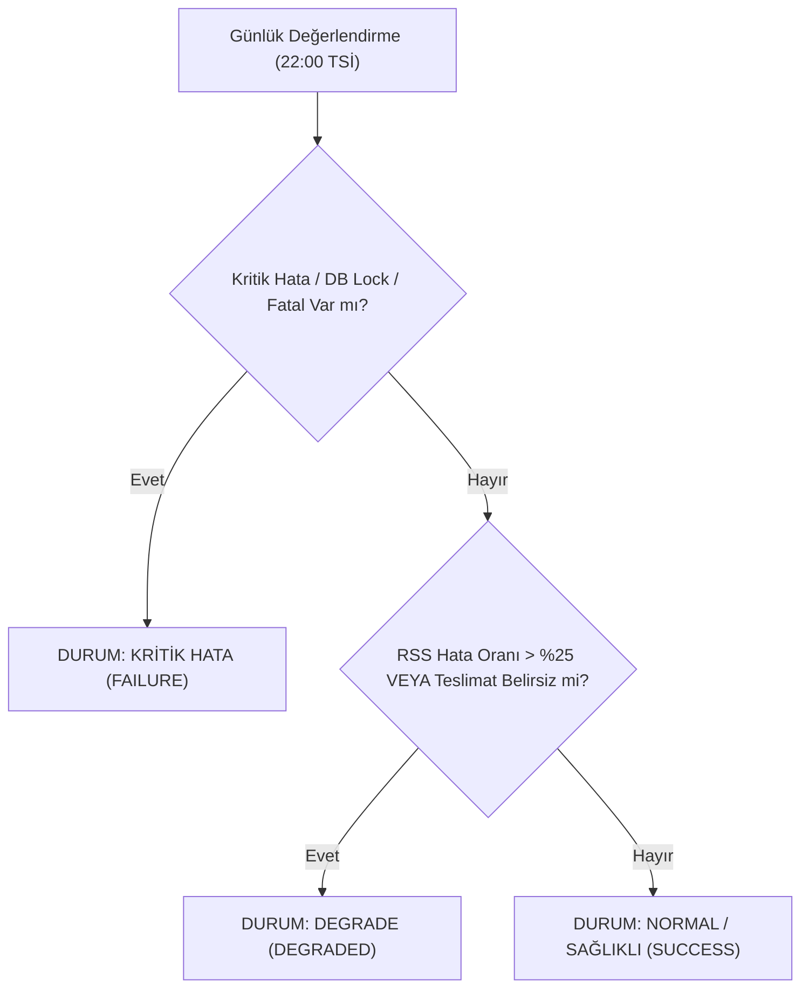

# Efso Radar — Günlük Yönetici Sağlık Raporu Tasarım Dokümanı (Daily ADMIN Health Report Design)

**Durum:** Tasarım Onayında (Phase 5B Gelecek Özellik — Henüz Aktif Değil)  
**Hedef Alıcı:** `ADMIN` (Ürün Sahibi / Yönetici — Özel Telegram Sohbeti)  
**Sıklık:** Günde tam olarak en fazla **1 rapor**  
**Hedef Zaman:** Her gün 22:00 Europe/Istanbul (21:30 son editoryal bülten penceresinden sonra)  
**Maliyet:** **0,00 TRY / $0.00** (0 Gemini API çağrısı, faturalandırılabilir harcama sıfır)  
**Editoryal İçerik:** **SIFIR** (Haber başlığı, magazin dedikodusu veya editoryal içerik kesinlikle içermez; salt operasyonel sistem sağlığı metrikleri sunar).

---

## 1. Amaç ve Kapsam

Ürün Sahibinin güncellenen kararı uyarınca:
1. `PRIMARY_EDITOR` (Baş Editör) Efso Radar'ın ana editoryal kullanıcısıdır ve tüm editoryal bildirimleri (`EDITORIAL_DIGEST`, `VERIFIED_BREAKING`, `SENSITIVE_EDITORIAL_REVIEW`, `HOLD_FOR_VERIFICATION`) özel Telegram kanalından düzenli olarak alır.
2. `ADMIN` (Ürün Sahibi), günlük rutin haber bültenleriyle meşgul edilmez.
3. Bunun yerine `ADMIN`, sistemin arka planda sağlıklı çalışıp çalışmadığını, RSS taramalarının durumunu, maliyetin sıfır kaldığını ve Baş Editör'e teslimatların eksiksiz ulaştığını özetleyen **günde tam olarak 1 adet Operasyonel Sağlık Raporu** alır.

---

## 2. Rapor İçeriği ve Operasyonel Metrikler

Sağlık raporu, hiçbir şekilde tahmini veya uydurma veri içermez; veritabanı ve teslimat defterindeki gerçek olay sayaçlarından derlenir.

### Metrik Alanları:
* **Rapor Tarihi ve Saati:** Europe/Istanbul (TSİ / UTC+3).
* **Sistem Durumu:**
  * `NORMAL / SAĞLIKLI`: Tüm RSS tarama pencereleri hatasız tamamlandı; en az bir tarama başarılı; editoryal bültenler PRIMARY_EDITOR'a iletildi; harcama 0 TRY.
  * `DEGRADE`: Bazı RSS kaynaklarında geçici ağ/zaman aşımı hatası oluştu veya bir teslimat `DELIVERY_UNCERTAIN` durumuna düştü; ancak veritabanı ve ana döngü çalışmaya devam ediyor.
  * `KRİTİK HATA`: Veritabanı kilit zaman aşımı, kalıcı depolama hatası veya ardışık tüm RSS kaynaklarının çökmesi durumu.
* **RSS Tarama İstatistikleri:**
  * Başarılı ve başarısız tarama sayıları (örn. `8 başarılı, 0 başarısız`).
  * Son başarılı taramanın zaman damgası (TSİ).
* **Makale ve Aday Havuzu:**
  * Gün içinde taranan toplam yeni makale sayısı.
  * Editoryal filtrelerden geçerek havuzda tutulan veya değerlendirilen aday sayısı.
* **PRIMARY_EDITOR Teslimatları:**
  * Gün içinde Baş Editör'e iletilen editoryal bülten sayısı ve toplam haber adedi (örn. `3 bülten, 9 haber`).
  * Baş Editör kanalında oluşan teslimat hatası sayısı (varsa).
* **Yapay Zekâ ve Finansal Harcama:**
  * Gemini Free-Tier çağrı adedi ve token tahmini.
  * Faturalandırılabilir teyitli maliyet: **0,00 TRY / $0.00**.
* **Operasyonel Uyarılar / Hatalar:**
  * Son 24 saatte kaydedilen önemli sistem hataları (özet şeklinde, yoksa *"Kayıtlı operasyonel hata bulunmuyor"*).

---

## 3. Durum Sınıflandırma Mantığı (Health State Machine)



---

## 4. Zamanlama, İdempotens ve Dayanıklılık (Resilience)

1. **Günde En Fazla 1 Rapor Kuralı:**
   * Takvim günü bazlı tekil anahtar: `admin_health_report:{YYYY-MM-DD}:{admin_chat_id}`.
   * Bu anahtar `telegram_digest_delivery_ledger.json` ve Turso/SQLite veritabanına işlenir.
   * Aynı gün içinde ikinci bir sağlık raporu tetiklenemez; mükerrer gönderim engellenir.
2. **GitHub Actions Zamanlama Sapmaları:**
   * GitHub Actions cron tetikleyicilerinde 5–30 dakikalık gecikmeler yaşanabilir.
   * 22:00 Europe/Istanbul (19:00 UTC) tetiklemesi gecikmeli çalışsa dahi günün anahtarı üzerinden işlem yapılır.
   * Eğer bir günün işi GitHub Actions altyapı kesintisi nedeniyle tamamen atlanırsa, sistem sonraki çalıştırmada hayali veri üretmez; atlanan zaman dilimi raporda "Zamanlanmış pencere çalıştırılamadı" olarak dürüstçe raporlanır.
3. **Uçucu (Ephemeral) Runner Dayanıklılığı:**
   * GitHub Actions runner'ları geçicidir. Metrikler runner diskinde değil, Turso bulut veritabanında tutulan `run_history`, `scan_metrics` ve kalıcı defter tablolarından çekilir.

---

## 5. Örnek Telegram Mesaj Formatı (HTML)

```html
🩺 <b>EFSO RADAR · GÜNLÜK SAĞLIK RAPORU</b>
📅 <b>19 Ekim 2026 · 22:00 TSİ</b>

━━━━━━━━━━━━━━
🟢 <b>SİSTEM DURUMU: NORMAL / SAĞLIKLI</b>
━━━━━━━━━━━━━━

📡 <b>RSS Taramaları:</b>
• Başarılı: 8 / 8 pencere (%100)
• Son Başarılı Tarama: 21:05 TSİ
• Toplam Taranan Makale: 343

🎯 <b>Editoryal Süreç:</b>
• Değerlendirilen / Havuzdaki Aday: 52
• PRIMARY_EDITOR Teslimatı: 3 bülten (9 haber)
• Teslimat Başarısı: %100 (Hata: 0)

💰 <b>Bütçe & Harcama:</b>
• Gemini Free-Tier Çağrısı: 0 (veya kota dahilinde)
• Faturalandırılabilir Maliyet: <b>0,00 TRY / $0.00</b>

⚠️ <b>Operasyonel Notlar:</b>
• Kritik veya degrade sistem hatası kaydedilmedi.
• Tüm veritabanı kilitleri zamanında serbest bırakıldı.

━━━━━━━━━━━━━━
🔒 <i>Bu rapor yalnızca sistem yöneticisine (ADMIN) iletilen operasyonel durum özetidir.</i>
```

---

## 6. Güvenlik ve Gizlilik Garantileri

* **Token ve Kimlik Maskeleme:** Loglarda veya hata metinlerinde bot tokenleri, API anahtarları ve ham chat ID'leri asla düz metin olarak yer alamaz.
* **Sıfır Yapay Zekâ Maliyeti:** Sağlık raporunun oluşturulması deterministik Python şablonuyla yapılır; Gemini API çağrısı yapılmaz ($0.00 maliyet garantisi).
* **Editoryal Ayrışma:** Editoryal haberler bu raporda asla yer almaz; Baş Editör'ün editoryal özerkliği ve yöneticinin operasyonel odaklılığı kesin sınırlarla korunur.
