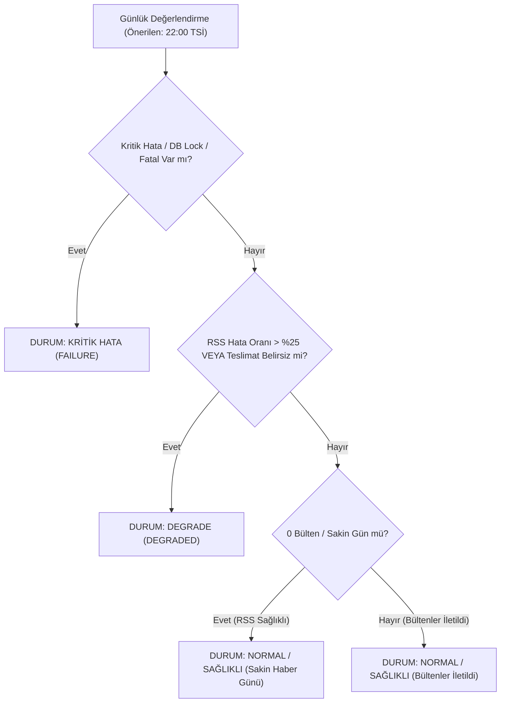

# Efso Radar — Günlük Yönetici Sağlık Raporu Tasarım Dokümanı (Daily ADMIN Health Report Design)

**Durum:** Tasarım İncelemesinde (Phase 5B Gelecek Özellik — Henüz Aktif Değil)  
**Hedef Alıcı:** `ADMIN` (Ürün Sahibi / Yönetici — Özel Telegram Sohbeti)  
**Sıklık:** Günde tam olarak en fazla **1 rapor**  
**Önerilen Varsayılan Zaman:** Her gün 22:00 Europe/Istanbul (21:30 son editoryal bülten penceresinden sonra önerilen varsayılan saattir; şu anda aktif bir cron zamanlaması **yoktur**).  
**Dahili Harcama Tahmini:** **0,00 TRY / $0.00** (Dahili hesaplama sıfır maliyet öngörür; sağlayıcı fatura durumu harici konsollardan teyit edilene kadar doğrulanmamış / unverified kabul edilir).  
**Editoryal İçerik:** **SIFIR** (Haber başlığı, magazin dedikodusu veya editoryal içerik kesinlikle içermez; salt operasyonel sistem sağlığı metrikleri sunar).

---

## 1. Amaç ve Kapsam

Ürün Sahibinin güncellenen kararı uyarınca:
1. `PRIMARY_EDITOR` (Baş Editör) Efso Radar'ın ana editoryal kullanıcısıdır ve tüm editoryal bildirimleri (`EDITORIAL_DIGEST`, `VERIFIED_BREAKING`, `SENSITIVE_EDITORIAL_REVIEW`, `HOLD_FOR_VERIFICATION`) özel Telegram kanalından düzenli olarak alır.
2. `ADMIN` (Ürün Sahibi), günlük rutin haber bültenleriyle meşgul edilmez.
3. Bunun yerine `ADMIN`, sistemin arka planda sağlıklı çalışıp çalışmadığını, RSS taramalarının durumunu, dahili harcama tahmininin sıfır kaldığını ve Baş Editör'e teslimatların eksiksiz ulaştığını özetleyen **günde tam olarak 1 adet Operasyonel Sağlık Raporu** alır.
4. **Zamanlama Durumu:** Bu dokümanda geçen 22:00 TSİ zamanlaması önerilen mimari bir varsayılandır; PR #4 veya Phase 5B.1 kapsamında aktif bir zamanlayıcı veya arka plan servisi çalıştırılmamaktadır.

---

## 2. Rapor İçeriği ve Operasyonel Metrikler

Sağlık raporu, hiçbir şekilde tahmini veya uydurma veri içermez; veritabanı ve teslimat defterindeki **salt gerçek operasyonel olay sayaçlarından** derlenir.

### Sakin Haber Günleri İlkesi (Quiet News Day):
Sakin bir magazin gününde hiçbir haberin editoryal barajı (örneğin skor >= 82) aşamaması ve Baş Editör'e sıfır (0) bülten iletilmesi bir **sistem hatası veya arıza değildir**. Bu durum Efso Radar'ın katı editoryal seçiciliğinin ve kalite filtresinin olağan bir sonucudur. RSS taramaları ve veritabanı döngüsü hatasız tamamlandığı sürece sistem durumu `NORMAL / SAĞLIKLI` kalır.

### Metrik Alanları:
* **Rapor Tarihi ve Saati:** Europe/Istanbul (TSİ / UTC+3).
* **Sistem Durumu:**
  * `NORMAL / SAĞLIKLI`: Tüm RSS tarama pencereleri hatasız tamamlandı; en az bir tarama başarılı; veritabanı kilitleri olağan serbest bırakıldı; editoryal bültenler (varsa) iletildi. (0 bülten iletilen sakin günlerde de sistem normaldir).
  * `DEGRADE`: Bazı RSS kaynaklarında geçici ağ/zaman aşımı hatası oluştu veya bir teslimat `DELIVERY_UNCERTAIN` durumuna düştü; ancak veritabanı ve ana döngü çalışmaya devam ediyor.
  * `KRİTİK HATA`: Veritabanı kilit zaman aşımı, kalıcı depolama hatası veya ardışık tüm RSS kaynaklarının çökmesi durumu.
* **RSS Tarama İstatistikleri:**
  * Gerçek başarılı ve başarısız tarama sayıları (örn. `8 başarılı, 0 başarısız`).
  * Son başarılı taramanın zaman damgası (TSİ).
* **Makale ve Aday Havuzu:**
  * Gün içinde taranan gerçek toplam yeni makale sayısı.
  * Editoryal filtrelerden geçerek havuzda tutulan veya değerlendirilen gerçek aday sayısı.
* **PRIMARY_EDITOR Teslimatları:**
  * Gün içinde Baş Editör'e iletilen gerçek editoryal bülten sayısı ve toplam haber adedi (örn. `3 bülten, 9 haber` veya `0 bülten, 0 haber — sakin haber günü`).
  * Baş Editör kanalında oluşan teslimat hatası sayısı (varsa).
* **Yapay Zekâ ve Finansal Harcama Durumu:**
  * Gerçek Gemini Free-Tier çağrı adedi ve token sayaçları.
  * Dahili Hesaplanan Maliyet: **0,00 TRY / $0.00**.
  * Fatura Doğrulama Statüsü: `DOĞRULANMAMIŞ (UNVERIFIED)` — Salt dahili tahminlere dayanarak sağlayıcı nezdinde kesin sıfır fatura iddiasında bulunulamaz; Google Cloud ve Turso faturalandırma durumu harici konsollardan bağımsız denetlenmelidir.
* **Operasyonel Uyarılar / Hatalar:**
  * Son 24 saatte kaydedilen gerçek sistem hataları (özet şeklinde, yoksa *"Kayıtlı operasyonel hata bulunmuyor"*).

---

## 3. Durum Sınıflandırma Mantığı (Health State Machine)



---

## 4. Zamanlama, İdempotens ve Dayanıklılık (Resilience)

1. **Günde En Fazla 1 Rapor Kuralı:**
   * Takvim günü bazlı tekil anahtar: `admin_health_report:{YYYY-MM-DD}:{admin_chat_id}`.
   * Bu anahtar `telegram_digest_delivery_ledger.json` ve Turso/SQLite veritabanına işlenir.
   * Aynı gün içinde ikinci bir sağlık raporu tetiklenemez; mükerrer gönderim engellenir.
2. **GitHub Actions Zamanlama Sapmaları ve Önerilen Saat:**
   * 22:00 TSİ, son akşam bülteni penceresinden (21:30 TSİ) sonra çalışması önerilen bir varsayılandır.
   * GitHub Actions cron tetikleyicilerinde 5–30 dakikalık gecikmeler yaşanabilir; takvim günü anahtarı bu sapmalara karşı dayanıklılık sağlar.
3. **Zamanlayıcı Çökmesi ve Kendi Ölümünü Bildirememe Sınırı (Dead-Man's Snitch):**
   * **Temel Mimari Gerçek:** GitHub Actions cron tetikleyicisi veya iş akışı altyapısal bir kesinti nedeniyle hiç başlamazsa, GitHub Actions içinde çalışan sistem **kendi çalışmadığını tespit edip raporlayamaz**.
   * Bu nedenle, dahili sağlık raporu yalnızca iş akışının fiilen çalıştığı günlerde raporlama yapabilir.
   * **Önerilen Harici İzleme Çözümü:** Tamamen ücretsiz bir "Dead-Man's Snitch" (örneğin *Healthchecks.io* ücretsiz planı) entegre edilmelidir. Efso Radar her başarılı sağlık raporu gönderiminde bu harici servise HTTP ping gönderir. Eğer 22:30 TSİ'ye kadar beklenen günlük ping ulaşmazsa, harici servis yöneticiye (e-posta/Telegram ile) sistemin hiç tetiklenmediğini haber verir. Bu sayede sıfır maliyetle sessiz çöküşler (silent failures) engellenir.
4. **Uçucu (Ephemeral) Runner Dayanıklılığı:**
   * GitHub Actions runner'ları geçicidir. Metrikler runner diskinde değil, Turso bulut veritabanında tutulan `run_history`, `scan_metrics` ve kalıcı defter tablolarından çekilir.

---

## 5. Örnek Telegram Mesaj Formatı (HTML)

```html
🩺 <b>EFSO RADAR · GÜNLÜK SAĞLIK RAPORU</b>
📅 <b>19 Ekim 2026 · 22:00 TSİ</b>

━━━━━━━━━━━━━━
🟢 <b>SİSTEM DURUMU: NORMAL / SAĞLIKLI</b>
━━━━━━━━━━━━━━

📡 <b>RSS Taramaları:</b>
• Başarılı: 8 / 8 pencere (%100)
• Son Başarılı Tarama: 21:05 TSİ
• Toplam Taranan Makale: 343

🎯 <b>Editoryal Süreç:</b>
• Değerlendirilen / Havuzdaki Aday: 52
• PRIMARY_EDITOR Teslimatı: 3 bülten (9 haber)
• Teslimat Başarısı: %100 (Hata: 0)
<i>(Not: Sakin günlerde 0 bülten olağan editoryal filtreleme sonucudur.)</i>

💰 <b>Bütçe & Harcama:</b>
• Gemini Free-Tier Çağrısı: 0 (veya kota dahilinde)
• Dahili Hesaplanan Harcama: <b>0,00 TRY / $0.00</b>
• Sağlayıcı Fatura Durumu: <i>Doğrulanmamış (Konsoldan teyit gerekir)</i>

⚠️ <b>Operasyonel Notlar:</b>
• Kritik veya degrade sistem hatası kaydedilmedi.
• Tüm veritabanı kilitleri zamanında serbest bırakıldı.

━━━━━━━━━━━━━━
🔒 <i>Bu rapor yalnızca sistem yöneticisine (ADMIN) iletilen operasyonel durum özetidir.</i>
```

---

## 6. Güvenlik ve Gizlilik Garantileri

* **Token ve Kimlik Maskeleme:** Loglarda veya hata metinlerinde bot tokenleri, API anahtarları ve ham chat ID'leri asla düz metin olarak yer alamaz.
* **Sıfır Yapay Zekâ Maliyeti:** Sağlık raporunun oluşturulması deterministik Python şablonuyla yapılır; Gemini API çağrısı yapılmaz ($0.00 maliyet garantisi).
* **Editoryal Ayrışma:** Editoryal haberler bu raporda asla yer almaz; Baş Editör'ün editoryal özerkliği ve yöneticinin operasyonel odaklılığı kesin sınırlarla korunur.

