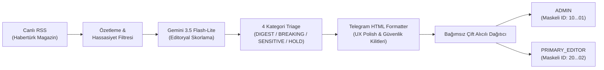
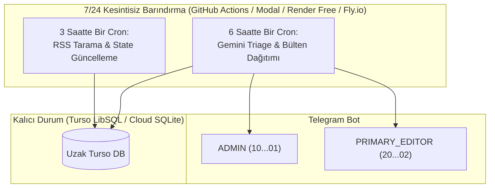

# Efso Radar — Phase 4 Kapanış ve Editoryal Pilot Kabul Raporu

**Tarih:** 18 Ekim 2026  
**Durum:** RESMİ OLARAK KABUL EDİLDİ VE KAPATILDI  
**Aşama:** Phase 4 (Telegram Entegrasyonu, Canlı RSS Denemesi, Gemini Değerlendirmesi ve Çift Alıcılı Editoryal Pilot)  
**Hedef Alıcılar:** `ADMIN` (Teknik Yönetici) & `PRIMARY_EDITOR` (Baş Editör)  
**Test Başarısı:** 234/234 Test Başarılı (%100 Pass Rate)  
**AI Harcaması:** $0.000305 (Aylık $1.20 tavan bütçenin %0.025'i)  

---

## 1. Tamamlanan Phase 4 Kilometre Taşları

Phase 4 boyunca geliştirilen ve doğrulanan tüm alt aşamalar:

1. **Phase 4A — Denetimli Telegram Pilot Kanalı:**
   - Özel Telegram bildirim kanalı (`TelegramNotificationChannel`).
   - Sıkı izin listesi (`telegram_allowed_chat_ids`), negatif Chat ID (grup/kanal) engellemesi.
   - 4 bildirim kategorisi (`EDITORIAL_DIGEST`, `VERIFIED_BREAKING`, `SENSITIVE_EDITORIAL_REVIEW`, `HOLD_FOR_VERIFICATION`).
   - Sessiz saatler (quiet hours) koruması ve sınırlandırılmış üstel geri çekilme (exponential backoff).

2. **Phase 4B — Periyodik Editoryal Bülten & Mükerrerlik Filtreleme:**
   - 6 saatlik periyodik bülten formatlayıcı (`format_telegram_digest`).
   - Olaylar arası anlamsal mükerrerlik eliminasyonu (`deduplicate_assessments`).
   - Telegram 4096 karakter sınırına kesin uyum denetimi.

3. **Phase 4C — İlk Denetimli Canlı RSS Taraması:**
   - Habertürk Magazin RSS kaynağından 16 özgün haber tespiti.
   - Hassas içerik sınıflandırması (Vefat / Taziye / Trajik gelişme izolasyonu).
   - Kanıtların `data/trial_live_rss_evidence.json` altında dondurulması (Sıfır maliyet).

4. **Phase 4D — İlk Canlı Gemini API Editoryal Çıkarımı:**
   - `gemini-3.5-flash-lite` modeliyle 6 aday üzerinde tekil canlı çıkarım isteği.
   - 4 `DIGEST`, 1 `RESERVE`, 1 `IGNORE` kararı.
   - Toplam çıkarım maliyeti: **$0.000305**.

5. **Phase 4E — İlk Canlı Telegram Editoryal Bülten İletimi:**
   - 3 onaylı haberlik seçkinin özel yönetici sohbetine iletimi (`message_id: 6`).
   - Mükerrer gönderim koruması için kalıcı defter (`data/telegram_digest_delivery_ledger.json`).
   - Belirsiz ağ zaman aşımlarında otomatik yeniden deneme yasağı (`DELIVERY_UNCERTAIN`).

6. **Phase 4F — Mobil Telegram UX Yeniden Tasarımı:**
   - Unicode emojiler, görsel ayraçlar ve okunabilir mobil tipografi.
   - Olgusal özet (`📝 Özet:`), editör gerekçesi (`💡 Editör notu:`) ve vurucu kapak başlığı (`🎯 Kapak önerisi:`).
   - Özel etiketli mobil UX doğrulama testi iletimi (`message_id: 9`).

7. **Phase 4G — Çift Alıcılı (Yönetici & Baş Editör) Mimari ve Karşılama Testi:**
   - `PRIMARY_EDITOR` (Baş Editör / Product Owner'ın Kız Arkadaşı) sistemin birincil kullanıcısı olarak tanımlandı.
   - `ADMIN` (Teknik Yönetici / Product Owner) ile her iki kullanıcıya 4 kategoride 100% eşit bilditoryal erişim sağlandı.
   - Defterde bağımsız anahtarlama (`{chat_id}:{digest_hash}`) ile mükerrerlik izolasyonu kuruldu.
   - Güvenli Chat ID tespit betiği (`scripts/identify_telegram_chat_id.py --primary-editor`) geliştirildi.
   - Baş Editör özel sohbetine canlı karşılama testi başarıyla iletildi (`message_id: 10`).

---

## 2. Doğrulanmış Uçtan Uca Boru Hattı (Pipeline)

---

## 3. Canlı Alıcı İletişim Kanıtları

Her iki alıcının bağımsız Telegram bağlantısı canlı API çağrılarıyla doğrulanmış ve deftere kaydedilmiştir:

| Alıcı Rolü | Maskeli Chat ID | İletilen Mesaj Türü | Telegram message_id | Teslim Tarihi / Saati |
| :--- | :---: | :--- | :---: | :--- |
| **`ADMIN`** | `10...01` | Phase 4E Editoryal Bülten | `6` | 18 Ekim 2026 · 21:07 TSİ |
| **`ADMIN`** | `10...01` | Phase 4F Mobil UX Testi | `9` | 18 Ekim 2026 · 21:58 TSİ |
| **`PRIMARY_EDITOR`** | `20...02` | Phase 4G Karşılama & Bağlantı Testi | `10` | 18 Ekim 2026 · 22:31 TSİ |

> [!IMPORTANT]
> **Önemli Editoryal Not:**
> Her iki alıcının bireysel bağlantısı (`message_id: 6`, `9`, `10`) kanıtlanmış olmakla birlikte, **her iki alıcıya eşzamanlı tam editoryal bülten gönderimi** henüz canlı ortamda yürütülmemiştir ve Phase 5 canlı kabul testlerinde yürütülecektir.

---

## 4. Test ve Bütçe Durumu

* **Otomasyon Testleri:** `unittest discover tests` ile 234 testin tamamı hatasız geçmiş (`OK`), regresyon riski bulunmadığı kanıtlanmıştır.
* **Mevcut AI Harcaması:** $0.000305.
* **Aylık Kalan AI Bütçesi:** $1.199695 / $1.200000.
* **Birim Maliyet Güvencesi:** Tek bir haber değerlendirmesi yaklaşık $0.00005 seviyesindedir.

---

## 5. Bilinen Sınırlar ve Phase 5 Devir Maddeleri

1. **Yerel PC Bağımlılığı:** Efso Radar şu ana kadar yerel geliştirme ortamında çalıştırılmıştır. Sahibin bilgisayarı kapandığında çalışmaya devam edebilmesi için Phase 5'te sunucusuz (serverless) veya bulut altyapısına taşınmalıdır.
2. **Eşzamanlı Çift İletim Canlı Kabulü:** Phase 5A başlangıcında ilk planlı bültenin hem `ADMIN` hem de `PRIMARY_EDITOR`e eşzamanlı canlı iletimi doğrulanacaktır.
3. **RSS Kaynak Genişletmesi:** Phase 4 yalnızca tek bir Habertürk Magazin RSS akışını denemiştir; Phase 5'te güvenilir ek kaynaklar eklenecektir.

---

# Phase 5A Mimari ve Uygulama Özeti (Handoff Brief)

**Hedef:** Bilgisayar kapalıyken de 7/24 kesintisiz, düşük maliyetli veya ücretsiz bulut altyapısında otonom çalışan editoryal asistan.

### 1. 7/24 Kesintisiz Çalışma Mimarisi
* **Zamanlanmış Görevler:**
  - **3 Saatte Bir (09:00, 12:00, 15:00, 18:00, 21:00, 00:00 TSİ):** RSS kaynaklarını tara, yeni haberleri tespit et, başlık benzerliklerini kümele ve veritabanına kaydet (Sıfır AI maliyeti).
  - **6 Saatte Bir (12:00, 18:00 TSİ ana editoryal bülten saatleri):** Havuzdaki en yüksek öncelikli haberleri Gemini 3.5 Flash-Lite ile değerlendir, 3-5 haberlik bülteni hazırla ve her iki alıcıya ilet.
  - **Anlık Sıcak Gelişme (Breaking Alert):** Skor $\ge 90$ doğrulanmış gelişmeler anında her iki alıcıya bağımsız gönderilir.

### 2. Düşük Maliyetli / Ücretsiz Dağıtım Alternatifleri
1. **GitHub Actions Scheduled Workflows (Önerilen & Mevcut Kod Tabanına En Uyumlu):**
   - Ayda 2.000 ücretsiz Linux çalıştırma dakikası.
   - Efso Radar'ın tek bir tarama çalıştırması ~20 saniye sürmektedir; günde 8 çalıştırma = ayda ~80 dakika (tamamen ücretsiz kota içinde kalır).
   - Kalıcı durum için halihazırda kodlanmış olan ücretsiz **Turso Cloud LibSQL** deposu kullanılır.
2. **Modal.com / Fly.io Free Tier / Render Cron:**
   - Alternatif hafif konteyner barındırma seçenekleri.

### 3. Katı Güvenlik ve Bütçe Korumaları
- Aylık harcama tavanı: $1.20. Tavan aşıldığında AI motoru kendini durdurur ve bültenler kural tabanlı (rule-based) özet moduna geçer.
- Her iki alıcı için de `{chat_id}:{digest_hash}` bağımsız defter takibi sürdürülür.
- Turso veritabanı yedeği günlük otomatik JSON dışa aktarımıyla korunur.
