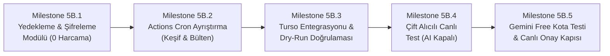

# Efso Radar — Phase 5A Mimari Karar Kaydı (Architecture Decision Record)

**Doküman Kodu:** ADR-2026-05A  
**Tarih:** 19 Ekim 2026  
**Durum:** ÜRÜN SAHİBİ TARAFINDAN ONAYLANDI (APPROVED)  
**Aşama:** Phase 5A Kapanışı ve Phase 5B Hazırlığı  
**Hedef Kitle:** Ürün Sahibi (Product Owner / Yönetici) & Baş Editör (Primary Editor)  
**Mevcut Kararlı Sürüm:** `v0.4.0`  
**Geliştirme Dalı:** `feature/phase5a-architecture`  
**Depo:** `fatihemres/efso-radar` (KAMUSAL / PUBLIC REPOSITORY)

---

## 1. Bağlam ve Temel Ürün Hedefi (Context & Non-Negotiable Goal)

Efso Radar, Phase 4 itibarıyla doğrulanmış editoryal pilot boru hattını (240/240 başarılı test, %100 kapsama) yerel bilgisayardan bağımsızlaştırarak sahibinin bilgisayarı kapalıyken 7/24 otonom çalışabilir hale getirmeyi hedeflemektedir.

Ürün Sahibi tarafından onaylanan temel ürün hedefi:
* **Bilgisayardan Bağımsızlık:** Sahibin Windows bilgisayarı kapalıyken haberleri otonom taramaya ve bülten hazırlamaya devam etmek.
* **Kesin Sıfır Maliyet (Strict Zero-Cost):** Desteklenen ücretsiz kota sınırları altında **aylık tam olarak 0 TL / 0 USD** maliyetle çalışmak.
* **Otomatik Ücretli Plana Geçiş Yasağı:** Ücretsiz kotalar tükendiğinde ücretli plana otomatik geçiş, fatura aktivasyonu veya ücretli API fallback kesinlikle yasaktır. Kota tükendiğinde sistem güvenli biçimde durmalı (fail-closed), bekleyen verileri korumalı ve işlemi bir sonraki uygun pencereye ertelemelidir.
* **Editoryal İnsan Denetimi:** Instagram'a otomatik paylaşım kesinlikle kapalıdır; sistem yalnızca editörlere karar desteği sunar.

### Tercih Edilen Altyapı Bileşenleri
1. **GitHub Actions (Kamusal Depo):** Zamanlanmış iş akışları (cron) ve Python çalışma ortamı (Public depoda sınırsız ve ücretsiz çalıştırma dakikaları).
2. **Turso Cloud (Starter Tier / libSQL):** Kalıcı bulut veritabanı (500 DB, 9 GB depolama, 1 milyar okuma/ay ücretsiz; kredi kartı gerekmez).
3. **Google Gemini API (Free Tier):** Editoryal yapay zeka değerlendirmesi (Şu an kapalı; üretime geçişte ücretsiz kota ile kullanılacaktır).
4. **Telegram Bot API:** Yönetici (`ADMIN`) ve Baş Editör (`PRIMARY_EDITOR`) için çift alıcılı editoryal bildirim kanalı (Ücretsiz).
5. **Özel Şifreli Yedekleme Deposu:** Felaket kurtarma için yalnızca pasif depolama olarak kullanılan harici özel (private) GitHub deposu.

---

## 2. Onaylanan Phase 5A Kararları (Approved Decisions)

### 2.1 Editoryal Bülten Pencereleri (Digest Windows)
Mekanik ve kesintisiz 6 saatlik döngü (`00:00, 06:00, 12:00, 18:00 TSİ`) editörlerin uyku saatlerine ve sosyal medya etkileşim ritmine uymadığı için terk edilmiş; yerine insan odaklı 3 bülten penceresi onaylanmıştır:
* **Sabah Bülteni:** `09:30 TSİ` (`06:30 UTC`) — Gece boyunca biriken haberleri ve sabah gündemini kapsar.
* **İkindi Bülteni:** `15:30 TSİ` (`12:30 UTC`) — Öğle ve gün ortası gelişmelerini kapsar.
* **Prime-Time Bülteni:** `21:30 TSİ` (`18:30 UTC`) — Akşamın en yüksek sosyal medya etkileşim saatlerini kapsar.

### 2.2 Sessiz Saatler ve Gece Tazelik Politikası (Quiet Hours & Freshness)
* **Sessiz Saatler:** `00:00 - 08:30 TSİ` (`21:00 - 05:30 UTC`) arasında hiçbir editoryal bülten veya rutin bildirim Telegram'a iletilmez.
* **Gece Haberlerinin Korunması:** 00:00 - 08:30 TSİ arasında toplanan haberler silinmez; Turso veritabanındaki `candidate_backlog` tablosunda korunur.
* **Tazelik Kuralları:**
  * **Sabah Penceresi (09:30 TSİ):** Önceki akşam 21:30'dan sonra yayımlanmış (son ~12-14 saatlik) tüm adayları tarar. Gece ABD/Hollywood veya geç saat Türkiye gelişmelerinin kaybolması önlenir.
  * **Gündüz Pencereleri (15:30 ve 21:30 TSİ):** Son 7.5 saat içindeki taze gelişmeleri değerlendirir.
  * **24 Saatlik Bayatlama Kuralı (Freshness Cutoff):** 24 saati aşan adaylar arşivlenir (`EXPIRED`); ancak daha önce duyurulmuş bir habere ait somut yeni bir gelişme (`UPDATE` türü) varsa bu gelişme 24 saat kuralına takılmadan korunur.

### 2.3 Otonom RSS Toplama ve Ayrık Boru Hattı (Background RSS Collection)
* **Zamanlama:** Gece dahil her 3 saatte bir otonom çalışır (`00:17, 03:17, 06:17, 09:17, 12:17, 15:17, 18:17, 21:17 TSİ` / `17 0,3,6,9,12,15,18,21 * * * UTC`).
* **Sıfır Maliyetli İzolasyon Garantisi:**
  * İş akışı `--scan-only` parametresiyle çalışır.
  * **Gemini API kesinlikle çağrılmaz ($0.00 maliyet).**
  * **Telegram mesajı kesinlikle gönderilmez.**
  * Yalnızca RSS akışlarını çeker, başlık/URL deduplikasyonu yapar ve adayları Turso `candidate_backlog` tablosuna yazar.
* **Sıcak Gelişme (Breaking News) Tespiti Gerçeği:**
  * Anlık sıcak gelişme tespiti, 3 saatlik RSS sorgulama periyodu ve GitHub Actions zamanlayıcı gecikmesi ile fiziksel olarak sınırlıdır (maksimum gecikme: 0 - 180 dakika + Actions kuyruk süresi).
* **Dört Bildirim Kategorisinin Eksiksiz Korunması:**
  * Hem `ADMIN` hem `PRIMARY_EDITOR` tüm kategorileri bağımsız iletim defteri kaydıyla (`{chat_id}:{digest_hash}`) alır:
    1. `EDITORIAL_DIGEST`: Konsolide bülten.
    2. `VERIFIED_BREAKING`: Doğrulanmış acil sıcak gelişme ($\text{Skor} \ge 92$).
    3. `SENSITIVE_EDITORIAL_REVIEW`: Vefat, kaza, trajedi içeren editoryal inceleme.
    4. `HOLD_FOR_VERIFICATION`: Spekülasyon veya dedikodu içeren doğrulama beklemesi.

### 2.4 Güvenli Şifreli Yedekleme ve Kurtarma (Backup & Recovery)
* **Kamusal Artifakt Yasağı:** Kamuya açık depoda GitHub Actions Artifacts alanına şifresiz veritabanı yedeği veya SQL dökümü yüklenmesi **kesinlikle yasaktır**.
* **İstemci Tarafı Şifreleme (Client-Side AES-256):**
  * Çalıştırıcı üzerinde üretilen veritabanı dökümü OpenSSL / GPG kullanılarak simetrik AES-256 ile şifrelenir (`turso_backup_YYYYMMDD.sql.gz.enc`).
  * Şifreleme anahtarı (`BACKUP_ENCRYPTION_KEY`) yalnızca GitHub Actions Secrets içinde saklanır.
* **Pasif Özel Depo Modeli:**
  * Şifreli dosya, aynı kullanıcıya ait ayrı ve **ÖZEL (PRIVATE) bir GitHub deposuna** (`efso-radar-backups`) ince taneli (fine-grained) PAT veya deploy key ile aktarılır.
  * **Özel depoda hiçbir workflow çalıştırılmaz.** Böylece özel depo Actions dakikaları (2.000 dk sınırı) asla tüketilmez.
* **Turso Free PITR Analizi:**
  * Turso Starter katmanında uzun vadeli sürekli point-in-time recovery (PITR) bulunmamaktadır. Dolayısıyla uygulama seviyesindeki günlük şifreli harici yedekleme vazgeçilmez bir güvenlik katmanıdır.
* **Kurtarma ve İdempotens Doğrulaması:**
  * Geri yükleme prosedürü şemayı (`v5`), işlenmiş haberleri (`processed_articles`) ve iletim defterini (`notifications`) eksiksiz doğrulamalıdır. Defter korunduğu için geri yükleme sonrasında editörlere mükerrer mesaj atılması imkansızdır.

### 2.5 Yapay Zeka Bütçe ve Maliyet Kontrolleri (Gemini Free Tier)
* **Canlı Çıkarım Kapalıdır:** `AI_EVALUATION_ENABLED=false` olarak kalacaktır. Bu aşamada hiçbir canlı API çağrısı yapılmamıştır.
* **Tarihsel Defterin Korunması:** `data/experiment_budget_ledger.json` ($0.05 limitli) dosyası Phase 3C/4 gölge değerlendirme deneyine ait dondurulmuş bir arşiv kaydıdır; para harcama yetkisi değildir.
* **$1.20/Ay Statüsü:** Önerilen $1.20 tavanı onaylanmış bir bütçe değildir; tasarım aşamasında konuşulmuş bir güvenlik eşiğidir.
* **Üretim Öncesi Doğrulama Şartı:** Canlı AI açılmadan önce Google AI Studio üzerindeki Free Tier kota limitleri (RPM, RPD), model uygunluğu (`gemini-3.5-flash-lite`) ve şartları resmi olarak doğrulanacaktır.
* **Fail-Closed Devre Kesiciler:**
  * İstek başına tavan: `compute_enforceable_batch_output_tokens` ile katı çıkış token sınırlaması.
  * Kota aşımında sistem hata fırlatıp çökmek yerine güvenli biçimde duracak (fail-closed), haber havuzunu koruyacak ve bülteni kural tabanlı özet moduna (`RULE_BASED_FALLBACK`) geçirecektir.

### 2.6 GitHub Actions Güvenilirliği ve Güvenlik (Reliability & Security)
* **Zamanlayıcı Gecikmeleri ve Dakika Kaydırma:**
  * Saat başı (`:00`) GitHub Actions kuyruk tıkanıklıklarından kaçınmak için cron dakikaları kaydırılmıştır (`:17` ve `:30/:33`).
  * Bir iş akışı asla bir öncekinin başarılı çalıştığını varsaymaz; her koşu Turso'daki backlog durumunu bağımsız sorgular.
* **60 Günlük İnaktivite Kapanması:**
  * GitHub, 60 gün boyunca commit yapılmayan kamuya açık repolarda zamanlanmış iş akışlarını otomatik olarak durdurur. Bunu engellemek için aylık bir keepalive adımı işletilecektir.
* **Eşzamanlılık ve Yarış Durumu (Race Condition) Koruması:**
  * `concurrency: group: efso-radar-prod, cancel-in-progress: false` ile aynı anda iki iş akışının çalışması engellenir.
  * Turso `run_locks` tablosundaki 15 dakikalık kiralama süresi (lease) veritabanı düzeyinde çift kilitleme sağlar.
* **En Düşük Yetki ve Fork PR Koruması:**
  * İş akışları `permissions: contents: read` ile sınırlandırılır.
  * `radar.yml` iş akışı **asla `pull_request` ile tetiklenmez**; sadece `schedule` ve `workflow_dispatch` ile korunur. Dışarıdan açılan PR'lar üretim sırlarına (`TURSO_*`, `TELEGRAM_*`, `GEMINI_*`) kesinlikle erişemez.
* **Mevcut CI Koruması:** `.github/workflows/ci.yml` dosyasındaki Python 3.11/3.12 matris testleri (240 test) aynen korunur.

---

## 3. Doğrulanmış Ücretsiz Kota Sınırları (Verified Free-Tier Limits)

| Bileşen | Sağlayıcı / Plan | Resmi Ücretsiz Kota | Efso Radar Kullanımı | Güvenlik Payı |
| :--- | :--- | :--- | :--- | :---: |
| **İş Akışı / Cron** | GitHub Actions (Public Repo) | **Sınırsız Linux Çalıştırma Dakikası** | ~150 dk / ay | Sınırsız |
| **Veritabanı** | Turso Cloud (Starter Plan) | 500 DB, 9 GB Depolama, 1 Milyar Satır Okuma/ay | 1 DB, ~15 MB, ~50.000 Okuma/ay | > %99.9 |
| **Bildirim API** | Telegram Bot API | Tamamen Ücretsiz, 30 mesaj/saniye | Günde 6-10 mesaj | > %99.9 |
| **Yapay Zeka** | Gemini API (Free Tier) | Modele göre 15 RPM / 1M TPM / 1.500 RPD | Günde 3 istek (bülten başına 1 batch) | > %99.5 |
| **Yedek Depolama** | GitHub Private Repo (Storage) | 1 GB Ücretsiz Git LFS / Depolama | ~10 MB / ay (sıkıştırılmış dump) | > %90 |

---

## 4. Bilinen Sınırlar ve Operasyonel Riskler (Known Limitations & Risks)

1. **Sıcak Gelişme Algılama Gecikmesi:** 3 saatlik RSS sorgulama aralığı nedeniyle çok acil bir gelişme sisteme 0-180 dakika gecikmeyle girebilir.
2. **GitHub Actions Zamanlayıcı Dalgalanmaları:** Ağır yük altında cron tetiklemeleri 5-30 dakika gecikebilir. `effective_max_age_hours` formülü bu gecikmelerde haber kaybını önler.
3. **Telegram Ağ Zaman Aşımı (Ambiguous Timeout):** Telegram API HTTP 504 veya ağ zaman aşımı döndüğünde iletim durumu `DELIVERY_UNCERTAIN` olarak işaretlenir ve editörlere mükerrer mesaj gitmemesi için otomatik yeniden deneme yapılmaz.
4. **Chat ID Mahremiyeti:** Kamusal depoda hiçbir kişisel Chat ID açık metin olarak loglanmaz; kod düzeyinde maskeleme (`87...43`) zorunludur.

---

## 5. Phase 5B Uygulama Yol Haritası (Implementation Sequence)

Phase 5B beş sıralı kilometre taşı (milestone) halinde yürütülecektir:

* **Milestone 5B.1 — Şifreli Yedekleme ve Kurtarma Altyapısı (Sıfır Harcama):**
  * İstemci tarafı AES-256 şifreleme ve Turso SQL dışa aktarım betiğinin (`scripts/backup_turso_encrypted.py`) yazılması.
  * Şifre çözme ve yerel SQLite'a geri yükleme doğrulama testlerinin (`tests/test_backup_restore.py`) eklenmesi.
* **Milestone 5B.2 — GitHub Actions Ayrık İş Akışlarının Yapılandırılması:**
  * `.github/workflows/radar_discovery.yml` (3 Saatte bir, `--scan-only`, sıfır AI, sıfır Telegram).
  * `.github/workflows/radar_digest.yml` (09:30, 15:30, 21:30 TSİ bülten pencereleri).
  * `.github/workflows/radar_backup.yml` (Günlük şifreli yedekleme).
* **Milestone 5B.3 — Bulut Veritabanı ve Kuru Çalıştırma (--dry-run) Testi:**
  * GitHub Secrets üzerinden Turso bağlantısının test edilmesi, Actions üzerinde `--dry-run` ile boru hattının başarıyla tamamlandığının kanıtlanması.
* **Milestone 5B.4 — Çift Alıcılı Canlı Dağıtım Doğrulaması (Yapay Zekasız / Kural Tabanlı):**
  * Gerçek Telegram botu üzerinden hem `ADMIN` hem `PRIMARY_EDITOR`e ilk canlı bültenin iletilmesi ve defterde `{chat_id}:{digest_hash}` izolasyonunun kanıtlanması.
* **Milestone 5B.5 — Gemini Free Tier Doğrulaması ve Nihai Canlı Açılış:**
  * Ücretsiz API kotasının doğrulanması, tekil canlı test ve Ürün Sahibi onayı ile `AI_EVALUATION_ENABLED=true` yapılarak otonom işletime geçilmesi.

---

## 6. Ürün Sahibi Onay Özeti (PO Sign-Off)

* [x] **0 TL / Ay Kesin Maliyet Kuralı:** Onaylandı.
* [x] **3 Odaklı Bülten Penceresi (09:30, 15:30, 21:30 TSİ):** Onaylandı.
* [x] **00:00 - 08:30 TSİ Sessiz Saatler:** Onaylandı.
* [x] **3 Saatte Bir Arka Plan RSS Havuzu (Sıfır AI / Sıfır Telegram):** Onaylandı.
* [x] **Public Repoda Açık Artifakt Yasağı & AES-256 Şifreli Harici Yedekleme:** Onaylandı.
* [x] **Canlı AI Çıkarımının Şimdilik Kapalı Tutulması:** Onaylandı.
* [x] **Phase 5B.1'e Geçiş:** Onaylandı.
