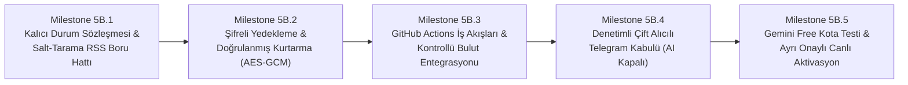

# Efso Radar — Phase 5A Mimari Karar Kaydı (Architecture Decision Record)

**Doküman Kodu:** ADR-2026-05A  
**Tarih:** 19 Ekim 2026  
**Durum:** ÜRÜN SAHİBİ İNCELEMESİ VE DÜZELTME REVİZYONU  
**Aşama:** Phase 5A Kapanışı ve Phase 5B Hazırlığı  
**Hedef Kitle:** Ürün Sahibi (Product Owner / Yönetici) & Baş Editör (Primary Editor)  
**Mevcut Kararlı Sürüm:** `v0.4.0`  
**Geliştirme Dalı:** `feature/phase5a-architecture`  
**Depo:** `fatihemres/efso-radar` (KAMUSAL / PUBLIC REPOSITORY)

---

## 1. Bağlam ve Temel Ürün Hedefi (Context & Non-Negotiable Goal)

Efso Radar; Phase 4 kapanışı itibarıyla doğrulanmış editoryal pilot boru hattını yerel geliştirme bilgisayarından bağımsızlaştırarak sahibinin Windows bilgisayarı kapalıyken 7/24 otonom çalışabilir hale getirmeyi hedeflemektedir.

### Test Doğrulama Durumu (Doğrulanmış Çevre Ayrımı)
- **Otantik Yerel Geliştirme Ortamı:** 240 birim ve entegrasyon testinin tamamı başarıyla geçmiştir (`240 passed, 0 failures`).
- **Temiz GitHub Actions CI Ortamı:** 226 test başarıyla geçmiş, 14 test atlanmıştır (`226 passed, 14 skipped`). Bu durum, canlı ağ ve donanım bağımlılıklarını izole eden hermetik/çevrimdışı test tasarımı gereğidir; %100 kod kapsama (code coverage) iddiası taşımamaktadır.

### Ürün Sahibi Tarafından Onaylanan Temel Hedefler
* **Bilgisayardan Bağımsız Çalışma:** Sahibin bilgisayarı kapalıyken haberleri otonom taramaya, filtrelemeye ve bülten hazırlamaya devam etmek.
* **Kesin Sıfır Maliyet Kuralı (Strict Zero-Cost):** Desteklenen ücretsiz kota sınırları altında **aylık tam olarak 0 TL / 0 USD** maliyetle çalışmak.
* **Otomatik Ücretli Plana Geçiş Yasağı:** Ücretsiz kotalar tükendiğinde ücretli plana otomatik geçiş, faturalandırma aktivasyonu veya ücretli API fallback kesinlikle yasaktır. Kota tükendiğinde sistem güvenli biçimde durmalı (fail-closed), bekleyen verileri havuzda korumalı ve işlemi sonraki pencereye ertelemelidir.
* **Editoryal İnsan Denetimi:** Instagram'a otomatik paylaşım kesinlikle kapalıdır (`instagram_publishing_enabled: false`); sistem yalnızca editörlere karar desteği sunar.

### Tercih Edilen Ücretsiz Altyapı Bileşenleri
1. **GitHub Actions (Kamusal Depo):** Zamanlanmış iş akışları (cron) ve Python çalışma ortamı (Kamuya açık depolarda standart Linux çalıştırıcılar ücretsizdir).
2. **Turso Cloud (Starter Tier / libSQL):** Kalıcı bulut veritabanı (100 veritabanı, 5 GB depolama, 500 milyon satır/ay okuma, 10 milyon satır/ay yazma, 1 günlük PITR; kredi kartı gerekmez).
3. **Google Gemini API (Free Tier):** Editoryal yapay zeka değerlendirmesi (Şu an kapalı; üretime geçişte ücretsiz kota ile kullanılacaktır. Ücretsiz API anahtarı ücretli kullanım izni teşkil etmez).
4. **Telegram Bot API:** Yönetici (`ADMIN`) ve Baş Editör (`PRIMARY_EDITOR`) için çift alıcılı editoryal bildirim kanalı (Ücretsiz).
5. **Özel Şifreli Yedekleme Deposu:** Felaket kurtarma için yalnızca pasif depolama olarak planlanan harici özel (private) GitHub deposu.

---

## 2. Onaylanan Phase 5A Kararları (Approved Decisions)

### 2.1 Editoryal Bülten Pencereleri (Digest Windows)
Mekanik ve kesintisiz 6 saatlik döngü (`00:00, 06:00, 12:00, 18:00 TSİ`) editörlerin uyku saatlerine ve sosyal medya etkileşim ritmine uymadığı için terk edilmiş; yerine insan odaklı 3 bülten penceresi onaylanmıştır:
* **Sabah Bülteni:** `09:30 TSİ` (`06:30 UTC`) — Gece boyunca biriken haberleri ve sabah gündemini kapsar.
* **İkindi Bülteni:** `15:30 TSİ` (`12:30 UTC`) — Öğle ve gün ortası gelişmelerini kapsar.
* **Prime-Time Bülteni:** `21:30 TSİ` (`18:30 UTC`) — Akşamın en yüksek sosyal medya etkileşim saatlerini kapsar.

### 2.2 Sessiz Saatler ve Gece Tazelik Politikası (Quiet Hours & Freshness)
* **Sessiz Saatler:** `00:00 - 08:30 TSİ` (`21:00 - 05:30 UTC`) arasında hiçbir editoryal bülten veya rutin bildirim Telegram'a iletilmez.
* **Gece Haberlerinin Korunması:** 00:00 - 08:30 TSİ arasında toplanan haberler silinmez; Turso veritabanındaki `candidate_backlog` tablosunda korunur.
* **Tazelik Kuralları:**
  * **Sabah Penceresi (09:30 TSİ):** Önceki akşam 21:30'dan sonra yayımlanmış (son ~12-14 saatlik) tüm adayları tarar. Gece ABD/Hollywood veya geç saat Türkiye gelişmelerinin kaybolması önlenir.
  * **Gündüz Pencereleri (15:30 ve 21:30 TSİ):** Son 7.5 saat içindeki taze gelişmeleri değerlendirir.
  * **24 Saatlik Bayatlama Kuralı (Freshness Cutoff):** 24 saati aşan adaylar arşivlenir (`EXPIRED`); ancak daha önce duyurulmuş bir habere ait somut yeni bir gelişme (`UPDATE` türü) varsa bu gelişme 24 saat kuralına takılmadan korunur.

### 2.3 Otonom RSS Toplama ve Ayrık Boru Hattı (Background RSS Collection)
* **Zamanlama:** Gece dahil her 3 saatte bir otonom çalışır (`00:17, 03:17, 06:17, 09:17, 12:17, 15:17, 18:17, 21:17 TSİ` / `17 0,3,6,9,12,15,18,21 * * * UTC`).
* **Sıfır Maliyetli İzolasyon Garantisi:**
  * İş akışı `--scan-only` parametresiyle çalışır.
  * **Gemini API kesinlikle çağrılmaz ($0.00 maliyet).**
  * **Telegram mesajı kesinlikle gönderilmez.**
  * Yalnızca RSS akışlarını çeker, başlık/URL deduplikasyonu yapar ve adayları Turso `candidate_backlog` tablosuna yazar.
* **Sıcak Gelişme (Breaking News) Tespiti Gerçeği:**
  * Anlık sıcak gelişme tespiti, 3 saatlik RSS sorgulama periyodu ve GitHub Actions zamanlayıcı gecikmesi ile fiziksel olarak sınırlıdır (maksimum gecikme: 0 - 180 dakika + Actions kuyruk süresi).
* **Dört Bildirim Kategorisinin Eksiksiz Korunması:**
  * Hem `ADMIN` hem `PRIMARY_EDITOR` tüm kategorileri bağımsız iletim defteri kaydıyla (`{chat_id}:{digest_hash}`) alır:
    1. `EDITORIAL_DIGEST`: Konsolide bülten.
    2. `VERIFIED_BREAKING`: Doğrulanmış acil sıcak gelişme ($\text{Skor} \ge 92$).
    3. `SENSITIVE_EDITORIAL_REVIEW`: Vefat, kaza, trajedi içeren editoryal inceleme.
    4. `HOLD_FOR_VERIFICATION`: Spekülasyon veya dedikodu içeren doğrulama beklemesi.

### 2.4 Güvenli Şifreli Yedekleme ve Kurtarma (Backup & Recovery)
* **Kamusal Artifakt Yasağı:** Kamuya açık depoda GitHub Actions Artifacts alanına şifresiz veritabanı yedeği veya SQL dökümü yüklenmesi **kesinlikle yasaktır**.
* **Kimlik Doğrulamalı İstemci Tarafı Şifreleme (AES-256-GCM):**
  * Veritabanı dökümü çalıştırıcı üzerinde üretildikten hemen sonra **AES-256-GCM** (Galois/Counter Mode — AEAD) ile şifrelenir (`turso_backup_YYYYMMDD_HHMM.sql.gz.enc`).
  * Kimlik doğrulaması sağlamayan ve padding oracle riskleri barındıran unauthenticated modlar (ör. AES-CBC) kesinlikle reddedilmiştir.
  * GCM kimlik doğrulama etiketi (authentication tag) ile şifreli paketin bütünlüğü garanti edilir.
* **Anahtar Saklama ve Düz Metin Kalıcılığının Asgariye İndirilmesi:**
  * 256-bit şifreleme anahtarı (`BACKUP_ENCRYPTION_KEY`) yalnızca GitHub Actions Secrets içinde saklanır.
  * Geçici (ephemeral) GitHub Actions çalıştırıcı sanal makinelerinde, sanallaştırılmış disk katmanları ve ana makine hypervisor mimarisi nedeniyle düz metin (plaintext) geçici dosyaların kalıcı olarak silinmesi (shred / secure wipe) doğrulanabilir bir garanti değil, "en iyi çaba" (best-effort) niteliğindedir. Bu nedenle mimari, düz metin verinin diske yazılmasını ve diskte kalış süresini asgariye indirmeyi (ör. bellek içi akış/pipe kullanımı veya işlem biter bitmez derhal temizleme) birincil güvenlik prensibi olarak benimser.
* **Pasif Özel Depo Modeli ve Git Depolama Yaşam Döngüsü Sınırları:**
  * Şifreli dosya, aynı kullanıcıya ait ayrı ve **ÖZEL (PRIVATE) bir GitHub deposuna** (`efso-radar-backups`) ince taneli (fine-grained) PAT ile aktarılır.
  * **Özel depoda hiçbir workflow çalıştırılmaz.** Böylece özel depo Actions dakikaları asla tüketilmez.
  * **Git Deposu vs. Git LFS Sınırları:** Standart GitHub depoları için önerilen boyut 1-5 GB, tekil dosya sınırı 100 MB'tır (önerilen <50 MB). Resmi güncel GitHub dokümantasyonuna göre GitHub Free planı **10 GiB Git LFS depolama ve 10 GiB/ay Git LFS bant genişliği** sunmaktadır. Efso Radar yedekleri sıkıştırılmış ve şifrelenmiş küçük dökümler (~1-5 MB) olacağından Git LFS'e gerek duyulmaz; standart Git nesnesi olarak saklanır.
  * **Git Geçmişi ve Depo Büyüme Sınırı Gerçeği:** Git'in nesne tabanlı mimarisi gereği, yeni commit'lerde eski yedek dosyalarının silinmesi (`git rm`), bu dosyaların içeriklerini Git commit geçmişinden otomatik olarak kaldırmaz. Dolayısıyla, salt 7-14 günlük dosya silme mantığıyla özel deponun boyutunun 200 MB altında kalacağını iddia etmek teknik olarak yanlıştır; her commit geçmişi büyütmeye devam eder.
  * **Güvenli ve Sıfır Maliyetli Depolama Yaşam Döngüsü Stratejisi Zorunluluğu:** Üretim ortamında yedekleme devreye alınmadan önce, yıkıcı geçmiş yeniden yazımı (destructive history rewriting / force-push) veya otomatik repo silme gibi riskli yöntemlere başvurmadan depoyu sıfır maliyetle yönetecek, ayrı olarak incelenmiş ve onaylanmış güvenli bir depolama yaşam döngüsü stratejisi (ör. GitHub Releases varlıklarının üzerine yazılması, orphan branch kullanımı veya periyodik tek commitli arşiv taktiği) tasarlanmalıdır.
  * **Mevcut Aşama Kuralı:** Bu aşamada hiçbir geçmiş yeniden yazımı, force push, otomatik repo silme veya rotasyon mekanizması uygulanmayacaktır; bu tasarım Milestone 5B.2'de ele alınacaktır. Özel yedekleme deposu henüz oluşturulmamıştır.
* **Turso Free PITR Değerlendirmesi:**
  * Turso Starter katmanında yalnızca 1 günlük point-in-time restore (1-day PITR) imkanı bulunmaktadır; uzun vadeli kurumsal PITR yoktur. Bu nedenle harici günlük şifreli yedekleme zorunlu bir güvenlik katmanıdır.
* **Kurtarma ve İdempotens Gerçeği (Mükerrerlik Risk Analizi):**
  * Geri yükleme prosedürü şemayı (`v5`), işlenmiş haberleri (`processed_articles`) ve iletim defterini (`notifications`) doğrular.
  * **Dürüst Hata Modeli:** Telegram iletimlerinde mükerrer gönderimin "matematiksel olarak imkansız" olduğu iddia edilemez. Belirsiz ağ zaman aşımlarında (HTTP 504 / TCP bağlantı kopması) veya son yedek ile çöküş anı arasındaki pencerede iletilmiş mesajlar eski yedekten dönüldüğünde defterde yer almayabilir. Bu belirsizlik durumlarında sistem `DELIVERY_UNCERTAIN` statüsüyle fail-closed davranır, körü körüne otomatik yeniden deneme yapmaz ve editör denetimi talep eder.

### 2.5 Yapay Zeka Bütçe ve Maliyet Kontrolleri (Gemini Free Tier)
* **Canlı Çıkarım Kapalıdır:** `AI_EVALUATION_ENABLED=false` olarak kalacaktır. Bu aşamada hiçbir canlı API çağrısı yapılmamıştır.
* **Tarihsel Defterin Korunması:** `data/experiment_budget_ledger.json` ($0.05 limitli) dosyası Phase 3C/4 gölge değerlendirme deneyine ait dondurulmuş bir arşiv kaydıdır; para harcama yetkisi değildir.
* **$1.20/Ay Statüsü:** Önerilen $1.20 tavanı onaylanmış bir bütçe değildir; tasarım aşamasında konuşulmuş bir güvenlik eşiğidir.
* **Üretim Öncesi Doğrulama Şartı:** Canlı AI açılmadan önce:
  * Google AI Studio üzerindeki Free Tier kota limitleri (RPM, TPM, RPD) Ürün Sahibinin kendi projesinde kontrol edilmelidir (Google proje bazlı dinamik kotalar uygulayabilmektedir).
  * `gemini-3.5-flash-lite` modelinin güncel GA durumu ve veri gizliliği şartları doğrulanacaktır.
  * Ücretsiz API anahtarının bulunması hiçbir şekilde ücretli kullanım izni olarak yorumlanamaz.
* **Fail-Closed Devre Kesiciler:**
  * İstek başına tavan: `compute_enforceable_batch_output_tokens` ile katı çıkış token sınırlaması.
  * Kota aşımında sistem çökmek yerine güvenli biçimde duracak (fail-closed), haber havuzunu koruyacak ve bülteni kural tabanlı özet moduna (`RULE_BASED_FALLBACK`) geçirecektir.

### 2.6 GitHub Actions Güvenilirliği ve Güvenlik (Reliability & Security)
* **Zamanlayıcı Gecikmeleri ve Dakika Kaydırma:**
  * Saat başı (`:00`) GitHub Actions kuyruk tıkanıklıklarından kaçınmak için cron dakikaları kaydırılmıştır (`:17` ve `:30/:33`).
  * Bir iş akışı asla bir öncekinin başarılı çalıştığını varsaymaz; her koşu Turso'daki backlog durumunu bağımsız sorgular.
* **60 Günlük İnaktivite Kapanması ve İzleme:**
  * GitHub, 60 gün boyunca commit yapılmayan kamuya açık repolarda zamanlanmış iş akışlarını otomatik olarak durdurur.
  * Depoda yapay commit'lerle (dummy/keepalive commits) sahte etkinlik üretmek reddedilmiştir. Bunun yerine, periyodik çalışma durumunun izlenmesi (monitoring) ve iş akışlarının durması durumunda Ürün Sahibi uyarısı veya onaylı kurtarma stratejisi (manuel `workflow_dispatch` ile yeniden uyandırma) benimsenecektir.
* **Eşzamanlılık ve Yarış Durumu (Race Condition) Koruması:**
  * `concurrency: group: efso-radar-prod, cancel-in-progress: false` ile aynı anda iki iş akışının çalışması engellenir.
  * Turso `run_locks` tablosundaki 15 dakikalık kiralama süresi (lease) veritabanı düzeyinde çift kilitleme sağlar.
* **En Düşük Yetki ve Fork PR Koruması:**
  * İş akışları `permissions: contents: read` ile sınırlandırılır.
  * `radar.yml` iş akışı **asla `pull_request` ile tetiklenmez**; sadece `schedule` ve `workflow_dispatch` ile korunur. Dışarıdan açılan PR'lar üretim sırlarına (`TURSO_*`, `TELEGRAM_*`, `GEMINI_*`) kesinlikle erişemez.
* **Kişisel Veri Mahremiyeti (Privacy):**
  * Dokümantasyonda ve loglarda gerçek kullanıcılara ait maskelenmiş Chat ID türevleri dahi yer alamaz. Salt sentetik yer tutucular (`ADMIN_MASKED_CHAT_ID`, `PRIMARY_EDITOR_MASKED_CHAT_ID`) kullanılır. `.env` veya operasyonel verilere dokunulmaz.
* **Mevcut CI Koruması:** `.github/workflows/ci.yml` dosyasındaki Python 3.11/3.12 matris testleri aynen korunur.

---

## 3. Doğrulanmış Ücretsiz Kota Sınırları (Verified Free-Tier Limits)

| Bileşen | Sağlayıcı / Plan | Resmi Güncel Ücretsiz Kota (2026) | Efso Radar Tahmini Kullanımı | Kota Aşım Riski | Kredi Kartı Gereksinimi |
| :--- | :--- | :--- | :--- | :---: | :---: |
| **İş Akışı / Cron** | GitHub Actions (Public Repo) | Standart Linux çalıştırıcılar için **Sınırsız Çalıştırma Dakikası** | ~150 dk / ay | **Yok** | **Gerekmez** |
| **Veritabanı** | Turso Cloud (Starter Plan) | 100 DB, 5 GB Depolama, 500M Okuma / 10M Yazma / ay, 1 Günlük PITR | 1 DB, ~15 MB, ~50.000 Okuma/ay | **Yok** (Kapasitenin <%0.01'i) | **Gerekmez** |
| **Bildirim API** | Telegram Bot API | Tamamen Ücretsiz, 30 mesaj/saniye sınırı | Günde 6-10 mesaj | **Yok** | **Gerekmez** |
| **Yapay Zeka** | Gemini API (Free Tier) | Proje bazlı değişir (AI Studio'dan doğrulanmalı) | Günde 3 batch istek | **Yok** | Free tier kart istemez; faturalandırma hesabı bağlanmaz |
| **Yedek Depolama** | GitHub Private Repo (Git Storage) | Standart Git depolaması (Önerilen <1 GB; Git LFS kotası: 10 GiB depolama, 10 GiB/ay bant genişliği) | ~15-30 MB (ayrı onaylanacak yaşam döngüsüyle yönetilecek) | **Yok** | **Gerekmez** |

---

## 4. Bilinen Sınırlar ve Operasyonel Riskler (Known Limitations & Risks)

1. **Sıcak Gelişme Algılama Gecikmesi:** 3 saatlik RSS sorgulama aralığı nedeniyle çok acil bir gelişme sisteme 0-180 dakika gecikmeyle girebilir.
2. **GitHub Actions Zamanlayıcı Dalgalanmaları:** Ağır yük altında cron tetiklemeleri 5-30 dakika gecikebilir. `effective_max_age_hours` formülü bu gecikmelerde haber kaybını önler.
3. **Telegram Ağ Zaman Aşımı (Ambiguous Timeout):** Telegram API HTTP 504 veya ağ zaman aşımı döndüğünde iletim durumu `DELIVERY_UNCERTAIN` olarak işaretlenir ve editörlere mükerrer mesaj gitmemesi için otomatik yeniden deneme yapılmaz.
4. **Chat ID Mahremiyeti:** Kamusal depoda hiçbir kişisel Chat ID açık metin olarak loglanmaz; kod düzeyinde maskeleme zorunludur.
5. **Yedekten Dönüşte Defter Boşluğu:** Felaket kurtarma senaryosunda son yedekleme ile çöküş anı arasındaki iletim kayıtları eski yedekte yer almayabilir; sistem fail-closed davranır.
6. **Git Yedek Deposu Boyut Büyümesi:** Git'te dosya silmenin geçmişi temizlememesi sebebiyle pasif yedek reposu zamanla büyüyebilir. Milestone 5B.2'de incelenmiş güvenli bir yaşam döngüsü stratejisi devreye alınmadan üretim yedeklemesi başlatılmayacaktır.

---

## 5. Phase 5B Uygulama Yol Haritası (Implementation Sequence)

Ürün Sahibinin onayladığı sıralama doğrultusunda Phase 5B şu beş kilometre taşı halinde yürütülecektir:

* **Milestone 5B.1 — Kalıcı Durum Sözleşmesi ve Çevrimdışı Test Edilebilir Salt-Tarama RSS Boru Hattı:**
  * RSS keşif boru hattının `--scan-only` parametresiyle çevrimdışı ve tam yalıtılmış ortamda çalışmasının doğrulanması.
  * Turso/SQLite `candidate_backlog` tablosuna sıfır yapay zeka maliyetiyle haberlerin güvenle yazılması ve 24 saatlik tazelik kuralının test edilmesi.
* **Milestone 5B.2 — Şifreli Yedekleme ve Doğrulanmış Geri Yükleme:**
  * İstemci tarafı **AES-256-GCM** authenticated şifreleme ve döküm dışa aktarma modülünün geliştirilmesi.
  * Pasif özel yedekleme deposu (`efso-radar-backups`) için güvenli, sıfır maliyetli depolama yaşam döngüsü stratejisinin tasarlanması.
  * İzole geri yükleme ve defter idempotens doğrulama testlerinin yazılması.
* **Milestone 5B.3 — GitHub Actions Zamanlanmış İş Akışları ve Kontrollü Bulut Entegrasyonu:**
  * `.github/workflows/` altında ayrık iş akışlarının oluşturulması (Keşif: 3 saatte bir; Bülten: 09:30, 15:30, 21:30 TSİ; Yedekleme: günlük).
  * Secrets tanımları, eşzamanlılık kilidi (`run_locks`) ve `--dry-run` ile bulut boru hattı doğrulaması.
* **Milestone 5B.4 — Denetimli Çift Alıcılı Telegram Kabulü:**
  * Hem `ADMIN` hem `PRIMARY_EDITOR`e canlı bültenin kural tabanlı (AI kapalı) iletilmesi, `{chat_id}:{digest_hash}` bağımsız outbox defterinin canlı doğrulanması.
* **Milestone 5B.5 — Gemini Free Tier Doğrulaması ve Ayrı Onaylı Aktivasyon:**
  * Google AI Studio projesinde ücretsiz kota ve model limitlerinin teyit edilmesi, fail-closed devre kesicilerin test edilmesi ve Ürün Sahibi'nin açık yazılı onayı ile canlı yapay zeka çıkarımının devreye alınması.

---

## 6. Ürün Sahibi Onay Özeti (PO Sign-Off)

* [x] **0 TL / Ay Kesin Maliyet Kuralı:** Onaylandı.
* [x] **3 Odaklı Bülten Penceresi (09:30, 15:30, 21:30 TSİ):** Onaylandı.
* [x] **00:00 - 08:30 TSİ Sessiz Saatler:** Onaylandı.
* [x] **3 Saatte Bir Arka Plan RSS Havuzu (Sıfır AI / Sıfır Telegram):** Onaylandı.
* [x] **Public Repoda Açık Artifakt Yasağı & AES-256-GCM Şifreli Harici Yedekleme:** Onaylandı.
* [x] **Canlı AI Çıkarımının Şimdilik Kapalı Tutulması:** Onaylandı.
* [x] **Phase 5B Sıralaması (Önce 5B.1 Kalıcı Durum/RSS, Sonra 5B.2 Yedekleme):** Onaylandı.

---

## 7. Mimari Zeyilname: Güncellenen Telegram Alıcı Politikası ve Yönetici Sağlık Raporu

**Karar Tarihi:** 19 Ekim 2026  
**Gerekçe:** 19 Ekim canlı pilotu sırasında `PRIMARY_EDITOR` bülteni sorunsuz alırken, `ADMIN` alıcısının geriye dönük uyumluluk kodundaki çapraz alıcı eşleşmesi nedeniyle mükerrerlik filtresine takılması ve Ürün Sahibinin editoryal bildirim ayrışması kararı.

### A. Güncellenen Alıcı Yönlendirme Politikası
1. **PRIMARY_EDITOR (Baş Editör):** Efso Radar'ın tekil ana editoryal kullanıcısıdır. Dört editoryal kategorinin tamamını (`EDITORIAL_DIGEST`, `VERIFIED_BREAKING`, `SENSITIVE_EDITORIAL_REVIEW`, `HOLD_FOR_VERIFICATION`) almaya yetkili yegane alıcıdır.
2. **ADMIN (Sistem Yöneticisi):** Rutin editoryal haber bültenlerinden tamamen çıkarılmıştır. Editoryal bülten akışıyla meşgul edilmez.
3. **Günlük Yönetici Sağlık Raporu (Gelecek Phase 5B Özelliği):** ADMIN alıcısı, son editoryal bültenden sonra (22:00 TSİ) günde en fazla 1 adet operasyonel sistem sağlığı raporu alacaktır. Bu rapor sıfır yapay zeka maliyetiyle oluşturulur ve haber içeriği barındırmaz (Ayrıntılı sözleşme için bkz. [DAILY_ADMIN_HEALTH_REPORT_DESIGN.md](file:///c:/Dev/EfsoRadar/docs/DAILY_ADMIN_HEALTH_REPORT_DESIGN.md)).
4. **Alıcı Kapsamlı Katı Mükerrerlik Koruması (Recipient-Scoped Deduplication):** Bir alıcıya yapılan başarılı teslimat asla diğer alıcı için mükerrerlik engeli oluşturmaz. Bozulmuş teslimat defterleri fail-closed ilkesiyle gönderimi durdurur.
