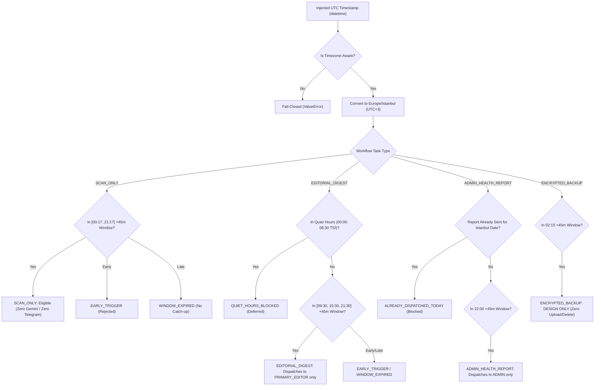

# Efso Radar — Phase 5B.3D: Offline Workflow Orchestration & Automation Readiness

**Document Version:** 1.0.0
**Status:** Completed & Validated Offline Baseline (Phase 5B.3D)
**Security Classification:** Public Documentation (Zero Secrets / Zero Private Identifiers)
**Operating Budget:** STRICTLY 0 TRY / $0.00 ongoing spending
**Anchor Tag Baseline:** `v0.4.0`
**Git Baseline:** `7c77fde59da100e333ebf8cbdc1d20d0ab12e8d7` (PR #1 through PR #8 merged)
**Target Feature Branch:** `feature/phase5b3d-offline-workflow-orchestration`

---

## 1. Executive Summary & Safety Charter

Phase 5B.3D establishes the architectural contracts, scheduling components, and workflow orchestration foundations required for future unattended operation of Efso Radar on GitHub Actions.

In strict adherence to the project safety charter:
- **Zero Real Automation:** All GitHub Actions scheduled cron triggers remain intentionally **DISABLED**. No background or cron job is active.
- **Zero Live Service Calls:** No network requests to Google News RSS feeds, Turso libSQL endpoints, Telegram Bot API, Google Gemini API, or GitHub Releases backup storage.
- **Strict Data Isolation:** Operational SQLite database (`data/radar.db`), JSON ledgers (`telegram_digest_delivery_ledger.json`, `experiment_budget_ledger.json`), legacy state (`data/state.json`), and `.env` files are unmounted and never written to by preview execution.
- **Strict Financial Invariant:** 0 TRY / $0.00 recurring expenditure. AI evaluation and Telegram delivery remain disabled by default.
- **Fail-Closed Execution:** Any attempt to invoke live production operations (`TaskExecutionMode.LIVE_PRODUCTION` or `--live`) raises `NotImplementedError` and terminates immediately.
- **Separated, Secret-Free Workflows:** The legacy monolithic manual workflow (`radar.yml`) that injected live secrets and accessed external RSS feeds has been permanently removed. It is replaced by four decoupled, secret-free workflow specifications equipped with commented cron schedules and harmless hermetic preview jobs.

---

## 2. Operational Schedule & UTC / Istanbul Conversion Table

Turkey permanently observes UTC+3 (`Europe/Istanbul`, Decree No. 2016/9154). There is no Daylight Saving Time (DST) shift; the offset is fixed year-round.

### 2.1. Authoritative Operational Schedule Matrix

| Task Type | Future Schedule (Europe/Istanbul) | UTC Schedule | UTC Day Offset | Future UTC Cron (Disabled) | Quiet Hours Rule | Target Recipient |
| :--- | :--- | :--- | :---: | :--- | :--- | :--- |
| **SCAN_ONLY** | `00:17` | `21:17` | -1 | `17 21 * * *` | Allowed (Internal queue only) | Internal Pipeline |
| **SCAN_ONLY** | `03:17` | `00:17` | 0 | `17 0 * * *` | Allowed (Internal queue only) | Internal Pipeline |
| **SCAN_ONLY** | `06:17` | `03:17` | 0 | `17 3 * * *` | Allowed (Internal queue only) | Internal Pipeline |
| **SCAN_ONLY** | `09:17` | `06:17` | 0 | `17 6 * * *` | Allowed (Outside quiet hours) | Internal Pipeline |
| **SCAN_ONLY** | `12:17` | `09:17` | 0 | `17 9 * * *` | Allowed (Outside quiet hours) | Internal Pipeline |
| **SCAN_ONLY** | `15:17` | `12:17` | 0 | `17 12 * * *` | Allowed (Outside quiet hours) | Internal Pipeline |
| **SCAN_ONLY** | `18:17` | `15:17` | 0 | `17 15 * * *` | Allowed (Outside quiet hours) | Internal Pipeline |
| **SCAN_ONLY** | `21:17` | `18:17` | 0 | `17 18 * * *` | Allowed (Outside quiet hours) | Internal Pipeline |
| **EDITORIAL_DIGEST** | `09:30` | `06:30` | 0 | `30 6 * * *` | Allowed (After 08:30 quiet hours) | `PRIMARY_EDITOR` only |
| **EDITORIAL_DIGEST** | `15:30` | `12:30` | 0 | `30 12 * * *` | Allowed (Afternoon slot) | `PRIMARY_EDITOR` only |
| **EDITORIAL_DIGEST** | `21:30` | `18:30` | 0 | `30 18 * * *` | Allowed (Before 00:00 quiet hours)| `PRIMARY_EDITOR` only |
| **ADMIN_HEALTH_REPORT**| `22:00` | `19:00` | 0 | `0 19 * * *` | Allowed (Nightly operational) | `ADMIN` only (Max 1/day) |
| **ENCRYPTED_BACKUP** | `02:15` | `23:15` | -1 | `15 23 * * *` | Allowed (Quiet-hours snapshot) | Archive Asset (DESIGN ONLY) |

### 2.2. Previous-Day UTC Boundary Mathematics
When Istanbul crosses midnight into a new calendar date $D$, the corresponding UTC timestamp belongs to calendar date $D-1$:
- `00:17:00+03:00` on 2026-10-24 $\rightarrow$ `2026-10-23T21:17:00Z` (Offset: -1 day).
- `02:15:00+03:00` on 2026-10-24 $\rightarrow$ `2026-10-23T23:15:00Z` (Offset: -1 day).
The scheduling contract (`src/efso_radar/workflow/schedule.py`) resolves these boundaries deterministically using explicit timezone arithmetic and never truncates dates in UTC space.

### 2.3. Quiet Hours Policy (00:00 – 08:30 Istanbul)
- Routine editorial dispatches (`EDITORIAL_DIGEST`) are strictly prohibited during quiet hours. If evaluated or triggered inside quiet hours, `evaluate_task_eligibility()` returns `is_eligible=False` with status `QUIET_HOURS_BLOCKED`.
- Non-editorial maintenance operations (`SCAN_ONLY` candidate discovery and `ENCRYPTED_BACKUP` snapshots) are permitted during quiet hours because they do not dispatch notifications.

---

## 3. Decoupled Workflow Contracts & Architecture

Four decoupled task contracts govern workflow execution (`src/efso_radar/workflow/contracts.py`):



### 3.1. Stable Window Identity
To guarantee idempotency across duplicate runner triggers or workflow restarts, each execution window derives a deterministic identity string:
- `SCAN_ONLY:YYYY-MM-DDTHH:MM` (e.g. `SCAN_ONLY:2026-10-24T09:17`)
- `EDITORIAL_DIGEST:YYYY-MM-DDTHH:MM` (e.g. `EDITORIAL_DIGEST:2026-10-24T15:30`)
- `ADMIN_HEALTH_REPORT:YYYY-MM-DD` (e.g. `ADMIN_HEALTH_REPORT:2026-10-24` — calendar-day scoped)
- `ENCRYPTED_BACKUP:YYYY-MM-DDTHH:MM` (e.g. `ENCRYPTED_BACKUP:2026-10-24T02:15`)

Multiple runs arriving at $T_0$, $T_0 + 5\text{m}$, or $T_0 + 20\text{m}$ resolve to the exact same `window_id`, enabling persistent deduplication without race conditions.

### 3.2. Bounded Jitter & Grace Window Tolerance
GitHub Actions cron triggers can experience platform delays ranging from 5 to 30 minutes. The scheduler incorporates a strictly bounded tolerance window:
- Bounded range: `MIN_TOLERANCE_MINUTES = 1` to `MAX_TOLERANCE_MINUTES = 120` (default: 45 minutes). Arbitrary wide tolerances are rejected with `ValueError` to prevent replaying missed slots.
- Execution at $T < T_{slot}$: Ineligible (`EARLY_TRIGGER`), `window_id = None`.
- Execution at $T_{slot} \le T \le T_{slot} + \text{tolerance}$: Eligible (`ELIGIBLE`), generates deterministic `window_id`.
- Execution at $T > T_{slot} + \text{tolerance}$: Ineligible (`WINDOW_EXPIRED`), `window_id = None`. Missed windows are strictly **not caught up or replayed**.

### 3.3. Unconditional Preview Storage Isolation & Ineligible Execution Gate
- **Unconditional Storage Isolation (Issue 1 Fix):** All preview writes occur strictly inside internally created ephemeral temporary SQLite databases that are immediately cleaned up. A caller-supplied repository is NEVER mutated or written to by preview operations.
- **Ineligible Execution Gate (Issue 4 Fix):** When a schedule check marks a task ineligible (early, expired, quiet hours, or already dispatched), the contract immediately halts execution. It does NOT generate an active window identity (`window_id = None`), clearly labels the status as `INELIGIBLE_*`, and executes zero state-writing preview actions.

---

## 4. Hardened GitHub Actions Workflow Architecture

### 4.1. Removal of Legacy `radar.yml`
The previous single-file workflow `.github/workflows/radar.yml` was identified as having critical safety hazards:
1. Injected five live secrets into runner environments on manual trigger.
2. Ran `python src/radar.py --dry-run`, which made live outbound HTTP network requests to Google News RSS feeds.
3. Created ambiguity between offline preview checks and external network operations.

`radar.yml` has been permanently deleted (`git rm .github/workflows/radar.yml`).

### 4.2. Four Decoupled, Secret-Free Workflows
Four distinct, maintainable workflow definitions have been introduced:

1. **`rss_discovery.yml` (`SCAN_ONLY`):**
   - Operating Schedule: 8 runs per day (`17 0,3,6,9,12,15,18,21 * * *` UTC) — disabled.
   - Permissions: `contents: read`.
   - Concurrency: `group: efso-radar-scan`.
   - Dispatch Step: Runs `python -m efso_radar.workflow --task scan-only --preview`.
   - Secret Injection: **None**. Zero secrets injected in active steps.

2. **`editorial_digest.yml` (`EDITORIAL_DIGEST`):**
   - Operating Schedule: 3 runs per day (`30 6,12,18 * * *` UTC) — disabled.
   - Permissions: `contents: read`.
   - Concurrency: `group: efso-radar-digest`.
   - Dispatch Step: Runs `python -m efso_radar.workflow --task editorial-digest --preview`.
   - Secret Injection: **None**.

3. **`admin_health_report.yml` (`ADMIN_HEALTH_REPORT`):**
   - Operating Schedule: Nightly (`0 19 * * *` UTC) — disabled.
   - Permissions: `contents: read`.
   - Concurrency: `group: efso-radar-admin-report`.
   - Dispatch Step: Runs `python -m efso_radar.workflow --task admin-health-report --preview`.
   - Secret Injection: **None**.

4. **`encrypted_backup.yml` (`ENCRYPTED_BACKUP`):**
   - Operating Schedule: Daily (`15 23 * * *` UTC) — disabled.
   - Permissions: `contents: read`.
   - Concurrency: `group: efso-radar-backup`.
   - Dispatch Step: Runs `python -m efso_radar.workflow --task encrypted-backup --preview`.
   - Remote Upload/Delete: **Strictly NOT IMPLEMENTED**.

All cron schedules are commented out (`# schedule:`). Manual dispatch triggers perform hermetic offline previews only. Future live production execution definitions are documented as inactive, commented-out templates.

---

## 5. Recipient Policy Implementation

In accordance with the October 19 Product Owner policy:

1. **`PRIMARY_EDITOR` (Baş Editör):**
   - Sole recipient for all routine editorial notifications (`EDITORIAL_DIGEST`, `VERIFIED_BREAKING`, `SENSITIVE_EDITORIAL_REVIEW`, `HOLD_FOR_VERIFICATION`).
   - Configured via `TELEGRAM_PRIMARY_EDITOR_CHAT_ID`.
2. **`ADMIN` (Yönetici / Ürün Sahibi):**
   - Sole recipient for operational system health summaries (`ADMIN_HEALTH_REPORT`).
   - Configured via `TELEGRAM_CHAT_ID`.
   - Limited to at most **one report per Istanbul calendar day**.
   - Routine editorial digests are **never** delivered to `ADMIN`.
3. **Recipient Chat-ID Privacy Protection (Issue 3 Fix):**
   - Output models use `SafeRecipientInfo` containing only safe role labels (`role`), masked chat IDs (`masked_chat_id`), and optional labels (`label`).
   - Raw chat IDs are strictly stripped and excluded from `model_dump()`, JSON serialization, `repr()`, `str()`, task messages, and CLI outputs.
4. **Cross-Routing Invariant Enforcement:**
   - Both `EditorialDigestTaskContract` and `AdminHealthReportTaskContract` verify recipient lists prior to execution. If `ADMIN` is found in editorial recipients or `PRIMARY_EDITOR` in administrative recipients, execution aborts with `AssertionError`.
5. **Instagram Auto-Publishing:**
   - Permanently disabled (`INSTAGRAM_PUBLISHING_ENABLED=False`).

---

## 6. Supported Offline Commands & CLI Usage

The orchestration CLI provides zero-network, zero-spend inspection and planning:

```bash
# Display operational schedule matrix and verify conversions:
python -m efso_radar.workflow --verify-schedule

# Check window eligibility and run preview for all 4 tasks at injected UTC timestamp:
python -m efso_radar.workflow --timestamp 2026-10-24T06:30:00Z

# Check quiet hours blocking for editorial digest (04:00 TSİ = 01:00 UTC):
python -m efso_radar.workflow --task editorial-digest --timestamp 2026-10-24T01:00:00Z

# Execute offline scan preview with ephemeral SQLite database:
python -m efso_radar.workflow --task scan-only --preview

# Attempting live mode fails closed immediately:
python -m efso_radar.workflow --live
# Output: ERROR: Live production execution is strictly NOT IMPLEMENTED and prohibited in Phase 5B.3D.
```

---

## 7. Explicit List of Disabled Production Capabilities

The following capabilities are deliberately **DISABLED** or **NOT IMPLEMENTED** in this milestone:

| Capability | Status in Phase 5B.3D | Re-activation Requirement |
| :--- | :---: | :--- |
| **GitHub Actions Cron Schedules** | ❌ DISABLED (Commented out) | Explicit Product Owner authorization |
| **Live External RSS Feed Fetching** | ❌ PROHIBITED in preview/CLI | Separate production workflow activation |
| **Gemini AI Model Inference** | ❌ DISABLED (`AI_EVALUATION_ENABLED=False`) | Explicit budget & model authorization |
| **Telegram Bot API Message Delivery**| ❌ DISABLED (`TELEGRAM_DELIVERY_ENABLED=False`) | Separate delivery pilot authorization |
| **Turso Cloud Database Writes** | ❌ DISABLED (Preview uses temp SQLite) | Staging cutover completion (Phase 5B.3C-2) |
| **Encrypted Backup Asset Upload** | ❌ NOT IMPLEMENTED (DESIGN ONLY) | Backup repo provisioning (`efso-radar-backups`)|
| **Remote Backup Retention Deletion** | ❌ NOT IMPLEMENTED (DESIGN ONLY) | Verified backup inventory SLA testing |
| **Instagram Automatic Posting** | ❌ PERMANENTLY DISABLED | Separate policy authorization |
| **Automated Replay of Missed Slots** | ❌ PROHIBITED (Fail-closed) | Incompatible with low-cost architecture |

---

## 8. Manual Activation Prerequisites for Future Milestones

Before any future milestone enables live cron scheduling or external dispatch, the following gates must be completed:

1. **Product Owner Written Sign-Off:** Explicit authorization to enable recurring cron schedules and external dispatch.
2. **Turso Staging Pilot Validation:** Verification of schema v6 and atomic claims on real libSQL instances using `CloudPreflightValidator` and `StagingCutoverReconciler`.
3. **Provider Console Free-Tier Verification:** Independent manual inspection of Google Cloud Platform and Turso billing dashboards to verify zero active spend.
4. **Recipient Allowlist Verification:** Pre-flight validation ensuring `TELEGRAM_PRIMARY_EDITOR_CHAT_ID` and `TELEGRAM_CHAT_ID` are distinct private chats.
5. **Private Backup Repository Provisioning:** Creation of `fatihemres/efso-radar-backups` with deploy key secrets.

---

## 9. Known Limitations, Failure Handling & Remaining Technical Debt

1. **GitHub Actions Infrastructure Outages (Dead-Man's Snitch):**
   - If GitHub Actions platform encounters a complete scheduler outage, Efso Radar cannot detect its own non-execution.
   - Recommended resolution: External ping-based dead-man's snitch (e.g. *Healthchecks.io*) integrated into the nightly Admin Health Report.
2. **Runner Disk Ephemerality:**
   - GitHub Actions runners destroy all local disk state upon workflow completion.
   - Production durability requires remote Turso libSQL persistence.
3. **Timezone Library Cross-Platform Consistency:**
   - Windows systems without Python `tzdata` package cannot resolve `zoneinfo.ZoneInfo("Europe/Istanbul")`.
   - Mitigated: `schedule.py` uses standard library `timezone(timedelta(hours=3), name="Europe/Istanbul")` which operates identically across all Windows, Linux, and macOS platforms.
4. **Admin Health Report Pre-flight Check vs Atomic Delivery Claim:**
   - In `evaluate_task_eligibility()`, checking `repository.has_admin_report_been_dispatched()` is a read-only pre-flight eligibility filter, NOT an atomic distributed delivery claim lock.
   - In production, atomic mutual exclusion must be obtained via database constraint (`admin_operational_reports.report_date PRIMARY KEY`) or a distributed worker lease, not via this read-only eligibility check alone.
5. **Admin Health Report Delivery History Date Resolution (Midnight Boundary Fix):**
   - When evaluating eligibility near midnight (e.g., 22:00 Istanbul slot triggered at 00:00 Istanbul with 120m tolerance), the evaluation resolves the active matching slot first (`2026-10-24 22:00`) and queries dispatch history using that slot's Istanbul calendar date (`2026-10-24`), preventing date mismatch false positives.
6. **Hardened Operational Metrics & Accounting Invariants:**
   - Delivery success percentage is never derived from error counts alone; if total attempts are missing, the error count is displayed and the percentage is marked `BİLİNMİYOR`.
   - Operational counters reject negative, fractional, boolean, and inconsistent values (`rss_windows_success > rss_windows_total`).
   - Costs reject non-finite values (`NaN`, `Infinity`) and negative values.
   - Missing members of metric pairs never fabricate zero for the missing member.
   - USD costs strictly require a verified positive exchange rate to display TRY equivalents, preserving `0,00 TRY / $0.00` for verified synthetic fixtures.
7. **Dynamic Synthetic RSS Fixture Freshness:**
   - Synthetic RSS discovery fixtures derive publication times deterministically relative to the injected preview timestamp, guaranteeing candidate freshness within the 24-hour retention window on any evaluation date.
8. **Manual Workflow Smoke Tests:**
   - GitHub Actions manual dispatch workflows (`workflow_dispatch`) specify default representative eligible timestamps per task (e.g., `06:17 UTC` for RSS discovery, `06:30 UTC` for editorial digest, `19:00 UTC` for admin report, `23:15 UTC` for backup), allowing smoke tests to exercise synthetic preview logic without bypassing eligibility rules or requiring live secrets.
   - CLI provides `--sample-eligible` flag for deterministic local validation.

---

## 10. Acceptance Evidence & Test Verification Results

### 10.1. Focused Milestone Regression Suite (`tests/test_phase5b3d_workflow_orchestration.py`)
**23 passed in 1.70s** (15 baseline contract tests + 4 security review regression tests + 4 final acceptance correction tests):
- `test_01_all_istanbul_slots_map_correctly_to_utc`: Verified all 13 operational slots and UTC date offsets.
- `test_02_quiet_hours_prevent_routine_editorial_dispatch`: Verified 00:00–08:30 Istanbul quiet hours blocking.
- `test_03_early_and_late_triggers_cannot_cause_invalid_window_dispatch`: Verified early/late trigger rejection.
- `test_04_skipped_windows_are_not_automatically_replayed`: Verified zero automatic replay of past slots.
- `test_05_duplicate_workflow_triggers_resolve_to_stable_identity`: Verified window identity determinism.
- `test_06_admin_receives_no_editorial_content`: Verified ADMIN receives no editorial digests.
- `test_07_primary_editor_does_not_receive_admin_health_reporting`: Verified PRIMARY_EDITOR receives no admin reports.
- `test_08_daily_admin_health_report_limited_to_one_per_istanbul_day`: Verified calendar-day at-most-once constraint.
- `test_09_missing_config_invalid_timestamps_and_incorrect_storage_fail_closed`: Verified fail-closed error handling.
- `test_10_no_api_or_network_transport_can_be_invoked_by_offline_preview`: Verified zero socket/HTTP calls.
- `test_11_no_operational_database_or_ledger_modified_by_preview_execution`: Verified zero disk mutations.
- `test_12_backup_previews_never_upload_delete_rotate_or_alter_recovery_points`: Verified DESIGN ONLY invariant.
- `test_13_active_github_actions_cron_remains_disabled`: Verified all `.github/workflows/*.yml` crons are commented out.
- `test_14_no_new_manual_workflow_runs_live_application_paths`: Verified zero live secrets in active steps.
- `test_15_admin_health_report_html_formatter`: Verified HTML layout and `0,00 TRY / $0.00` formatting.
- `test_issue1_unconditional_preview_repository_isolation`: Verified zero mutations to caller-supplied repository doubles and zero execution on ineligible triggers.
- `test_issue2_admin_health_report_no_fabricated_counters_or_costs`: Verified missing data is marked BİLİNMİYOR, nonzero costs require verified rates and never default to 0 TRY, and zero denominators are handled safely.
- `test_issue3_preview_result_chat_id_privacy`: Verified high-entropy sensitive raw chat IDs never leak into model_dump(), JSON, repr(), str(), or CLI logs.
- `test_issue4_bounded_tolerance_and_strict_execution_modes`: Verified tolerance bounded to [1, 120] minutes, invalid execution modes rejected, and ineligible runs set window_id=None.
- `test_correction1_admin_health_report_invalid_metrics_adversarial`: Verified rejection of negative, fractional, boolean, and inconsistent metrics; error count with % UNKNOWN when attempts are missing; non-finite (NaN, Inf) and negative cost rejection; and pair completeness.
- `test_correction2_admin_health_report_midnight_date_mismatch`: Verified midnight trigger (00:00 Istanbul) queries repository using matched slot date (2026-10-24), keeping ineligible runs fail-closed with window_id=None.
- `test_correction3_synthetic_rss_fixtures_freshness_across_dates`: Verified synthetic RSS fixtures remain fresh within 24-hour candidate retrieval windows across future months and years.
- `test_correction4_manual_workflow_smoke_tests_and_cli_sample_eligible`: Verified deterministic eligible timestamps in `.github/workflows/*.yml` and CLI `--sample-eligible` smoke testing.

### 10.2. Full Repository Regression Suite
- Local Python test suite: **427 passed, 1 warning, 136 subtests passed** in 128.67s.
- Zero test regressions from Phase 5B.3C baseline.
