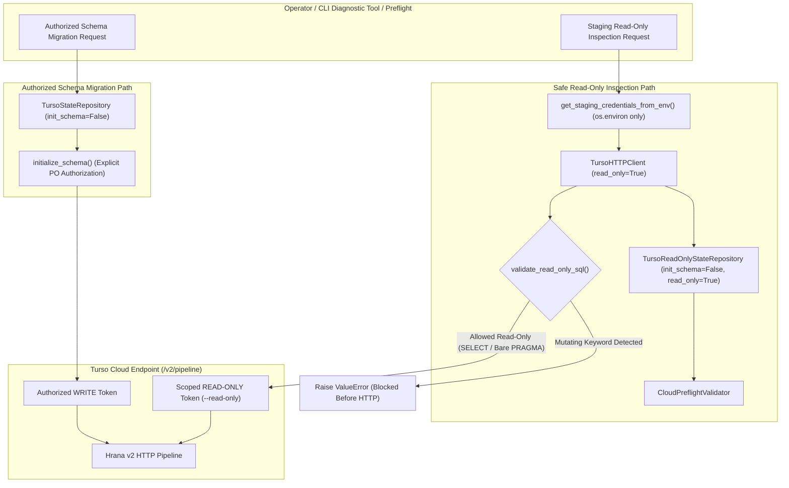
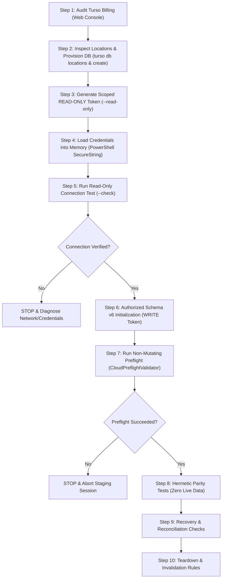

# Efso Radar — Phase 5B.3E: Turso Staging Integration & Safe Connection Readiness

**Document Version:** 1.1.0  
**Status:** Completed & Validated Offline Baseline (Phase 5B.3E Final Corrections)  
**Security Classification:** Public Documentation (Zero Secrets / Zero Private Identifiers)  
**Operating Budget:** STRICTLY 0 TRY / $0.00 ongoing spend  
**Anchor Tag Baseline:** `v0.4.0`  
**Git Baseline:** `8e61edfcc237672c39498e482f67ed6d98546699` (PR #9 merged)  
**Target Feature Branch:** `feature/phase5b3e-turso-staging-readiness`  

---

## 1. Executive Summary & Critical Security Findings

Phase 5B.3E establishes the safe, non-mutating connection foundation and operator procedures required for Efso Radar's upcoming Turso staging integration, reusing existing infrastructure from Phase 5B.3C and Phase 5B.3D without introducing redundant architectural layers.

### 1.1. Critical Security Findings & Root Cause Analysis

1. **Constructor Remote Mutation Vulnerability:**
   - **Flaw:** `TursoStateRepository.__init__()` previously executed `self._init_db()` unconditionally.
   - **Impact:** Instantiating `TursoStateRepository` dispatched DDL and DML statements (`CREATE TABLE`, `CREATE INDEX`, `INSERT OR IGNORE INTO schema_migrations`, and `ALTER TABLE`) across the HTTP wire.
   - **Hazard:** Inspecting an uninitialized remote database inadvertently created tables before preflight could evaluate baseline state.
   - **Resolution:** `TursoStateRepository` now defaults to `init_schema=False`. Construction is completely side-effect free, sending zero outbound HTTP requests. Dedicated `TursoReadOnlyStateRepository` enforces `init_schema=False, read_only=True`. Schema initialization is isolated to an explicit, authorized operator method (`repo.initialize_schema()`).

2. **Remote Insecure HTTP Hostname Bypass:**
   - **Flaw:** Substring matching and inverted boolean logic permitted remote HTTP hosts containing `localhost` in domain names (e.g., `http://localhost.attacker.invalid`), IP prefixes (e.g., `http://127.0.0.1.attacker.invalid`), paths, or query parameters.
   - **Resolution:** `normalize_turso_url` now extracts `urlparse(...).hostname` and permits plaintext HTTP exclusively for an exact allowlist of loopback hosts (`localhost`, `127.0.0.1`, `::1`). All remote HTTP hosts are strictly blocked, regardless of parameters, substrings, or injected mock transports.

3. **Secret Leakage in Error Reporting & Response Bodies:**
   - **Flaw:** Untrusted HTTP response bodies (e.g. 401 Unauthorized echoing invalid tokens) or unhandled `httpx.HTTPError` exceptions could leak authorization tokens into `str(exception)` or exception tracebacks.
   - **Resolution:** Untrusted HTTP response bodies are never included verbatim in exceptions. `TursoClientError` reports sanitized HTTP status codes and standard categories. Underlying network exceptions suppress chained causes (`from None`), and tokens are redacted from SQL error messages. `mask_turso_url` discards secret paths and query parameters, canonicalizing valid URLs to `/v2/pipeline`.

4. **Read-Only Enforcement at Query Execution Boundary:**
   - **Flaw:** Repository-level `_assert_writable()` guards could be bypassed via direct `client.execute()` or direct `_init_db()` calls.
   - **Resolution:** Read-only restrictions are now enforced directly at the query execution boundary. When `read_only=True`, `TursoHTTPClient.execute()` and `execute_pipeline()` validate every outbound SQL statement via `validate_read_only_sql()`, blocking DDL/DML before HTTP dispatch. `execute_transaction()`, `executescript()`, and `_init_db()` raise `PermissionError` immediately.

5. **Staging Connection CLI Configuration Isolation:**
   - **Flaw:** The CLI diagnostic tool previously relied on `Settings()`, which could not load process environment variables without reading `.env`.
   - **Resolution:** Implemented `get_staging_credentials_from_env()`, which reads strictly from process `os.environ` without touching `.env` or application config files, fails closed on partial credentials, and never prints secrets.

### 1.2. Architectural Boundary: Client-Side Safety vs Database-Side Privileges

> [!IMPORTANT]
> **Client-Side Guarantees vs Server-Side Privileges:**
> - **Client-Side Guarantees:** Constructor safety (`init_schema=False`), `TursoReadOnlyStateRepository`, and `validate_read_only_sql` guarantee that the Efso Radar application will not initiate DDL or DML statements during inspection. These guarantees are verified hermetically by local unit and integration tests.
> - **Server-Side Privileges:** Remote database integrity against compromised credentials or accidental misconfiguration depends on Turso cloud database token permissions. A scoped `--read-only` token MUST be used for connectivity testing and preflight inspection. A write-capable token is authorized ONLY for explicit schema initialization.

---

## 2. Safe Read-Only Staging Architecture & Invariants



### 2.1. Read-Only Query Validation Rules (`validate_read_only_sql`)
All queries executed through `execute_read_query()`, `check_staging_connection()`, or any read-only client are validated before dispatch:
- **Allowed Starting Verbs:** Must begin with `SELECT`, `WITH`, or an allowed read-only `PRAGMA`.
- **Allowed PRAGMA Allowlist:** Only introspection forms: `table_info`, `table_xinfo`, `index_list`, `index_info`, `index_xinfo`, `foreign_key_list`, `collation_list`, `database_list`, `compile_options`, `user_version`.
- **Prohibited Mutating Verbs:** `INSERT`, `UPDATE`, `DELETE`, `DROP`, `ALTER`, `CREATE`, `REPLACE`, `ATTACH`, `DETACH`, `VACUUM`, `REINDEX`, `UPSERT`, `SAVEPOINT`, `RELEASE`, `GRANT`, `REVOKE`, `LOAD_EXTENSION`, `BEGIN`, `COMMIT`, `ROLLBACK`, `ANALYZE`.
- **Comment Stripping:** SQL comments (`--`, `/* */`) are rejected to prevent token-splitting evasion.
- **Multi-statement Prohibited:** Semicolon-separated statement chains are rejected.

---

## 3. Preserved Schema v6 Contracts & Protocol Compatibility

### 3.1. Preserved Schema v6 Elements
All 15 schema v6 tables, 11 indexes, and critical unique constraints are preserved with zero modifications:
1. `schema_migrations`
2. `run_locks`
3. `processed_articles`
4. `stories`
5. `story_updates`
6. `notifications`
7. `editorial_assessments`
8. `owner_feedback`
9. `candidate_backlog`
10. `ai_usage_ledger`
11. `telegram_delivery_records` (Critical unique constraint: `(recipient_chat_id, message_key)`)
12. `durable_recovery_state`
13. `admin_operational_reports`
14. `experiment_budget_history`
15. `scheduled_execution_history`

### 3.2. Compatibility Analysis: Mock Hrana v2 vs Real Turso Cloud

| Architectural Aspect | Existing Mock Hrana Transport | Real Turso Cloud (libSQL) | Operational Impact / Mitigation |
| :--- | :--- | :--- | :--- |
| **Protocol Endpoint** | HTTP `/v2/pipeline` | HTTP `/v2/pipeline` | 100% compatible. |
| **Data Types** | `null`, `integer`, `float`, `text`, `blob` | `null`, `integer`, `float`, `text`, `blob` | Integers serialized as strings to prevent 64-bit precision loss in JSON. |
| **Transaction Batons** | Static mock baton (`mock-hrana-baton-v2`) | Server-issued session baton | Real Turso issues session batons on transaction start. Single-roundtrip pipelines do not require batons. |
| **PRAGMA Support** | Full SQLite PRAGMA support | Restricted libSQL PRAGMAs | Real Turso permits read-only introspection pragmas (`table_info`, `index_list`, `foreign_key_list`, `user_version`). `validate_read_only_sql` restricts queries to supported introspection pragmas only. |
| **Network Transport** | In-memory `httpx.BaseTransport` | TLS 1.3 HTTPS (`https://`) | Real connection requires TLS and valid JWT. Validated via `normalize_turso_url`. |
| **Region Availability** | In-memory loopback | Dynamic cloud regions | Operator must verify active regions via `turso db locations` before provisioning. |

---

## 4. Safe Windows PowerShell Guidelines for Operators

To prevent authentication tokens and database URLs from being persisted in cleartext on disk, follow these strict guidelines on Windows:

1. **PSReadLine Command History Warning:**
   PowerShell automatically saves executed command lines to `(Get-PSReadLineOption).HistorySavePath`. Never execute `$env:TURSO_AUTH_TOKEN = "eyJ..."` or pass raw tokens as command arguments!
2. **Interactive In-Memory Credential Input:**
   Set credentials in memory using `Read-Host -AsSecureString`:
   ```powershell
   $env:TURSO_DATABASE_URL = "libsql://efso-radar-staging-<org>.turso.io"
   $secToken = Read-Host -AsSecureString "Enter Turso Staging Auth Token"
   $env:TURSO_AUTH_TOKEN = [System.Net.NetworkCredential]::new("", $secToken).Password
   ```
3. **Session Teardown & History Cleanup:**
   After the authorized testing session concludes, remove environment variables and clear command history:
   ```powershell
   Remove-Item Env:\TURSO_DATABASE_URL -ErrorAction SilentlyContinue
   Remove-Item Env:\TURSO_AUTH_TOKEN -ErrorAction SilentlyContinue
   Clear-History
   ```

---

## 5. Explicit Operator Staging Activation Procedure

This procedure governs the first future authorized connection to real Turso Cloud staging.  
**DO NOT EXECUTE THESE STEPS WITHOUT EXPLICIT PRODUCT OWNER AUTHORIZATION.**



### Step 1: Audit Turso Billing and Spend Settings (Manual Web Console Audit)
> [!WARNING]
> Turso account-level zero-spend and billing settings are NOT independently verified by this codebase. The operator must manually verify these settings before provisioning.
- Log in to the Turso web console: `https://turso.tech/app`.
- Navigate to **Settings $\rightarrow$ Billing**.
- Confirm account tier is **Starter (Free)**.
- Confirm zero active payment methods, zero credit cards attached, and zero overage billing authorizations.
- **STOP Condition:** If any payment method or automatic tier upgrade is active, abort immediately.

### Step 2: Inspect Available Regions and Provision Staging Database
- Inspect currently available regions for the account:
  ```bash
  turso db locations
  ```
- Select the closest European region returned by the CLI (e.g., `fra` Frankfurt, `ams` Amsterdam, `cdg` Paris, `lhr` London). Do not assume `fra` is universally available without checking `turso db locations`.
- Provision a separate staging database:
  ```bash
  turso db create efso-radar-staging --location <selected-region>
  ```
- Retrieve database URL:
  ```bash
  turso db show efso-radar-staging --url
  # Expected: libsql://efso-radar-staging-<org>.turso.io
  ```

### Step 3: Generate Scoped READ-ONLY Token for Initial Inspection
- For connectivity testing and baseline preflight inspection, generate a strictly **read-only** token:
  ```bash
  turso db tokens create efso-radar-staging --read-only --expiration 7d
  ```

### Step 4: Load Credentials into Memory Safely Outside Git
- On Windows PowerShell, load credentials into session environment variables without disk history:
  ```powershell
  $env:TURSO_DATABASE_URL = "libsql://efso-radar-staging-<org>.turso.io"
  $sec = Read-Host -AsSecureString "Paste Scoped READ-ONLY Token"
  $env:TURSO_AUTH_TOKEN = [System.Net.NetworkCredential]::new("", $sec).Password
  ```
- Verify dry-run syntax strictly without network:
  ```powershell
  python -m efso_radar.staging.connection --dry-run
  ```

### Step 5: Validate Connectivity in a Controlled Read-Only Session
- Run the safe connection inspection tool with strictly read-only queries:
  ```powershell
  python -m efso_radar.staging.connection --check
  ```
- **Expected Output:**
  ```text
  === TURSO STAGING CONNECTION REPORT [PASSED] ===
  Endpoint: https://efso-radar-staging-<org>.turso.io/v2/pipeline
  Reachability: VERIFIED (28.4ms)
  Schema Status: UNINITIALIZED (0 tables — initialization required)
  Tables Present: 0
  ```
- Confirm `is_reachability_verified=True`, `table_count=0`, and that **0 tables were created**.

### Step 6: Initialize Schema v6 as a Separately Authorized Mutating Operation
- Only after Step 5 confirms reachability and an uninitialized database, request a short-lived **WRITE** token:
  ```bash
  turso db tokens create efso-radar-staging --expiration 1d
  ```
- Update `$env:TURSO_AUTH_TOKEN` with the authorized write token.
- Execute schema initialization:
  ```powershell
  python -c "import os; from efso_radar.repositories.turso import TursoStateRepository; repo = TursoStateRepository(database_url=os.environ['TURSO_DATABASE_URL'], auth_token=os.environ['TURSO_AUTH_TOKEN'], init_schema=False); repo.initialize_schema(); print('Schema v6 successfully initialized.')"
  ```

### Step 7: Run Non-Mutating Preflight After Initialization
- Re-apply the scoped **READ-ONLY** token to `$env:TURSO_AUTH_TOKEN`.
- Execute preflight validator:
  ```powershell
  python -c "import os; from efso_radar.staging.preflight import CloudPreflightValidator; v = CloudPreflightValidator.create_for_turso(database_url=os.environ['TURSO_DATABASE_URL'], auth_token=os.environ['TURSO_AUTH_TOKEN']); r = v.validate(); assert r.success and r.is_non_mutating and r.schema_version == 6; print('Preflight PASSED (v6).')"
  ```
- Confirm that all 15 tables, 11 indexes, and unique constraints pass.

### Step 8: Run Synthetic Read/Write Parity Tests
- Execute hermetic synthetic tests with synthetic candidate fixtures (from `test_repository_parity.py`).
- **Strict Invariant:** Do not use real Google News RSS articles, real Telegram bot tokens, or real recipient chat IDs.

### Step 9: Run Recovery and Reconciliation Checks
- Run `DeliveryRecoveryInspector`: confirm 0 stuck claims, 0 uncertain deliveries.
- Run `StagingCutoverReconciler`: reconcile synthetic source SQLite and target Turso. Confirm content hash match.

### Step 10: Teardown, Token Invalidation, and Cleanup
- **Immediate Stop Conditions:** Abort session immediately if any 401/403 occurs unexpectedly, if any unexpected table exists, or if billing dashboard shows non-zero spend.
- **Teardown Procedure:**
  ```bash
  # 1. Destroy staging database
  turso db destroy efso-radar-staging --yes

  # 2. Invalidate staging tokens
  turso db tokens invalidate efso-radar-staging
  ```
- **Session Cleanup (PowerShell):**
  ```powershell
  Remove-Item Env:\TURSO_DATABASE_URL -ErrorAction SilentlyContinue
  Remove-Item Env:\TURSO_AUTH_TOKEN -ErrorAction SilentlyContinue
  Clear-History
  ```

---

## 6. Offline vs Live Capability Matrix

| Architectural Component | Status Classification | Verification Evidence |
| :--- | :---: | :--- |
| **Turso HTTP Client (`TursoHTTPClient`)** | `OFFLINE TESTED` | 447+ tests pass using hermetic `MockHranaTransport`. |
| **Constructor Side-Effect Elimination** | `OFFLINE TESTED` | Verified 0 outbound requests on default constructor and `TursoReadOnlyStateRepository`. |
| **Remote Insecure HTTP Rejection** | `OFFLINE TESTED` | Bypasses (`localhost.attacker.invalid`, paths, query params) strictly rejected. |
| **Token & URL Redaction** | `OFFLINE TESTED` | HTTP 401 and hostile response bodies sanitized; zero secret leakage. |
| **Read-Only Execution Boundary** | `OFFLINE TESTED` | DDL/DML blocked on `client.execute()`, `pipeline()`, `transaction()`, `executescript()`. |
| **Operator Connection Tool & CLI** | `OFFLINE TESTED` | `get_staging_credentials_from_env()` verified with process `os.environ`. |
| **Multi-Worker Lock Contention** | `OFFLINE TESTED` | Race condition & lease stealing tests pass hermetically. |
| **Outbox Deduplication & Claims** | `OFFLINE TESTED` | Tested across simulated runner crashes and restarts. |
| **SHA-256 Cutover Reconciliation** | `OFFLINE TESTED` | Type-tagged lossless serialization tested across all data types. |
| **Real Turso Cloud Network Connection** | `PREPARED (PENDING AUTHORIZATION)` | Code ready; awaiting PO authorization for live staging session. |
| **Real Staging Database Provisioning** | `PREPARED (PENDING AUTHORIZATION)` | CLI procedure documented; zero live databases created. |
| **Production Turso Cutover** | `NOT AUTHORIZED` | Out of scope for Phase 5B.3. |

---

## 7. Strict Financial and Operational Boundaries

- **Spending Limit:** Exactly 0 TRY / $0.00 ongoing spend.
- **Zero Paid Subscriptions:** No credit card, no paid plan, no automated tier upgrades.
- **Zero Database Provisioning in this Task:** No Turso databases were created or accessed during Phase 5B.3E.
- **Zero Live Secrets in Repository:** No real API keys or database tokens are stored in Git.
- **Zero Real Automation:** All GitHub Actions scheduled cron triggers remain disabled.
- **Zero External Network Requests:** Zero socket calls to Google News RSS, Telegram API, Gemini API, Turso Cloud, or GitHub Releases.
- **Operational Data Untouched:** `data/radar.db`, `data/state.json`, and `.env` were unmounted and unmodified.

---

## 8. GO / NO-GO Recommendation

- **Implementation Status:** COMPLETE. All five targeted security review fixes implemented and verified.
- **Safety Invariants:** VERIFIED. Constructor remote mutation eliminated, remote insecure HTTP blocked, token leakage in errors stopped, read-only enforced at execution boundary, CLI configuration isolated, full regression suite passing.
- **Recommendation:** **GO** for Product Owner review of `feature/phase5b3e-turso-staging-readiness`.
