# Efso Radar — Phase 5B.3F: Hermetic Turso Reliability & Recovery Validation

**Document Version:** 1.2.0
**Status:** Completed & Validated Offline Baseline (Phase 5B.3F Final Hardening)
**Security Classification:** Public Documentation (Zero Secrets / Zero Private Identifiers)
**Operating Budget:** STRICTLY 0 TRY / \$0.00 ongoing spend
**Anchor Tag Baseline:** `v0.4.0`
**Target Feature Branch:** `phase-5b3f-hermetic-reliability`

---

## 1. Executive Summary & Defect Resolutions

Phase 5B.3F solidifies the reliability, recovery, concurrency, and parity guarantees of Efso Radar's cloud persistence layer following initial staging connectivity. All validation is conducted **strictly offline and hermetically**, with zero live cloud tokens, zero external API requests, and zero financial spend.

```mermaid
flowchart TD
    subgraph ClientLayer["Turso libSQL Hrana v2 Client (turso_client.py)"]
        TxReq["execute_transaction(statements)"] --> BeginStmt["BEGIN (index 0)"]
        BeginStmt --> UserStmts["User Statements (index 1..N)"]
        UserStmts --> ValidateResp{"Validate JSON &\nraw_results complete?"}
        ValidateResp -- "Malformed JSON / Missing results" --> AbortMalformed["TursoClientError\n(Malformed Response)"]
        ValidateResp -- "OK" --> CheckResults{"raw_results[0] OK?"}
        CheckResults -- "BEGIN error" --> BeginAbort["Abort & Sanitize Error\n(No silent success)"]
        CheckResults -- "BEGIN unexpected type" --> BeginTypeAbort["Abort: Fixed Sanitized Error Category\n(Never echo remote strings)"]
        CheckResults -- "BEGIN OK" --> CheckStmts{"User stmts OK & valid?"}
        CheckStmts -- "Error / unexpected type" --> Rollback["ROLLBACK & close baton\n(Fixed sanitized category)"]
        CheckStmts -- "Truncated results" --> RollbackTrunc["ROLLBACK & close baton\n(Truncated Result List)"]
        CheckStmts -- "All OK" --> BatonCheck{"baton present?"}
        BatonCheck -- "No" --> ProtoErr["TursoClientError\n(Protocol Error)"]
        BatonCheck -- "Yes" --> Commit["COMMIT & close"]
        Commit -- "Network Error / 5xx / Malformed JSON / Truncated / Unexpected Type" --> Ambiguous["Ambiguous Transaction Outcome\n(UNKNOWN - Never blindly retried)"]
        Commit -- "Missing / Malformed execute result payload" --> AmbiguousPayload["Ambiguous Transaction Outcome\n(UNKNOWN - Never blindly retried)"]
        Commit -- "200 OK & confirmed execute payload" --> Committed["Success (Committed)"]
    end

    subgraph ParityLayer["Cutover & Reconciler Safety (cutover.py)"]
        Reconcile["StagingCutoverReconciler"] --> MetaTable{"Table: schema_migrations?"}
        MetaTable -- "Yes" --> VerCheck["Reconcile Applied Version Set\n(Ignore backend-specific applied_at/desc)"]
        MetaTable -- "No" --> FullHash["Strict Full-Column SHA-256 Framing\n(All 14 Business Tables Lossless)"]
    end

    subgraph WindowsCleanup["Windows Lifecycle Safety (sqlite.py & closing)"]
        RepoClose["SqliteStateRepository.close()"] --> FixtureCheck{"Owned synthetic fixture?"}
        FixtureCheck -- "Yes" --> WalCheckpoint["PRAGMA wal_checkpoint(TRUNCATE)"]
        FixtureCheck -- "No" --> NoOp["No-op: Avoids unnecessary checkpoint on operational DB"]
        ExternalConns["External Connections"] --> ExplicitClosing["contextlib.closing(sqlite3.connect(...))\n(Mandatory for external callers)"]
        WalCheckpoint --> CleanTemp["Clean Temporary Directory Disposal\n(Zero WinError 32 PermissionError)"]
        ExplicitClosing --> CleanTemp
    end
```



### 1.1. Production Code Defects Found & Fixed

1. **Hrana Transaction BEGIN Error Suppression & Response Hardening (Defect):**
   - **Root Cause:** In `TursoHTTPClient.execute_transaction()`, error checking previously scanned `raw_results[1:]` (the user statements), omitting index 0 (`BEGIN`). Furthermore, truncated result lists, unexpected result types, and malformed JSON payloads were not strictly validated before execution proceeded.
   - **Fix:**
     - Explicitly validates `resp.json()` and checks that `raw_results` is a non-empty list.
     - Validates `raw_results[0]` (`BEGIN`). If `BEGIN` fails, the transaction is immediately aborted, the baton is closed if present, and a sanitized `TursoClientError` is raised.
     - Validates that each user statement result is an object with `type == "ok"` and valid `response.result` payload. If any statement encounters an error or unexpected type, `ROLLBACK` is issued and sanitized error categories are reported.
     - Verifies result list completeness: if `len(raw_results) < len(requests_payload)` after statements succeed, `ROLLBACK` is issued and a malformed truncated response error is raised.

2. **Hrana COMMIT Response Structure Validation & Ambiguous Outcome Semantics:**
   - **Specification:** When an HTTP timeout, network disconnect, 5xx gateway error, malformed JSON, truncated result list, or unexpected result type occurs during `COMMIT`, the remote engine may have successfully applied the commit before the transport connection severed or response framed. Furthermore, accepting `commit_results[0].type == "ok"` without validating the inner execution result payload could misclassify truncated confirmations as success.
   - **Fix:** Validates the complete successful COMMIT response structure (`type == "ok"`, `response.type == "execute"`, and `response.result` dictionary). Any error, missing result, non-execute frame, or missing payload during `COMMIT` raises a standardized `TursoClientError` marking the outcome as ambiguous (`UNKNOWN`):
     `"Ambiguous transaction outcome (UNKNOWN): ... The transaction may or may not have committed."`
     The state remains `UNKNOWN` and is **never automatically retried**.

3. **Sanitized Error Categories (Zero Echoing of Remote Response Types):**
   - **Requirement:** Remote server-supplied response type strings from BEGIN, statement, or COMMIT responses must never be echoed or interpolated into exception messages or logs.
   - **Fix:** Replaced dynamic string formatting of remote type values with fixed, sanitized error categories (`"Turso transaction response malformed: unexpected BEGIN response type."`, `"Turso transaction aborted due to unexpected statement response type."`, and `"Ambiguous transaction outcome (UNKNOWN): unexpected result type in Turso COMMIT response."`). Added adversarial regression coverage asserting that injected secrets are absent from all exposed error messages and logs.

4. **Missing Session Baton in Multi-Statement Transactions (Defect):**
   - **Root Cause:** If `resp.status_code == 200` but the remote server returned `baton: None`, the code skipped the commit block and returned parsed rows as if committed.
   - **Fix:** Enforced `if not baton: raise TursoClientError("Turso transaction protocol error: server did not return a session baton for transaction.")`.

5. **Windows SQLite Connection Cleanup & Resource Lifecycle Hardening (Defect):**
   - **Root Cause:** The smoke test failed on Windows with `PermissionError [WinError 32]` because independent `sqlite3.Connection` objects opened by diagnostic and staging routines held file handles. Calling `SqliteStateRepository.close()` cannot close external connections it does not own. Furthermore, unconditional WAL checkpointing in `close()` ran unnecessarily on operational databases.
   - **Fix:**
     - Managed connection lifecycles across `src/efso_radar/repositories/sqlite.py`, `src/efso_radar/staging/preflight.py`, `src/efso_radar/ai/cost.py`, `src/efso_radar/backup/creator.py`, and `src/efso_radar/backup/restore.py` using `contextlib.closing` to guarantee prompt handle closure even on exceptions.
     - Restricted WAL checkpointing in `SqliteStateRepository.close()` strictly to explicitly owned synthetic fixtures (`_is_owned_synthetic_fixture=True`), avoiding unnecessary checkpointing on operational databases.
     - Documented the repository boundary contract: external callers and diagnostic tools holding independent connections must close them before storage disposal.
     - Ensured cleanup errors are never silently concealed where successful cleanup is required.

6. **Simultaneous Concurrent Worker Contention Coverage:**
   - **Requirement:** Existing tests verified sequential lock contention but lacked simultaneous acquisition verification.
   - **Fix:** Added deterministic offline multi-worker contention tests using two independent repository backend connections to the same database file synchronized via `threading.Barrier(2)`. Asserts exactly one winner, one rejected loser, and safe takeover after lease expiration.

7. **Staging Cutover Reconciler Migration Metadata Mismatch (Defect):**
   - **Root Cause:** `StagingCutoverReconciler` computed full-row SHA-256 content hashes across all columns of `schema_migrations`, including `applied_at` and `description`.
   - **Fix:** For `schema_migrations`, content parity verifies the applied migration `version` set (`hash_cols = ["version"]`). All 14 business tables retain 100% strict, lossless full-column content hashing.

8. **Double-Import RuntimeWarning in Staging CLI:**
   - **Root Cause:** `efso_radar.staging.__init__.py` eagerly imported `StagingConnectionReport` from `efso_radar.staging.connection`.
   - **Fix:** Implemented PEP 562 module-level `__getattr__` lazy attribute loading in `efso_radar.staging.__init__.py`.

---

## 2. Invariants & Safety Contracts

| Subsystem | Safety Invariant | Verification Mechanism |
| :--- | :--- | :--- |
| **Transaction Atomicity** | All-or-none execution. If any statement or `BEGIN` fails, `ROLLBACK` is sent and zero changes persist. | `TestHranaTransactionReliability.test_02_statement_error_aborts_transaction_and_rolls_back` |
| **Ambiguous Commit** | Network timeouts, 5xx errors, malformed JSON, or missing results on `COMMIT` must not be retried automatically; marked `UNKNOWN`. | `TestHranaTransactionReliability.test_06` & `test_08f`–`test_08h`, `test_08j`–`test_08l` |
| **Secret Redaction** | Error payloads from statement, transaction, commit, or rollback exceptions never echo raw secrets or remote response types. | `TestHranaTransactionReliability.test_08` & `test_08i_untrusted_response_types_never_leak_secrets` |
| **Simultaneous Contention** | Barrier-synchronized concurrent workers produce exactly 1 winner, 1 rejected loser, and safe recovery post-expiry. | `TestMultiWorkerLeaseContention.test_12b_simultaneous_concurrent_worker_contention_with_barrier` |
| **Delivery Uncertainty** | `DELIVERY_UNCERTAIN` outbox records are permanently isolated from automatic retry. | `TestRecoveryAndOutboxSafety.test_13_delivery_uncertain_never_blindly_retried` |
| **Role Segregation** | `PRIMARY_EDITOR` and `ADMIN` cannot cross-claim or overwrite each other's message keys. | `TestRecoveryAndOutboxSafety.test_14_role_segregation_and_conflicting_identities_rejected` |
| **Cutover Parity** | 100% exact business-table content parity. Migration versions must match without requiring synthetic timestamp hacks. | `TestRepositoryContractParityAndCutover.test_18_cutover_reconciler_handles_migration_metadata_without_artificial_update` |
| **Windows Cleanup** | External connections use `contextlib.closing`; repo `close()` only checkpoints synthetic fixtures; zero `WinError 32`. | `TestWindowsSQLiteCleanupRegression.test_23b_external_connection_lifecycle_must_be_explicitly_closed_for_windows_cleanup` |

---

## 3. Test Execution Summary

The hermetic test suite runs under the virtual environment interpreter with `$env:PYTHONPATH = "src"`:

```powershell
$env:PYTHONPATH = "src"
.\.venv\Scripts\python.exe -m unittest tests.test_phase5b3f_hermetic_reliability
```

### Complete Test Suite Matrix (40 Passed Tests)

#### Section 1: Hermetic Hrana v2 Transaction Atomicity & Error Handling
1. `test_01_transaction_full_success_atomicity` — Full multi-statement atomic commit.
2. `test_02_statement_error_aborts_transaction_and_rolls_back` — Statement failure rollback & 0 rows persistence.
3. `test_03_begin_failure_aborts_without_commit` — BEGIN failure rejection without silent success.
4. `test_04_missing_baton_on_begin_raises_protocol_error` — Missing session baton protocol error.
5. `test_05_commit_failure_raises_sanitized_error` — COMMIT failure sanitization.
6. `test_06_commit_timeout_reports_ambiguous_outcome_and_is_not_retried` — COMMIT timeout ambiguous outcome (`UNKNOWN`).
7. `test_07_commit_http_504_reports_ambiguous_outcome` — COMMIT HTTP 504 ambiguous outcome (`UNKNOWN`).
8. `test_08_rollback_failure_does_not_mask_statement_error_or_leak_secrets` — Rollback logging secret redaction.
9. `test_08a_hrana_malformed_json_on_pipeline_aborts_transaction` — Malformed non-JSON payload on pipeline response aborts transaction.
10. `test_08b_hrana_missing_or_empty_pipeline_results_aborts_transaction` — Empty results array on pipeline response aborts transaction.
11. `test_08c_hrana_unexpected_begin_response_type_aborts_transaction` — Unexpected response type for BEGIN aborts transaction without commit.
12. `test_08d_hrana_unexpected_statement_response_type_aborts_and_rolls_back` — Unexpected response type for statement rolls back and aborts.
13. `test_08e_hrana_truncated_pipeline_results_aborts_and_rolls_back` — Truncated pipeline result list triggers rollback and aborts.
14. `test_08f_commit_malformed_json_reports_ambiguous_outcome` — Malformed JSON response during COMMIT raises ambiguous outcome (`UNKNOWN`).
15. `test_08g_commit_missing_results_reports_ambiguous_outcome` — Missing results in COMMIT response raises ambiguous outcome (`UNKNOWN`).
16. `test_08h_commit_unexpected_result_type_reports_ambiguous_outcome` — Unexpected result type in COMMIT response raises ambiguous outcome (`UNKNOWN`).
17. `test_08i_untrusted_response_types_never_leak_secrets` — Arbitrary server-supplied response types never leak into errors or logs.
18. `test_08j_commit_missing_execute_response_structure_reports_ambiguous_outcome` — HTTP 200 with `{"results": [{"type": "ok"}]}` lacking execution payload raises ambiguous outcome (`UNKNOWN`).
19. `test_08k_commit_malformed_execute_result_reports_ambiguous_outcome` — COMMIT response with malformed response/result dictionary raises ambiguous outcome (`UNKNOWN`).
20. `test_08l_commit_wrong_response_type_reports_ambiguous_outcome` — COMMIT response with non-execute response frame raises ambiguous outcome (`UNKNOWN`).

#### Section 2: Multi-Worker Lease & Run Locking
21. `test_09_mutual_exclusion_and_contention` — Exclusive `radar_cron` run lock.
22. `test_10_non_owner_cannot_renew_or_release_lock` — Non-owner lease renewal/release rejection.
23. `test_11_expired_lock_takeover_with_clock_control` — Expired lock takeover via clock control.
24. `test_12_runner_restart_preserves_lock_state` — Lock state persistence across runner restart.
25. `test_12b_simultaneous_concurrent_worker_contention_with_barrier` — 2 concurrent workers synchronized by `threading.Barrier(2)` produce exactly 1 winner, 1 rejected loser, and safe recovery post-expiry.

#### Section 3: Recovery & Outbox Idempotency
26. `test_13_delivery_uncertain_never_blindly_retried` — Outbox blind retry prevention for uncertain deliveries.
27. `test_14_role_segregation_and_conflicting_identities_rejected` — Recipient role conflict rejection.
28. `test_15_recovery_inspector_diagnoses_checkpoints_without_mutating` — Read-only recovery inspection.

#### Section 4: Full Repository Contract Parity & Cutover
29. `test_16_contract_parity_articles_candidates_and_stories` — Parity: articles, candidates, stories, assessments.
30. `test_17_contract_parity_ai_usage_and_budget_history` — Parity: AI usage and immutable budget ledger.
31. `test_18_cutover_reconciler_handles_migration_metadata_without_artificial_update` — Cutover reconciler metadata handling.
32. `test_19_reconcile_uncertain_delivery_requires_authorization` — Uncertain delivery authorization enforcement.
33. `test_20_story_updates_and_scheduled_execution_parity` — Parity: story updates and scheduled execution audit.
34. `test_21_admin_operational_report_parity_and_idempotency` — Parity: daily admin operational reports at-most-once.
35. `test_22_read_only_repository_rejects_mutations_and_transactions` — Read-only repo mutation rejection.

#### Section 5: Windows SQLite Connection Cleanup & Resource Lifecycle
36. `test_23_sqlite_repository_close_enables_clean_directory_disposal` — SQLite clean directory disposal.
37. `test_23a_sqlite_close_does_not_checkpoint_unowned_operational_databases` — `close()` on standard repository does NOT checkpoint operational databases.
38. `test_23b_external_connection_lifecycle_must_be_explicitly_closed_for_windows_cleanup` — Demonstrates original Windows failure mechanism with external unclosed connection and verifies `contextlib.closing` solution.
39. `test_24_context_manager_lifecycle_closes_cleanly` — SQLite context manager auto-closure.
40. `test_25_error_distinction_between_remote_cleanup_and_local_permission_error` — Local file lock vs remote cleanup distinction.

---

## 4. Current Milestone Security State

- **Turso Live Tokens:** All tokens invalidated.
- **Turso Remote Database:** Block Writes is ON. Remote remaining test rows: 0.
- **External Network Calls:** Zero network requests made. All tests use synthetic in-memory/temp SQLite transports.
- **Financial Spend:** STRICTLY \$0.00 / 0 TRY.
- **Operational Data Integrity:** `data/radar.db`, `data/state.json`, and `.env` remain untouched.
