# Efso Radar — Phase 5B.3F: Hermetic Turso Reliability & Recovery Validation

**Document Version:** 1.0.0
**Status:** Completed & Validated Offline Baseline (Phase 5B.3F)
**Security Classification:** Public Documentation (Zero Secrets / Zero Private Identifiers)
**Operating Budget:** STRICTLY 0 TRY / $0.00 ongoing spend
**Anchor Tag Baseline:** `v0.4.0`
**Target Feature Branch:** `phase-5b3f-hermetic-reliability`

---

## 1. Executive Summary & Defect Resolutions

Phase 5B.3F solidifies the reliability, recovery, concurrency, and parity guarantees of Efso Radar's cloud persistence layer following initial staging connectivity. All validation is conducted **strictly offline and hermetically**, with zero live cloud tokens, zero external API requests, and zero financial spend.

```mermaid
flowchart TD
    subgraph ClientLayer["Turso libSQL Hrana v2 Client (turso_client.py)"]
        TxReq["execute_transaction(statements)"] --> BeginStmt["BEGIN (index 0)"]
        BeginStmt --> UserStmts["User Statements (index 1..N)"]
        UserStmts --> CheckResults{"raw_results[0] OK?"}
        CheckResults -- "BEGIN error" --> BeginAbort["Abort & Sanitize Error\n(No silent success)"]
        CheckResults -- "BEGIN OK" --> CheckStmts{"User stmts OK?"}
        CheckStmts -- "Error detected" --> Rollback["ROLLBACK & close baton\n(Atomicity: 0 rows)"]
        CheckStmts -- "All OK" --> BatonCheck{"baton present?"}
        BatonCheck -- "No" --> ProtoErr["TursoClientError\n(Protocol Error)"]
        BatonCheck -- "Yes" --> Commit["COMMIT & close"]
        Commit -- "Network Error / 504" --> Ambiguous["Ambiguous Transaction Outcome\n(UNKNOWN - Not retried)"]
        Commit -- "200 OK" --> Committed["Success (Committed)"]
    end

    subgraph ParityLayer["Cutover & Reconciler Safety (cutover.py)"]
        Reconcile["StagingCutoverReconciler"] --> MetaTable{"Table: schema_migrations?"}
        MetaTable -- "Yes" --> VerCheck["Reconcile Applied Version Set\n(Ignore backend-specific applied_at/desc)"]
        MetaTable -- "No" --> FullHash["Strict Full-Column SHA-256 Framing\n(All 14 Business Tables Lossless)"]
    end

    subgraph WindowsCleanup["Windows Lifecycle Safety (sqlite.py)"]
        RepoClose["SqliteStateRepository.close()"] --> WalCheckpoint["PRAGMA wal_checkpoint(TRUNCATE)"]
        WalCheckpoint --> CleanTemp["Clean Temporary Directory Disposal\n(Zero WinError 32 PermissionError)"]
    end
```



### 1.1. Production Code Defects Found & Fixed

1. **Hrana Transaction BEGIN Error Suppression (Defect):**
   - **Root Cause:** In `TursoHTTPClient.execute_transaction()`, error checking previously scanned `raw_results[1:]` (the user statements), completely omitting index 0 (`BEGIN`).
   - **Impact:** If `BEGIN` failed on the remote server (e.g. database locked `SQLITE_BUSY` or syntax error), `has_error` remained `False`. If the server returned no baton, the method silently fell through and parsed user statements, reporting uncommitted statements as successful.
   - **Fix:** `execute_transaction()` now explicitly validates `raw_results[0]`. If `BEGIN` fails, the transaction is immediately aborted, the baton is closed if present, and a sanitized `TursoClientError` is raised.

2. **Missing Session Baton in Multi-Statement Transactions (Defect):**
   - **Root Cause:** If `resp.status_code == 200` but the remote server returned `baton: None`, the code skipped `if baton:` commit block and returned parsed rows as if committed.
   - **Fix:** Enforced `if not baton: raise TursoClientError("Turso transaction protocol error: server did not return a session baton for transaction.")`.

3. **Ambiguous COMMIT Outcome Classification:**
   - **Specification:** When an HTTP timeout, network disconnect, or 500/502/503/504 gateway error occurs during `COMMIT`, the remote engine may have successfully applied the commit before the transport connection severed.
   - **Fix:** These conditions now raise a standardized `TursoClientError` marking the outcome as ambiguous ("Ambiguous transaction outcome: network error during Turso COMMIT... The transaction may or may not have committed."). The state remains `UNKNOWN` and is **never automatically retried**.

4. **Staging Cutover Reconciler Migration Metadata Mismatch (Defect):**
   - **Root Cause:** `StagingCutoverReconciler` computed full-row SHA-256 content hashes across all columns of `schema_migrations`, including `applied_at` and `description`.
   - **Impact:** In SQLite, `applied_at` is the local ISO timestamp and `description` is `"Initial schema"`. In Turso cloud, `applied_at` is the cloud provisioning timestamp and `description` is `"Turso schema initialization"`. Freshly initialized repositories failed cutover reconciliation (`ERR_CONTENT_MISMATCH_SCHEMA_MIGRATIONS`), requiring tests to perform synthetic `UPDATE schema_migrations` workarounds.
   - **Fix:** For `schema_migrations`, content parity verifies the applied migration `version` set (`hash_cols = ["version"]`). All 14 business tables (`run_locks`, `processed_articles`, `stories`, `story_updates`, `notifications`, `editorial_assessments`, `owner_feedback`, `candidate_backlog`, `ai_usage_ledger`, `telegram_delivery_records`, `durable_recovery_state`, `admin_operational_reports`, `experiment_budget_history`, `scheduled_execution_history`) retain 100% strict, lossless full-column content hashing.

5. **Windows SQLite Connection Cleanup & Resource Lifecycle (Defect):**
   - **Root Cause:** `SqliteStateRepository` lacked a `close()` method and context manager protocol (`__enter__` / `__exit__`). On Windows, held file handles or un-truncated WAL files (`-wal` / `-shm`) caused `PermissionError [WinError 32]` when removing temporary directories, producing exit code 2 in operator smoke tests.
   - **Fix:** Added `close()` to `SqliteStateRepository`, executing `PRAGMA wal_checkpoint(TRUNCATE)` and closing resources. Implemented context manager support. Added targeted regression tests that distinguish local Windows filesystem locking from remote staging cleanup outcomes.

6. **Benign Double-Import RuntimeWarning in Staging CLI:**
   - **Root Cause:** `efso_radar.staging.__init__.py` eagerly imported `StagingConnectionReport` from `efso_radar.staging.connection`. When invoked as `python -m efso_radar.staging.connection`, Python's `runpy` imported the parent package first, placing `connection` in `sys.modules` before executing it as `__main__`.
   - **Fix:** Implemented PEP 562 module-level `__getattr__` lazy attribute loading in `efso_radar.staging.__init__.py`, eliminating the warning completely while preserving type checking and public exports.

---

## 2. Invariants & Safety Contracts

| Subsystem | Safety Invariant | Verification Mechanism |
| :--- | :--- | :--- |
| **Transaction Atomicity** | All-or-none execution. If any statement or `BEGIN` fails, `ROLLBACK` is sent and zero changes persist. | `TestHranaTransactionReliability.test_02_statement_error_aborts_transaction_and_rolls_back` |
| **Ambiguous Commit** | Network timeouts or 504 errors on `COMMIT` must not be retried automatically; marked `UNKNOWN`. | `TestHranaTransactionReliability.test_06_commit_timeout_reports_ambiguous_outcome_and_is_not_retried` |
| **Secret Redaction** | Error payloads from statement, transaction, commit, or rollback exceptions never echo raw secrets. | `TestHranaTransactionReliability.test_08_rollback_failure_does_not_mask_statement_error_or_leak_secrets` |
| **Multi-Worker Lease** | Exactly one runner owns `radar_cron`. Non-owners cannot renew or release. Expired leases require clock control. | `TestMultiWorkerLeaseContention.test_09_mutual_exclusion_and_contention` |
| **Delivery Uncertainty** | `DELIVERY_UNCERTAIN` outbox records are permanently isolated from automatic retry. | `TestRecoveryAndOutboxSafety.test_13_delivery_uncertain_never_blindly_retried` |
| **Role Segregation** | `PRIMARY_EDITOR` and `ADMIN` cannot cross-claim or overwrite each other's message keys. | `TestRecoveryAndOutboxSafety.test_14_role_segregation_and_conflicting_identities_rejected` |
| **Cutover Parity** | 100% exact business-table content parity. Migration versions must match without requiring synthetic timestamp hacks. | `TestRepositoryContractParityAndCutover.test_18_cutover_reconciler_handles_migration_metadata_without_artificial_update` |
| **Windows Cleanup** | Temporary SQLite test fixtures truncate WAL and close handles cleanly without `WinError 32`. | `TestWindowsSQLiteCleanupRegression.test_23_sqlite_repository_close_enables_clean_directory_disposal` |

---

## 3. Test Execution Summary

The hermetic test suite runs under the virtual environment interpreter with `$env:PYTHONPATH = "src"`:

```powershell
$env:PYTHONPATH = "src"
.\.venv\Scripts\python.exe -m unittest tests.test_phase5b3f_hermetic_reliability
```

### Test Suite Matrix (25 New Tests)

1. `test_01_transaction_full_success_atomicity` — Full multi-statement atomic commit.
2. `test_02_statement_error_aborts_transaction_and_rolls_back` — Statement failure rollback & 0 rows persistence.
3. `test_03_begin_failure_aborts_without_commit` — BEGIN failure rejection without silent success.
4. `test_04_missing_baton_on_begin_raises_protocol_error` — Missing session baton protocol error.
5. `test_05_commit_failure_raises_sanitized_error` — COMMIT failure sanitization.
6. `test_06_commit_timeout_reports_ambiguous_outcome_and_is_not_retried` — COMMIT timeout ambiguous outcome.
7. `test_07_commit_http_504_reports_ambiguous_outcome` — COMMIT HTTP 504 ambiguous outcome.
8. `test_08_rollback_failure_does_not_mask_statement_error_or_leak_secrets` — Rollback logging secret redaction.
9. `test_09_mutual_exclusion_and_contention` — Exclusive `radar_cron` run lock.
10. `test_10_non_owner_cannot_renew_or_release_lock` — Non-owner lease renewal/release rejection.
11. `test_11_expired_lock_takeover_with_clock_control` — Expired lock takeover via clock control.
12. `test_12_runner_restart_preserves_lock_state` — Lock state persistence across runner restart.
13. `test_13_delivery_uncertain_never_blindly_retried` — Outbox blind retry prevention for uncertain deliveries.
14. `test_14_role_segregation_and_conflicting_identities_rejected` — Recipient role conflict rejection.
15. `test_15_recovery_inspector_diagnoses_checkpoints_without_mutating` — Read-only recovery inspection.
16. `test_16_contract_parity_articles_candidates_and_stories` — Parity: articles, candidates, stories, assessments.
17. `test_17_contract_parity_ai_usage_and_budget_history` — Parity: AI usage and immutable budget ledger.
18. `test_18_cutover_reconciler_handles_migration_metadata_without_artificial_update` — Cutover reconciler metadata handling.
19. `test_19_reconcile_uncertain_delivery_requires_authorization` — Uncertain delivery authorization enforcement.
20. `test_20_story_updates_and_scheduled_execution_parity` — Parity: story updates and scheduled execution audit.
21. `test_21_admin_operational_report_parity_and_idempotency` — Parity: daily admin operational reports at-most-once.
22. `test_22_read_only_repository_rejects_mutations_and_transactions` — Read-only repo mutation rejection.
23. `test_23_sqlite_repository_close_enables_clean_directory_disposal` — SQLite clean directory disposal.
24. `test_24_context_manager_lifecycle_closes_cleanly` — SQLite context manager auto-closure.
25. `test_25_error_distinction_between_remote_cleanup_and_local_permission_error` — Local file lock vs remote cleanup distinction.

---

## 4. Current Milestone Security State

- **Turso Live Tokens:** All tokens invalidated.
- **Turso Remote Database:** Block Writes is ON. Remote remaining test rows: 0.
- **External Network Calls:** Zero network requests made. All tests use synthetic in-memory/temp SQLite transports.
- **Financial Spend:** STRICTLY $0.00 / 0 TRY.
- **Operational Data Integrity:** `data/radar.db`, `data/state.json`, and `.env` remain untouched.
