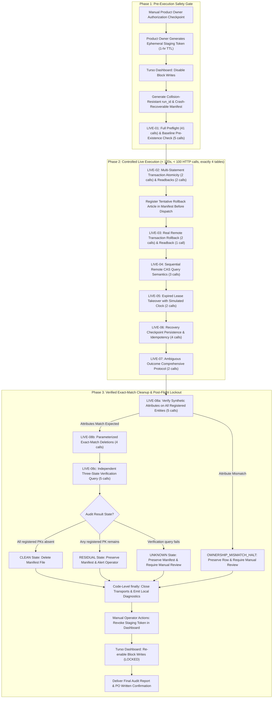
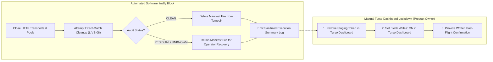

# Efso Radar — Phase 5B.3G: Controlled Live Turso Staging Reliability Validation

**Document Version:** 2.1.0  
**Status:** Architectural Specification & Operational Safety Plan (Revised Post-Review)  
**Security Classification:** Public Documentation (Zero Secrets / Zero Private Identifiers)  
**Target Database:** Turso Cloud Staging (`libsql://*.turso.io`)  
**Operating Budget Policy:** STRICTLY 0 TRY / \$0.00 spend ceiling  
**Prerequisite Milestones:** Phase 5B.3E (PR #10), Phase 5B.3F (PR #12, commit `390b13e`)  

---

## 1. Executive Summary & Purpose

Phase 5B.3G defines the operational engineering protocol for a **single, controlled, live validation session** against real Turso cloud staging infrastructure.

In Phase 5B.3F, comprehensive hermetic testing proved Hrana v2 transaction atomicity, ambiguous commit handling (`UNKNOWN`), barrier-synchronized multi-worker lease contention, and SQLite/Turso contract parity across 40 offline tests. Phase 5B.3G validates that the remote Turso libSQL server endpoint exhibits identical behavior under live HTTP transport, with **crash-recoverable manifest tracking**, **pre-deletion ownership verification**, **exact-match record cleanup**, and **zero financial spend**.



---

## 2. Strict Operational & Security Policies

All validation activities are bound by the following non-negotiable operational policies:

1. **Zero Financial Cost ($0.00 / 0 TRY Policy):**
   - The operational policy strictly requires \$0.00 / 0 TRY spend.
   - Defensive operational limits (**< 100 HTTP requests, < 10 row writes, < 2 MB bandwidth, execution < 120 seconds**) act as defensive circuit-breakers to strictly prevent resource over-utilization.
   - *Policy Clarification:* Request limits alone do not constitute an abstract mathematical guarantee against third-party platform billing or policy changes; rather, strict operational caps, ephemeral credentials, and immediate write-blocking provide defense-in-depth against unexpected charges.
2. **Database Isolation & Operational Safeguards:**
   - Operational SQLite database `data/radar.db`, ledger `data/state.json`, and `.env` are **strictly forbidden from access**.
   - Target host must match `libsql://*.turso.io` staging domain exclusively.
   - Production workers, Telegram dispatchers, RSS collectors, Gemini API, and backup engines remain **completely disabled**.
3. **Minimum Required Token Permissions:**
   - Dedicated staging-only token generated via Turso CLI or Dashboard.
   - Permission scope: Read/Write access restricted strictly to the single designated staging database (`efso-radar-staging`).
   - Zero organization permissions, zero database provisioning or deletion rights.
   - Immediate manual revocation upon session completion or error abort.
4. **Current Inactive Baseline:**
   - Throughout this planning phase, **Block Writes remains ON** and all tokens remain invalidated.

---

## 3. Exact Table Scope, Synthetic Collision Resistance & Crash-Recoverable Manifest

### 3.1. Authoritative Schema v6 Table Classification (15 Tables)
The staging validation scope is strictly reconciled against the actual 15 Schema v6 tables verified by `CloudPreflightValidator`:

| Table Name | Test Reference | Role in Phase 5B.3G | Synthetic Primary Key / Partition Value | Max Synthetic Rows |
| :--- | :--- | :--- | :--- | :---: |
| `processed_articles` | LIVE-02, LIVE-03 | Multi-statement commit atomicity & rollback | `article_id = f"synth_art_{run_id}_01"`<br>`article_id = f"synth_art_{run_id}_02_rollback"` | 2 (1 persisted, 1 tentative) |
| `stories` | LIVE-02 | Multi-table transaction atomicity | `story_id = f"synth_story_{run_id}_01"` | 1 |
| `run_locks` | LIVE-04, LIVE-05 | CAS query semantics & lease expiry (Raw SQL) | `lock_key = f"synth_lock_{run_id}"` | 1 |
| `durable_recovery_state` | LIVE-06 | Checkpoint recovery & idempotency | `state_key = f"synth_stage_{run_id}::current"` | 1 |
| **Strictly Read-Only Tables (11 Tables)** | LIVE-01, LIVE-08 | **READ-ONLY STRUCTURAL AUDIT ONLY** | *Zero writes permitted* | **0** |
| `schema_migrations` | LIVE-01 | Read-only version inspection (`SELECT MAX(version)`) | *None* | 0 |
| `story_updates` | LIVE-01 | Read-only schema & index inspection | *None* | 0 |
| `notifications` | LIVE-01 | Read-only schema & index inspection | *None* | 0 |
| `editorial_assessments` | LIVE-01 | Read-only schema & index inspection | *None* | 0 |
| `owner_feedback` | LIVE-01 | Read-only schema & column inspection | *None* | 0 |
| `candidate_backlog` | LIVE-01 | Read-only schema & index inspection | *None* | 0 |
| `ai_usage_ledger` | LIVE-01 | Read-only schema & index inspection | *None* | 0 |
| `telegram_delivery_records` | LIVE-01 | Read-only uniqueness metadata inspection | *None* | 0 |
| `admin_operational_reports` | LIVE-01 | Read-only schema & column inspection | *None* | 0 |
| `experiment_budget_history` | LIVE-01 | Read-only schema & index inspection | *None* | 0 |
| `scheduled_execution_history` | LIVE-01 | Read-only schema & index inspection | *None* | 0 |

*Correction Note:* All non-existent table references (`pending_candidates`, `operational_metrics`, `cost_log`, `rss_fetch_log`, `gemini_request_log`, `dead_letter_queue`, `quarantine_log`) are eliminated. Only the authoritative 15 Schema v6 tables are referenced.

### 3.2. Collision-Resistant Unique Run ID & Derived Identities
To prevent key collisions across runs, test sessions never use hardcoded or predictable synthetic IDs. Every session generates a cryptographically collision-resistant run identifier:
```python
# Format: run_<UTC_TIMESTAMP>_<HEX_RANDOM>
run_id = f"run_{datetime.now(timezone.utc).strftime('%Y%m%dT%H%M%SZ')}_{uuid.uuid4().hex[:12]}"
```

All entity identities, synthetic payloads, worker identities, and lock keys are strictly derived from this `run_id`:
1. `processed_articles` (LIVE-02): `article_id = f"synth_art_{run_id}_01"`
   - Content Marker: `title = f"SYNTH_ARTICLE_{run_id}_01"`, `source = "staging_synth_test"`
2. `stories` (LIVE-02): `story_id = f"synth_story_{run_id}_01"`
   - Content Marker: `headline_tr = f"SYNTH_STORY_{run_id}_01"`, `category = "synth_test"`
3. `processed_articles` (LIVE-03 rollback tentative): `article_id = f"synth_art_{run_id}_02_rollback"`
   - Content Marker: `title = f"SYNTH_ARTICLE_{run_id}_02_ROLLBACK"`, `source = "staging_synth_test"`
4. `run_locks` (LIVE-04, LIVE-05): `lock_key = f"synth_lock_{run_id}"`
   - Content Marker: `worker_id in (f"runner_alpha_{run_id}", f"runner_beta_{run_id}")`
5. `durable_recovery_state` (LIVE-06): stage is `f"synth_stage_{run_id}"`, yielding `state_key = f"synth_stage_{run_id}::current"`
   - Content Marker: `worker_id = f"synth_worker_{run_id}"`

### 3.3. Crash-Recoverable Ownership Manifest
An in-memory-only manifest is vulnerable to process crashes, unhandled OS signals, or network drops, which would orphan staging records without a record of what was created. Phase 5B.3G specifies a **Crash-Recoverable Manifest Strategy**:

- **Pre-Dispatch Registration Invariant:** Every record that might potentially be written—including tentative records like the rollback article in LIVE-03—**MUST be registered and persisted to the on-disk manifest before the dispatch of its network request**.
- **Manifest Location & Storage Rules:**
  - Persisted in an ephemeral OS temporary directory:  
    `manifest_path = Path(tempfile.gettempdir()) / f"efso_radar_staging_manifest_{run_id}.json"`
  - **Strict Prohibition:** Never stored in the Git repository (`.git`, `src/`, `docs/`) and never stored in operational data directories (`data/`, `data/radar.db`, `data/state.json`).
  - File permissions are restricted to the executing user account (`0600` on POSIX, ACL-restricted on Windows).
- **Strict Zero-Secrets Invariant:**
  - The manifest file records ONLY structural metadata:
    `run_id`, timestamp, table, pk_column, pk_value, cleanup_dependency_order, and expected attribute verification markers.
  - **NEVER** persist tokens, passwords, database URLs, chat IDs, or private identifiers to the manifest file.
- **Manifest Schema:**
  ```json
  {
    "run_id": "run_20261025T150000Z_a1b2c3d4e5f6",
    "created_at": "2026-10-25T15:00:00Z",
    "registered_entities": [
      {
        "table": "processed_articles",
        "pk_column": "article_id",
        "pk_value": "synth_art_run_20261025T150000Z_a1b2c3d4e5f6_01",
        "order": 2,
        "expected_attributes": {"source": "staging_synth_test"}
      },
      {
        "table": "stories",
        "pk_column": "story_id",
        "pk_value": "synth_story_run_20261025T150000Z_a1b2c3d4e5f6_01",
        "order": 1,
        "expected_attributes": {"category": "synth_test"}
      },
      {
        "table": "processed_articles",
        "pk_column": "article_id",
        "pk_value": "synth_art_run_20261025T150000Z_a1b2c3d4e5f6_02_rollback",
        "order": 2,
        "expected_attributes": {"source": "staging_synth_test"}
      },
      {
        "table": "run_locks",
        "pk_column": "lock_key",
        "pk_value": "synth_lock_run_20261025T150000Z_a1b2c3d4e5f6",
        "order": 1,
        "expected_attributes": {"worker_prefix": "runner_"}
      },
      {
        "table": "durable_recovery_state",
        "pk_column": "state_key",
        "pk_value": "synth_stage_run_20261025T150000Z_a1b2c3d4e5f6::current",
        "order": 1,
        "expected_attributes": {"worker_prefix": "synth_worker_"}
      }
    ]
  }
  ```
- **Crash Recovery Protocol:**
  If the runner process terminates abnormally, an operator can execute standalone recovery mode using the persisted manifest:
  `python -m efso_radar.staging.runner --recover-manifest <manifest_path>`
  The runner reads the registered entities, verifies ownership on staging, executes parameterized deletion, performs the 3-state audit, and unlinks the manifest file only when `CLEAN` state is verified.

---

## 4. Controlled Live Test Specifications

### LIVE-01: Read-Only Preflight & Baseline Pre-Existence Verification
- **Objective:** Verify staging database schema structure and confirm a 100% clean baseline prior to any write.
- **Preflight Inspection:**
  - Executes `CloudPreflightValidator.validate()` against staging Turso endpoint (41 HTTP calls).
  - Asserts `report.success is True`, all 15 Schema v6 tables present, all 129 columns valid, all 13 secondary indexes present, and critical uniqueness constraint on `telegram_delivery_records` verified.
  - Confirms schema fingerprint non-mutation invariant (`schema_fingerprint_before == schema_fingerprint_after`).
- **Baseline Pre-Existence Verification (Exact-Match Checks):**
  - Before any write dispatch, queries the remote database for each of the 5 registered manifest entities:
    `SELECT 1 FROM <table> WHERE <pk_column> = ?`, `[pk_value]` (5 HTTP calls).
  - Asserts that all 5 queries return 0 rows.
  - *Fail-Closed Abort:* If any registered entity pre-exists, execution immediately halts without dispatching any writes.

### LIVE-02: Hrana v2 Multi-Statement Transaction Atomicity & Baton Read-Back
- **Objective:** Prove multi-statement atomic commits succeed over real HTTP Hrana v2 transport.
- **Method:** `TursoHTTPClient.execute_transaction()` sends `BEGIN`, `INSERT` into `processed_articles` (`synth_art_{run_id}_01`), and `INSERT` into `stories` (`synth_story_{run_id}_01`).
- **Expected Outcome:**
  - Remote libSQL server returns a session baton in response 1.
  - Client issues `COMMIT` + `close` in response 2.
  - Commit confirmation returns HTTP 200 containing a complete `execute` result structure.
  - Read-back queries confirm both records persist with matching attributes (2 HTTP calls).

### LIVE-03: Real Remote Transaction Rollback on Statement Error
- **Ahead-of-Time Registration Requirement:**
  - The tentative rollback record (`synth_art_{run_id}_02_rollback`) **MUST be registered in the ownership manifest before dispatch**.
- **Method:**
  - `execute_transaction()` sends `BEGIN`, valid `INSERT` into `processed_articles` (`synth_art_{run_id}_02_rollback`), and an invalid second statement violating a `NOT NULL` constraint (`processed_articles.title`).
- **Expected Outcome:**
  - Server reports error on statement 2.
  - Client issues `ROLLBACK` + `close` over the baton.
  - Sanitized `TursoClientError` raised with zero untrusted strings echoed.
  - Read-back query confirms `synth_art_{run_id}_02_rollback` was **not** persisted (0 rows returned) (1 HTTP call).

### LIVE-04: Sequential Remote CAS Semantics & Ownership Enforcement (Isolated Synthetic Key)
- **Scope Clarification & Narrowed Claim:**
  - LIVE-04 explicitly tests **sequential remote Compare-And-Swap (CAS) query semantics** under HTTP transport (`INSERT ... ON CONFLICT(lock_key) DO UPDATE ... WHERE expires_at < ? OR worker_id = ?`).
  - *Scope Notice:* It does not test simultaneous multi-threaded socket contention over the wire (which was already proven hermetically offline with barrier synchronization in Phase 5B.3F).
  - Production lock methods (`acquire_run_lock`, etc.) hardcode `lock_key = 'radar_cron'` and are **NOT called**. LIVE-04 executes raw SQL targeting `lock_key = f"synth_lock_{run_id}"`.
- **Method:**
  - Runner Alpha executes CAS query with 5-minute lease at timestamp $t_0$ $\rightarrow$ affected rows = 1 (ownership acquired).
  - Runner Beta executes CAS query with same timestamp $t_0$ $\rightarrow$ affected rows = 0 (ownership rejected).
  - Runner Alpha executes CAS renewal query at timestamp $t_0$ $\rightarrow$ affected rows = 1 (idempotent owner renewal).
- **Expected Outcome:** Remote database enforces CAS conditional update semantics sequentially over HTTP (3 HTTP calls).

### LIVE-05: Expired Lease Takeover with Clock Progression (Isolated Synthetic Key)
- **Method:**
  - Runner Alpha holds `synth_lock_{run_id}` expiring at timestamp $t_0$.
  - Runner Beta executes CAS query simulating clock progression to $t_0 + 6\text{ min}$ (past expiration).
- **Expected Outcome:**
  - Runner Beta CAS query succeeds (affected rows = 1).
  - Read-back query confirms `worker_id == f"runner_beta_{run_id}"` (2 HTTP calls).

### LIVE-06: Recovery Checkpoint Persistence & Idempotency (Unique Synthetic Stage)
- **Repository Isolation Guarantee:**
  - `TursoStateRepository.save_recovery_state(stage, ...)` constructs `state_key = f"{stage}::current"`.
  - LIVE-06 uses uniquely partitioned synthetic stage `stage = f"synth_stage_{run_id}"`, yielding `state_key = f"synth_stage_{run_id}::current"`.
  - Guaranteed never to collide with production recovery stages (`rss_ingestion`, `curation`, `dispatch`).
- **Method:**
  - `get_recovery_state(stage)` confirms initial state is `None` (1 HTTP call).
  - `save_recovery_state(stage, f"synth_worker_{run_id}", {"cursor": 100})` persists checkpoint (1 HTTP call).
  - `save_recovery_state(stage, f"synth_worker_{run_id}", {"cursor": 100})` executes idempotent re-save (1 HTTP call).
  - `get_recovery_state(stage)` reads back persisted checkpoint (1 HTTP call).
- **Expected Outcome:** Checkpoint persisted and re-saved idempotently with matching cursor.

### LIVE-07: Ambiguous Outcome Protocol & Comprehensive Multi-Record Reconciliation
- **Handling Protocol for Uncertain Commits:**
  - If a real network disconnect or HTTP 500/502/503/504 gateway error occurs during `execute_transaction` COMMIT:
  - The client immediately halts write operations and raises `TursoClientError("Ambiguous transaction outcome (UNKNOWN)...")`.
  - **Comprehensive Multi-Record Inspection:**
    The inspection protocol must reconcile **all expected entities** in the transaction, not just a single article:
    1. Query 1: `SELECT 1 FROM processed_articles WHERE article_id = ?`, `[synth_art_id]`
    2. Query 2: `SELECT 1 FROM stories WHERE story_id = ?`, `[synth_story_id]`
  - **Outcome Classification:**
    - If **both** records exist $\rightarrow$ mark `COMMITTED_ORPHAN` and retain in manifest for cleanup.
    - If **neither** record exists $\rightarrow$ mark `NOT_COMMITTED`.
    - If **one exists and one is missing** $\rightarrow$ mark `PARTIAL_CORRUPTION_DETECTED` (libSQL atomicity failure); halt immediately for critical investigation.
    - If either reconciliation query fails or times out $\rightarrow$ status **MUST remain `UNKNOWN`**. Never assume absence or commit if verification cannot conclude. Halt and require manual review.

### LIVE-08: Pre-Deletion Ownership Verification, Exact-Match Deletion & Three-State Audit

#### Step 8a: Explicit Ownership Verification Before Deletion
- **Safety Rule:** Never delete a record solely because its primary key matches.
- For each entity in the manifest:
  - Query existing record: `SELECT * FROM <table> WHERE <pk_column> = ?`, `[pk_value]` (5 HTTP calls).
  - If record exists, verify that its payload contains the exact expected synthetic markers:
    - `processed_articles`: `title.startswith(f"SYNTH_ARTICLE_{run_id}")` and `source == "staging_synth_test"`
    - `stories`: `headline_tr.startswith(f"SYNTH_STORY_{run_id}")` and `category == "synth_test"`
    - `run_locks`: `worker_id in (f"runner_alpha_{run_id}", f"runner_beta_{run_id}")`
    - `durable_recovery_state`: `stage == f"synth_stage_{run_id}"` and `worker_id == f"synth_worker_{run_id}"`
- **Ownership Mismatch Halt:**
  - If any row exists whose attributes do NOT match the expected synthetic markers, **DO NOT DELETE IT**.
  - Halt execution immediately with status `OWNERSHIP_MISMATCH_HALT`, preserve the row, log sanitized diagnostic identifiers, and require manual review.

#### Step 8b: Parameterized Exact-Match Deletion
- For entities that passed ownership verification (in descending cleanup dependency order):
  `DELETE FROM <table> WHERE <pk_column> = ?`, `[pk_value]` (4 HTTP calls).
- Sweepers (`LIKE 'synth%'`) are strictly prohibited.

#### Step 8c: Independent Three-State Verification Audit
- For all 5 registered manifest entities, execute an independent verification query:
  `SELECT COUNT(*) AS cnt FROM <table> WHERE <pk_column> = ?`, `[pk_value]` (5 HTTP calls).
- **Audit Outcome States:**
  1. **`CLEAN` State:** Every registered entity returns `cnt == 0`. Unlink the on-disk manifest file. Zero synthetic rows remain.
  2. **`RESIDUAL` State:** Any registered entity returns `cnt > 0`. Preserve the on-disk manifest file. Halt and report sanitized diagnostics.
  3. **`UNKNOWN` State:** Any verification query fails or times out. Preserve the on-disk manifest file. Halt and require manual review.

---

## 5. Empirical Offline Request-Count Budget & Capacity Proof

An empirical offline simulation executed against the Schema v6 database proves the exact HTTP request breakdown:

| Step Reference | Sub-Actions Executed | Nominal HTTP Calls |
| :--- | :--- | :---: |
| **LIVE-01** | `CloudPreflightValidator.validate()` (15 tables, 129 cols, 11 idx, unique constraints, fingerprints) | 41 |
| **LIVE-01** | Baseline Pre-Existence Verification (exact-match queries for 5 manifest entities) | 5 |
| **LIVE-02** | Hrana v2 Transaction (BEGIN+stms, COMMIT+close) + 2 read-backs | 4 |
| **LIVE-03** | Rollback Transaction (BEGIN+stmts, ROLLBACK+close) + 1 read-back | 3 |
| **LIVE-04** | Sequential Remote CAS Semantics (Alpha acquire, Beta conflict reject, Alpha renew) | 3 |
| **LIVE-05** | Expired Lease Takeover (Beta takeover CAS) + 1 read-back | 2 |
| **LIVE-06** | Recovery Checkpoint (Initial read, save, idempotent re-save, read-back) | 4 |
| **LIVE-07** | Ambiguous Outcome Reconciliation Protocol (Article read, story read) | 2 |
| **LIVE-08a** | Pre-Deletion Ownership Verification (attribute inspection across manifest entities) | 5 |
| **LIVE-08b** | Parameterized Exact-Match Deletion (targeted deletes for verified entities) | 4 |
| **LIVE-08c** | Independent Three-State Audit (exact-match COUNT queries for all manifest entities) | 5 |
| **TOTAL NOMINAL CALLS** | **Complete Full-Session Execution** | **78** |

### Capacity Analysis & Revised Realistic Limits:
- **Prior Limit Invalidation:** The previously proposed cap of `< 50 HTTP requests` was mathematically impossible (preflight alone consumes 41 calls, leaving only 9 calls for all test execution and cleanup). Setting a cap of 50 would cause a premature circuit-breaker trip during LIVE-02, starving LIVE-08 cleanup and violating database safety!
- **Revised Request Budget:** Total session ceiling is set to **< 100 HTTP requests** (or up to 120 under network retry conditions).
- **Dedicated Cleanup Reserve Invariant:**
  - Exactly **20 HTTP requests are strictly reserved for LIVE-08 cleanup and audit**.
  - If cumulative HTTP calls reach **80 requests** during test steps LIVE-02 through LIVE-07, testing is immediately suspended and the runner transitions directly to LIVE-08 cleanup using its reserved allocation.
- **Revised Execution Timeout:**
  - Revised from `< 60 seconds` to **< 120 seconds**, providing adequate headroom for 78 remote TLS round-trips with normal internet latency and libSQL response processing.

---

## 6. Separation of Software Cleanup vs. Manual Dashboard Operations

Software-level execution and cloud platform administration must never be conflated. Software cannot guarantee third-party cloud dashboard settings or token revocations:



1. **Automated Software-Level `finally` Block:**
   - Ensures `httpx.Client` and connection transports are cleanly closed.
   - Executes best-effort parameterized cleanup and 3-state audit using the crash-recoverable manifest.
   - Unlinks the manifest file if and only if `CLEAN` state is verified; preserves the manifest if `RESIDUAL` or `UNKNOWN`.
   - Emits sanitized audit diagnostics.
2. **Manual Turso Dashboard Operations (Mandatory Human Responsibilities):**
   - Product Owner manually invalidates/revokes the staging token in the Turso Dashboard or CLI.
   - Product Owner manually verifies and re-enables **Block Writes: ON** on the `efso-radar-staging` database.
   - Product Owner provides explicit written post-flight confirmation that Block Writes is ON and the token is revoked.

---

## 7. Fail-Closed Abort Triggers & Emergency Lockdown

Execution must abort immediately and trigger lockdown upon any of the following triggers:

| Abort Trigger | Detection Mechanism | Immediate Action |
| :--- | :--- | :--- |
| **Schema Inconsistency** | Preflight finds $< 15$ tables, $< 129$ columns, or schema fingerprint mutation | Halt immediately; zero writes dispatched. |
| **Baseline Contamination** | Baseline pre-existence check returns $> 0$ rows for any manifest entity | Halt immediately; zero writes dispatched. |
| **Ownership Mismatch** | Pre-delete verification finds row with non-matching synthetic attributes | Halt immediately; DO NOT delete; flag `OWNERSHIP_MISMATCH_HALT`. |
| **Execution Request Cap** | Cumulative HTTP calls reach 80 requests before cleanup | Suspend test execution; enter LIVE-08 cleanup using reserved calls. |
| **Hard Session Ceiling** | Cumulative HTTP calls reach 100 requests | Hard halt; log error; retain manifest for manual review. |
| **Server Error** | HTTP status 500, 502, 503, 504 outside expected error tests | Halt; enter read-only inspection protocol; never retry blind writes. |
| **Cleanup Failure** | Exact-match deletion fails or audit returns `RESIDUAL`/`UNKNOWN` | Flag `RESIDUAL`/`UNKNOWN`; retain manifest; alert operator. |

---

## 8. Manual Product Owner Authorization Protocol

Live staging execution remains strictly blocked until the following manual checkpoint is satisfied:

```
[ ] 1. Product Owner reviews and approves this specification (v2.1.0) and Issue #13.
[ ] 2. Product Owner creates a staging-only, single-database ephemeral token (1-hour TTL).
[ ] 3. Product Owner disables Block Writes on database 'efso-radar-staging' in Turso Dashboard.
[ ] 4. Product Owner provides token via ephemeral environment variable (never stored on disk).
[ ] 5. Operator runs Phase 5B.3G runner (< 120s, < 100 requests, 20-call cleanup reserve).
[ ] 6. Three-state audit confirms CLEAN state (0 remaining synthetic rows) and manifest unlinked.
[ ] 7. Product Owner manually re-enables Block Writes: ON in Turso Dashboard.
[ ] 8. Product Owner manually revokes staging token and provides written confirmation.
```
