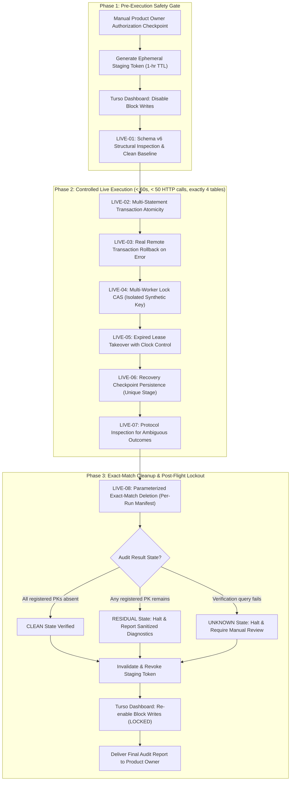

# Efso Radar — Phase 5B.3G: Controlled Live Turso Staging Reliability Validation

**Document Version:** 2.0.0  
**Status:** Architectural Specification & Operational Safety Plan (Revised Post-Review)  
**Security Classification:** Public Documentation (Zero Secrets / Zero Private Identifiers)  
**Target Database:** Turso Cloud Staging (`libsql://*.turso.io`)  
**Operating Budget Policy:** STRICTLY 0 TRY / \$0.00 spend ceiling  
**Prerequisite Milestones:** Phase 5B.3E (PR #10), Phase 5B.3F (PR #12, commit `390b13e`)  

---

## 1. Executive Summary & Purpose

Phase 5B.3G defines the operational engineering protocol for a **single, controlled, live validation session** against real Turso cloud staging infrastructure.

In Phase 5B.3F, comprehensive hermetic testing proved Hrana v2 transaction atomicity, ambiguous commit handling (`UNKNOWN`), barrier-synchronized multi-worker lease contention, and SQLite/Turso contract parity across 40 offline tests. Phase 5B.3G validates that the remote Turso libSQL server endpoint exhibits identical behavior under live HTTP transport, with **exact-match per-run record cleanup** and **zero financial spend**.



---

## 2. Strict Operational & Security Policies

All validation activities are bound by the following non-negotiable operational policies:

1. **Zero Financial Cost ($0.00 / 0 TRY Policy):**
   - The operational policy strictly requires \$0.00 / 0 TRY spend.
   - Defensive operational limits (**< 50 HTTP requests, < 10 row writes, < 2 MB bandwidth, execution < 60 seconds**) act as defensive circuit-breakers to strictly prevent resource over-utilization.
   - *Policy Clarification:* Request limits alone do not constitute an abstract mathematical guarantee against third-party platform billing or policy changes; rather, strict operational caps, ephemeral credentials, and immediate write-blocking provide defense-in-depth against unexpected charges.
2. **Database Isolation & Operational Safeguards:**
   - Operational SQLite database `data/radar.db`, ledger `data/state.json`, and `.env` are **strictly forbidden from access**.
   - Target host must match `libsql://*.turso.io` staging domain exclusively.
   - Production workers, Telegram dispatchers, RSS collectors, Gemini API, and backup engines remain **completely disabled**.
3. **Minimum Required Token Permissions:**
   - Dedicated staging-only token generated via Turso CLI or Dashboard.
   - Permission scope: Read/Write access restricted strictly to the single designated staging database (`efso-radar-staging`).
   - Zero organization permissions, zero database provisioning or deletion rights.
   - Immediate manual revocation upon session completion or error abort.
4. **Current Inactive Baseline:**
   - Throughout this planning phase, **Block Writes remains ON** and all tokens remain invalidated.

---

## 3. Exact Table Scope & Isolated Synthetic Manifest

### 3.1. Exact Four-Table Mutation Scope
The staging validation scope is strictly reconciled to exactly **four tables**. Ten business tables plus `schema_migrations` remain **100% read-only**:

| Table Name | Test Reference | Role in Phase 5B.3G | Synthetic Primary Key / Partition Value | Max Synthetic Rows |
| :--- | :--- | :--- | :--- | :---: |
| `processed_articles` | LIVE-02, LIVE-03 | Multi-statement commit atomicity & rollback | `article_id = 'synth-art-phase5b3g-01'` | 1 |
| `stories` | LIVE-02 | Multi-table transaction atomicity | `story_id = 'synth-story-phase5b3g-01'` | 1 |
| `run_locks` | LIVE-04, LIVE-05 | CAS contention & lease expiry (Raw SQL) | `lock_key = 'synth_lock_phase5b3g'` | 1 |
| `durable_recovery_state` | LIVE-06 | Checkpoint recovery & idempotency | `state_key = 'phase5b3g_synth_recovery::current'` | 1 |
| *All Other 11 Tables* | LIVE-01, LIVE-08 | **READ-ONLY STRUCTURAL AUDIT ONLY** | *Zero writes permitted* | **0** |

*Note on Scope Reconciliation:* `notifications` and `story_updates` were excluded from writes because LIVE-02 through LIVE-06 provide complete transaction atomicity, CAS, and recovery coverage with a smaller blast radius.

### 3.2. Per-Run Ownership Manifest
Unlike unsafe globbing or sweeping (`LIKE 'synth%'`), Phase 5B.3G enforces an explicit in-memory **Per-Run Ownership Manifest**. Every synthetic entity created during execution must register its exact primary key before write dispatch:

```python
@dataclass(frozen=True)
class SyntheticEntityOwnership:
    table: str
    pk_column: str
    pk_value: str
    cleanup_dependency_order: int  # Higher order cleaned first
```

Expected Manifest Entries:
1. `processed_articles` $\rightarrow$ `article_id = "synth-art-phase5b3g-01"` (order 2)
2. `stories` $\rightarrow$ `story_id = "synth-story-phase5b3g-01"` (order 1)
3. `run_locks` $\rightarrow$ `lock_key = "synth_lock_phase5b3g"` (order 1)
4. `durable_recovery_state` $\rightarrow$ `state_key = "phase5b3g_synth_recovery::current"` (order 1)

---

## 4. Controlled Live Test Specifications

### LIVE-01: Read-Only Preflight & Schema v6 Structural Inspection
- **Objective:** Verify staging database connectivity, schema integrity, and initial clean baseline without mutating any data.
- **Structural Checks:**
  - Presence of all 15 Schema v6 tables.
  - Column counts and data types matching all 129 column definitions.
  - Presence of all 13 canonical secondary indexes.
  - Presence of unique constraint on `telegram_delivery_records` (`recipient_chat_id + message_key`).
  - Migration version: `MAX(version) == 6` in `schema_migrations`.
- **Schema Fingerprint Non-Mutation Guarantee:**
  - `CloudPreflightValidator` computes an MD5 digest of `sqlite_master` object definitions immediately prior to inspection (`schema_fingerprint_before`) and immediately after inspection (`schema_fingerprint_after`).
  - Asserts `schema_fingerprint_before == schema_fingerprint_after` to prove the inspection executed non-mutating queries only.
  - *Correction Note:* The fingerprint verifies non-mutation during inspection; it is not compared against an externally fixed static hash.
- **Baseline Audit:** Executes exact-match queries for manifest keys to confirm zero pre-existing rows exist before writes begin.

### LIVE-02: Hrana v2 Multi-Statement Transaction Atomicity
- **Objective:** Prove multi-statement atomic commits succeed over real HTTP Hrana v2 transport.
- **Method:** `TursoHTTPClient.execute_transaction()` sends `BEGIN`, `INSERT` into `processed_articles`, `INSERT` into `stories`, and `COMMIT` within a single session baton.
- **Expected Outcome:**
  - Server returns a valid session baton.
  - `COMMIT` confirmation returns HTTP 200 containing a complete `execute` result structure (`type == "execute"` with inner `result` object).
  - Exact-match read queries confirm both records exist simultaneously in staging.

### LIVE-03: Real Remote Transaction Rollback on Statement Error
- **Objective:** Verify remote libSQL server aborts and rolls back a multi-statement transaction upon statement error.
- **Method:** `execute_transaction()` sends `BEGIN`, valid `INSERT` into `processed_articles` (`synth-art-phase5b3g-02`), and an invalid second statement violating a `NOT NULL` constraint.
- **Expected Outcome:**
  - Server reports error on statement 2.
  - Client issues `ROLLBACK` and closes session baton.
  - Sanitized `TursoClientError` raised with zero untrusted strings echoed.
  - Exact-match query confirms `synth-art-phase5b3g-02` was **not** persisted (0 rows inserted).

### LIVE-04: Multi-Worker Run Lock CAS & Idempotent Ownership (Isolated Synthetic Key)
- **Production Method Isolation Notice:**
  - `TursoStateRepository.acquire_run_lock()`, `renew_run_lock()`, and `release_run_lock()` hardcode `lock_key = 'radar_cron'`.
  - To prevent any risk of touching or overwriting the operational lock identity, LIVE-04 and LIVE-05 **do not call these production repository methods directly**.
  - Instead, LIVE-04 and LIVE-05 execute **isolated raw SQL queries** targeting the synthetic key `lock_key = 'synth_lock_phase5b3g'`.
  - *Explicit Guarantee:* This tests the remote libSQL database CAS semantics (`INSERT ... ON CONFLICT(lock_key) DO UPDATE ... WHERE expires_at < ? OR worker_id = ?`) under live HTTP transport, strictly isolated from production lock state.
- **Method:**
  - Worker Alpha executes CAS query for `synth_lock_phase5b3g` with 5-minute lease at timestamp $t_0$.
  - Worker Beta executes CAS query for `synth_lock_phase5b3g` at timestamp $t_0$ $\rightarrow$ affected rows must be 0 (`False`).
  - Worker Alpha executes CAS query at timestamp $t_0$ $\rightarrow$ affected rows must be 1 (idempotent owner renewal `True`).
- **Expected Outcome:** Exactly one worker holds ownership; conflicting worker is rejected.

### LIVE-05: Expired Lease Takeover with Clock Progression (Isolated Synthetic Key)
- **Method:**
  - Worker Alpha holds `synth_lock_phase5b3g` expiring at $t_0$.
  - Worker Beta executes CAS query with timestamp $t_0 + 6\text{ min}$ (past expiration).
- **Expected Outcome:**
  - Worker Beta CAS query succeeds (affected rows = 1), claiming ownership.
  - Exact-match read query confirms `worker_id == 'runner_beta'` for `lock_key = 'synth_lock_phase5b3g'`.

### LIVE-06: Recovery Checkpoint Persistence & Idempotency (Unique Stage)
- **Repository Contract Isolation Notice:**
  - `TursoStateRepository.save_recovery_state(stage, ...)` constructs `state_key = f"{stage}::current"`.
  - LIVE-06 uses a uniquely partitioned synthetic stage: `stage = "phase5b3g_synth_recovery"`, mapping to `state_key = "phase5b3g_synth_recovery::current"`.
  - *Explicit Guarantee:* Guaranteed never to collide with or overwrite production recovery stages (`rss_ingestion`, `curation`, `dispatch`).
- **Method:**
  - Verify `get_recovery_state("phase5b3g_synth_recovery")` returns `None`.
  - Call `save_recovery_state("phase5b3g_synth_recovery", "worker_test", {"cursor": 100})`.
  - Call `save_recovery_state("phase5b3g_synth_recovery", "worker_test", {"cursor": 100})` again (idempotent re-save).
- **Expected Outcome:**
  - State persisted accurately and re-saved idempotently.
  - Read-back confirms `state_payload["cursor"] == 100`.

### LIVE-07: Protocol Handling Protocol for Potential Ambiguous Outcomes
- **Scope Distinction:**
  - Network disconnection or 504 gateway timeout injection was verified hermetically in Phase 5B.3F.
  - LIVE-07 defines the **bounded handling protocol** if a real HTTP network drop or server gateway error happens to occur during live staging:
- **Handling Protocol:**
  1. If `TursoClientError` indicates `Ambiguous transaction outcome (UNKNOWN)`, **stop immediately**. Do NOT automatically retry.
  2. Perform read-only reconciliation:
     `SELECT 1 FROM processed_articles WHERE article_id = 'synth-art-phase5b3g-01'`
  3. If found, mark status as `COMMITTED_ORPHAN` and add to cleanup manifest.
  4. If not found, mark status as `NOT_COMMITTED`.
  5. Never execute blind write retries against an unknown transaction state.

### LIVE-08: Exact-Match Cleanup & Three-State Audit Verification
- **Removal of Globbing Sweeper:**
  - The unsafe `LIKE 'synth%'` sweeper is **completely removed**.
- **Parameterized Exact-Match Deletion:**
  - For each entity in `PerRunOwnershipManifest` (in cleanup dependency order):
    `DELETE FROM <table> WHERE <pk_column> = ?`, `[pk_value]`
- **Independent Three-State Audit Verification:**
  - For each registered entity in the manifest, execute an independent verification query:
    `SELECT COUNT(*) AS cnt FROM <table> WHERE <pk_column> = ?`, `[pk_value]`
  - Evaluate outcome state:
    1. **`CLEAN` State:** Every registered entity returns `cnt == 0`. Zero synthetic records remain in staging.
    2. **`RESIDUAL` State:** Any registered entity returns `cnt > 0`. Stop immediately, report sanitized diagnostic record (table, PK), and require manual investigation.
    3. **`UNKNOWN` State:** If verification query fails or connection drops. Stop immediately, report network diagnostic state, and require manual investigation. Do not retry writes.

---

## 5. Fail-Closed Abort Triggers & Emergency Lockdown

Execution must abort immediately and trigger security lockdown upon any of the following:

| Abort Trigger | Detection Mechanism | Immediate Action |
| :--- | :--- | :--- |
| **Schema Inconsistency** | Preflight finds $< 15$ tables, $< 129$ columns, or fingerprint mutation | Halt immediately; zero writes executed. |
| **Non-Synthetic Target** | Update affects $> 1$ row, or PK does not match manifest | Rollback; abort session; trigger exact-match cleanup. |
| **Request Cap Exceeded** | Cumulative HTTP calls reach 50 requests | Circuit-breaker trips; abort execution. |
| **Server Error** | HTTP status 500, 502, 503, 504 outside error tests | Halt; enter read-only inspection protocol; never retry. |
| **Cleanup Failure** | Exact-match deletion fails or audit returns `RESIDUAL`/`UNKNOWN` | Flag `RESIDUAL`/`UNKNOWN`; halt for manual operator review. |

### Universal Lockdown (Executed in `finally` block under all outcomes):
1. **Invalidate Token:** Operator manually invalidates staging token in Turso Dashboard.
2. **Re-Enable Block Writes:** Turso Dashboard setting **Block Writes: ON** restored immediately.
3. **Audit Log Emission:** Complete sanitized execution log presented to Product Owner.

---

## 6. Manual Product Owner Authorization Protocol

Live staging execution remains strictly blocked until the following manual checkpoint is satisfied:

```
[ ] 1. Product Owner reviews and approves this specification (v2.0.0) and Issue #13.
[ ] 2. Product Owner creates a staging-only, single-database ephemeral token (1-hour TTL).
[ ] 3. Product Owner disables Block Writes on database 'efso-radar-staging' in Turso Dashboard.
[ ] 4. Product Owner provides token via ephemeral environment variable (never stored on disk).
[ ] 5. Operator runs single-pass dry-run validated Phase 5B.3G runner (< 60s, < 50 requests).
[ ] 6. Three-state audit confirms CLEAN state (0 remaining synthetic rows).
[ ] 7. Product Owner re-enables Block Writes: ON and revokes staging token.
```
