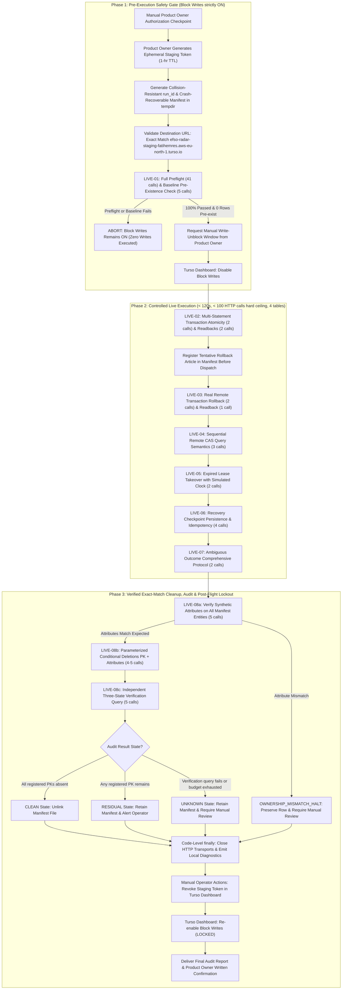
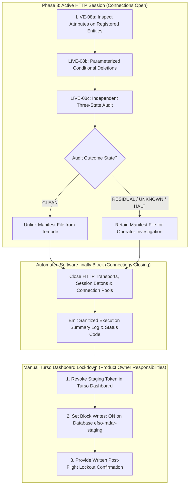

# Efso Radar — Phase 5B.3G: Controlled Live Turso Staging Reliability Validation

**Document Version:** 2.2.0  
**Status:** Architectural Specification & Operational Safety Plan (Final Post-Review Hardening)  
**Security Classification:** Public Documentation (Zero Secrets / Zero Private Identifiers)  
**Target Database:** Turso Cloud Staging (Exact Allowlist: `libsql://efso-radar-staging-fatihemres.aws-eu-north-1.turso.io`)  
**Operating Budget Policy:** STRICTLY 0 TRY / \$0.00 spend ceiling  
**Prerequisite Milestones:** Phase 5B.3E (PR #10), Phase 5B.3F (PR #12, commit `390b13e`)  

---

## 1. Executive Summary & Purpose

Phase 5B.3G defines the operational engineering protocol for a **single, controlled, live validation session** against real Turso cloud staging infrastructure.

In Phase 5B.3F, comprehensive hermetic testing proved Hrana v2 transaction atomicity, ambiguous commit handling (`UNKNOWN`), barrier-synchronized multi-worker lease contention, and SQLite/Turso contract parity across 40 offline tests. Phase 5B.3G validates that the remote Turso libSQL server endpoint exhibits identical behavior under live HTTP transport, with **crash-recoverable manifest tracking**, **pre-deletion ownership verification**, **parameterized conditional record cleanup**, and **zero financial spend**.



---

## 2. Strict Operational & Security Policies

All validation activities are bound by the following non-negotiable operational policies:

1. **Zero Financial Cost ($0.00 / 0 TRY Policy):**
   - The operational policy strictly requires \$0.00 / 0 TRY spend.
   - Defensive operational limits (**Strictly < 100 HTTP requests hard ceiling, < 10 row writes, < 2 MB bandwidth, execution < 120 seconds**) act as defensive circuit-breakers to strictly prevent resource over-utilization.
   - *Policy Clarification:* Request limits alone do not constitute an abstract mathematical guarantee against third-party platform billing or policy changes; rather, strict operational caps, ephemeral credentials, and immediate write-blocking provide defense-in-depth against unexpected charges.
2. **Exact Destination Allowlist & Isolation:**
   - The remote staging database destination is strictly allowlisted to:
     `libsql://efso-radar-staging-fatihemres.aws-eu-north-1.turso.io`  
     (and HTTPS endpoint `https://efso-radar-staging-fatihemres.aws-eu-north-1.turso.io`).
   - Wildcard destinations (`*.turso.io`) are strictly prohibited. Any destination differing from the exact allowlist fails closed immediately with `PermissionError`.
   - Operational SQLite database `data/radar.db`, ledger `data/state.json`, and `.env` are **strictly forbidden from access**.
   - Production workers, Telegram dispatchers, RSS collectors, Gemini API, and backup engines remain **completely disabled**.
3. **Minimum Required Token Permissions:**
   - Dedicated staging-only token generated via Turso CLI or Dashboard.
   - Permission scope: Read/Write access restricted strictly to the single designated staging database (`efso-radar-staging`).
   - Zero organization permissions, zero database provisioning or deletion rights.
   - Immediate manual revocation upon session completion or error abort.
4. **Read-Only Gate Under Block Writes: ON:**
   - Read-only preflight and baseline collision checks are completed **while Block Writes remains strictly ON**.
   - The manual write-unblock window is requested from the Product Owner if and only if preflight and baseline checks pass 100%.

---

## 3. Exact Table Scope, Synthetic Collision Resistance & Crash-Recoverable Manifest

### 3.1. Authoritative Schema v6 Table Classification (15 Tables)
The staging validation scope is strictly reconciled against the actual 15 Schema v6 tables verified by `CloudPreflightValidator`:

| Table Name | Test Reference | Role in Phase 5B.3G | Synthetic Primary Key / Partition Value | Max Synthetic Rows |
| :--- | :--- | :--- | :--- | :---: |
| `processed_articles` | LIVE-02, LIVE-03 | Multi-statement commit atomicity & rollback | `article_id = f"synth_art_{run_id}_01"`<br>`article_id = f"synth_art_{run_id}_02_rollback"` | 2 (1 persisted, 1 tentative) |
| `stories` | LIVE-02 | Multi-table transaction atomicity | `story_id = f"synth_story_{run_id}_01"` | 1 |
| `run_locks` | LIVE-04, LIVE-05 | CAS query semantics & lease expiry (Raw SQL) | `lock_key = f"synth_lock_{run_id}"` | 1 |
| `durable_recovery_state` | LIVE-06 | Checkpoint recovery & idempotency | `state_key = f"synth_stage_{run_id}::current"` | 1 |
| **Strictly Read-Only Tables (11 Tables)** | LIVE-01, LIVE-08 | **READ-ONLY STRUCTURAL AUDIT ONLY** | *Zero writes permitted* | **0** |
| `schema_migrations` | LIVE-01 | Read-only version inspection (`SELECT MAX(version)`) | *None* | 0 |
| `story_updates` | LIVE-01 | Read-only schema & index inspection | *None* | 0 |
| `notifications` | LIVE-01 | Read-only schema & index inspection | *None* | 0 |
| `editorial_assessments` | LIVE-01 | Read-only schema & index inspection | *None* | 0 |
| `owner_feedback` | LIVE-01 | Read-only schema & column inspection | *None* | 0 |
| `candidate_backlog` | LIVE-01 | Read-only schema & index inspection | *None* | 0 |
| `ai_usage_ledger` | LIVE-01 | Read-only schema & index inspection | *None* | 0 |
| `telegram_delivery_records` | LIVE-01 | Read-only uniqueness metadata inspection | *None* | 0 |
| `admin_operational_reports` | LIVE-01 | Read-only schema & column inspection | *None* | 0 |
| `experiment_budget_history` | LIVE-01 | Read-only schema & index inspection | *None* | 0 |
| `scheduled_execution_history` | LIVE-01 | Read-only schema & index inspection | *None* | 0 |

*Correction Note:* All non-existent table references (`pending_candidates`, `operational_metrics`, `cost_log`, `rss_fetch_log`, `gemini_request_log`, `dead_letter_queue`, `quarantine_log`) are eliminated. Only the authoritative 15 Schema v6 tables are referenced.

### 3.2. Collision-Resistant Unique Run ID & Derived Identities
To prevent key collisions across runs, test sessions never use hardcoded or predictable synthetic IDs. Every session generates a cryptographically collision-resistant run identifier:
```python
# Format: run_<UTC_TIMESTAMP>_<HEX_RANDOM>
run_id = f"run_{datetime.now(timezone.utc).strftime('%Y%m%dT%H%M%SZ')}_{uuid.uuid4().hex[:12]}"
```

All entity identities, synthetic payloads, worker identities, and lock keys are strictly derived from this `run_id`:
1. `processed_articles` (LIVE-02): `article_id = f"synth_art_{run_id}_01"`
   - Content Marker: `title = f"SYNTH_ARTICLE_{run_id}_01"`, `source = "staging_synth_test"`
2. `stories` (LIVE-02): `story_id = f"synth_story_{run_id}_01"`
   - Content Marker: `headline_tr = f"SYNTH_STORY_{run_id}_01"`, `category = "synth_test"`
3. `processed_articles` (LIVE-03 rollback tentative): `article_id = f"synth_art_{run_id}_02_rollback"`
   - Content Marker: `title = f"SYNTH_ARTICLE_{run_id}_02_ROLLBACK"`, `source = "staging_synth_test"`
4. `run_locks` (LIVE-04, LIVE-05): `lock_key = f"synth_lock_{run_id}"`
   - Content Marker: `worker_id in (f"runner_alpha_{run_id}", f"runner_beta_{run_id}")`
5. `durable_recovery_state` (LIVE-06): stage is `f"synth_stage_{run_id}"`, yielding `state_key = f"synth_stage_{run_id}::current"`
   - Content Marker: `worker_id = f"synth_worker_{run_id}"`

### 3.3. Crash-Recoverable Ownership Manifest

#### Pre-Dispatch Registration Invariant
Every record that might potentially be written—including tentative records like the rollback article in LIVE-03—**MUST be registered and persisted to the on-disk manifest before the dispatch of its network request**.

#### Manifest Location & Storage Rules
- Persisted in an ephemeral OS temporary directory:  
  `manifest_path = Path(tempfile.gettempdir()) / f"efso_radar_staging_manifest_{run_id}.json"`
- **Strict Prohibition:** Never stored in the Git repository (`.git`, `src/`, `docs/`) and never stored in operational data directories (`data/`, `data/radar.db`, `data/state.json`).
- File permissions are restricted to the executing user account (`0600` on POSIX, ACL-restricted on Windows).

#### Zero-Secrets Invariant
- The manifest file records ONLY structural metadata:
  `run_id`, timestamp, table, pk_column, pk_value, cleanup_dependency_order, and expected attribute verification markers.
- **NEVER** persist tokens, passwords, database URLs, chat IDs, or private identifiers to the manifest file.

#### Manifest Schema
```json
{
  "run_id": "run_20261025T150000Z_a1b2c3d4e5f6",
  "created_at": "2026-10-25T15:00:00Z",
  "registered_entities": [
    {
      "table": "processed_articles",
      "pk_column": "article_id",
      "pk_value": "synth_art_run_20261025T150000Z_a1b2c3d4e5f6_01",
      "order": 2,
      "expected_attributes": {"source": "staging_synth_test", "title_prefix": "SYNTH_ARTICLE_"}
    },
    {
      "table": "stories",
      "pk_column": "story_id",
      "pk_value": "synth_story_run_20261025T150000Z_a1b2c3d4e5f6_01",
      "order": 1,
      "expected_attributes": {"category": "synth_test", "headline_prefix": "SYNTH_STORY_"}
    },
    {
      "table": "processed_articles",
      "pk_column": "article_id",
      "pk_value": "synth_art_run_20261025T150000Z_a1b2c3d4e5f6_02_rollback",
      "order": 2,
      "expected_attributes": {"source": "staging_synth_test", "title_prefix": "SYNTH_ARTICLE_"}
    },
    {
      "table": "run_locks",
      "pk_column": "lock_key",
      "pk_value": "synth_lock_run_20261025T150000Z_a1b2c3d4e5f6",
      "order": 1,
      "expected_attributes": {"worker_prefix": "runner_"}
    },
    {
      "table": "durable_recovery_state",
      "pk_column": "state_key",
      "pk_value": "synth_stage_run_20261025T150000Z_a1b2c3d4e5f6::current",
      "order": 1,
      "expected_attributes": {"worker_prefix": "synth_worker_"}
    }
  ]
}
```

#### Crash Recovery Limitations & Status
> [!IMPORTANT]
> **Storage Durability Limitation:** Storage in the OS temporary directory (`tempfile.gettempdir()`) is **best-effort process crash protection, NOT guaranteed persistent storage**. Operating systems may purge temporary directories upon reboot, under disk storage pressure, or through background maintenance services (e.g. Windows Storage Sense or POSIX tmpfs unmounts). Operators must not rely on temp directory retention across system restarts.
> 
> **Post-integration status (2026-10-26):** Under the earlier documentation-only Phase 5B.3G-A PR, live recovery was only a design. Subsequent integrated G-B now implements `--recover-manifest` **for offline manifest validation only**, using in-memory SQLite. It does not connect to Turso, establish remote CLEAN, mutate staging or delete the source manifest. A **live remote recovery procedure** remains unimplemented, and requires separate PO authorization.

> **Persistent Manifest Store Foundation (Phase 5B.3G-C, 2026-10-28 — Remediated Candidate, Round 3):**
> A candidate persistent manifest store (`PersistentManifestStore` / `HermeticTestManifestStore`) is introduced to provide durable on-disk file writes with fsync, lockfile concurrency protection, publication without overwrite, and hash seal verification outside volatile OS temp directories.
>
> **Safety Invariants & Remediation Specifications:**
> 1. *Fail-Closed Deletion & Post-Publication Preservation (P1-A):* In this offline-only foundation, persistent manifest deletion is strictly disabled / fail-closed. Passing `AuditOutcomeState.CLEAN` does not delete the file; it raises `ManifestStoreSecurityError` because offline modules cannot produce independent remote audit proofs. Manifests are strictly preserved under all outcomes (`UNKNOWN`, `RESIDUAL`, `FAILED`, `OFFLINE_VALIDATION_PASSED`).
> 2. *Atomic Publication Without Overwrite & Fallback Narrowing (P1-B, P2):* Replaced `os.replace` with a platform-correct publication primitive (`_publish_file_no_overwrite`) using Win32 `MoveFileWithProgressW` without `MOVEFILE_REPLACE_EXISTING` on Windows (raises `FileExistsError` on existing targets) and `renameat2(RENAME_NOREPLACE)` / `os.link` on POSIX. Fallback from `renameat2` to `os.link` is narrowed strictly to unsupported operations (`ENOSYS`, `EINVAL`, `EOPNOTSUPP`); real I/O or permission errors (`EIO`, `EPERM`, `EACCES`) fail closed immediately without blind alternative publication. Strictly blocks late target creation races and dangling symlinks; all publication failures clean up temporary artifacts.
> 3. *Complete Write, Fsync & Canonical Entity Validation (P1-B, P1-C):* Employs a full write-all loop preventing short writes, executes `os.fsync()`, performs pre-publication size and SHA-256 readback verification, synchronously fsyncs parent directory on POSIX (with fail-closed error escalation), and performs post-publication content verification. Validates all 5 synthetic entities against canonical allowlists prior to writing (rejecting invalid title, modified ownership markers, duplicate entities, or wrong cleanup orders). Leaked temporary files and lockfiles are strictly prevented on any failure.
> 4. *Fixture Ownership & Explicit Registration (P1 — Round 3):* Substring matching on `"pytest"` is strictly eliminated from `_is_authorized_test_fixture`. A directory is authorized if and only if it is an explicitly validated subpath of `HermeticTestManifestStore._AUTHORIZED_FIXTURE_ROOTS`. `register_authorized_fixture_root` strictly verifies active test execution context (`PYTEST_CURRENT_TEST`), candidate pre-existence, non-root temp location, no symlinks/reparse points, repository/home/system exclusion, and strictly owner-private POSIX mode 0700 permissions. Test workspaces are linked to trusted pytest fixtures via autouse fixture. Arbitrary test root registration, unauthorized directories with `"pytest"` in name, and direct `is_hermetic_test=True` bypass attempts fail closed without directory creation or chmod mutations.
> 5. *Lock Acquisition Ownership & Foreign Lockfile Preservation (P2 — Round 3):* In `_ManifestRunLock.__enter__` error paths, strict descriptor, inode/device (POSIX), and token verification is enforced before unlinking. Foreign lockfiles are never deleted or modified under any circumstances.
> 6. *Consistent Post-Publication Error Reporting (P2 — Round 3):* Any failure after canonical file publication (parent directory fsync, regular file inspection, readback OSError, byte length mismatch, content mismatch, or SHA-256 seal mismatch) consistently raises `ManifestStorePostPublicationError` explicitly stating an uncertain outcome, strictly prohibiting automatic retries, and preserving the canonical manifest file on disk fail-closed for forensic recovery.
> 7. *Durability Claims & Neutralized Authorization (P1-C, P1-D, P2):* Clarified as a candidate local persistent store foundation with documented platform limitations. Passing `live_authorized=True` is neutralized and rejected; live persistent writes fail closed (`PermissionError`) in this offline foundation. In-process store re-instantiation is documented as a *reopen simulation*, distinguished from real OS subprocess restart (verified via subprocess) and physical power-loss / machine reboot durability. Live staging write execution remains strictly unauthorized (offline-only engineering foundation).

---

## 4. Controlled Live Test Specifications

### LIVE-01: Read-Only Preflight & Baseline Pre-Existence Verification (Block Writes: ON)
- **Objective:** Verify staging database schema structure and confirm a 100% clean baseline prior to any write.
- **Execution State:** Executed **while Turso Block Writes is strictly ON**.
- **Preflight Inspection:**
  - Executes `CloudPreflightValidator.validate()` against staging Turso endpoint (41 HTTP calls).
  - Asserts `report.success is True`, all 15 Schema v6 tables present, all 129 columns valid, all 13 secondary indexes present, and critical uniqueness constraint on `telegram_delivery_records` verified.
  - Confirms schema fingerprint non-mutation invariant (`schema_fingerprint_before == schema_fingerprint_after`).
- **Baseline Pre-Existence Verification (Exact-Match Checks):**
  - Before any write dispatch, queries the remote database for each of the 5 registered manifest entities:
    `SELECT 1 FROM <table> WHERE <pk_column> = ?`, `[pk_value]` (5 HTTP calls).
  - Asserts that all 5 queries return 0 rows.
  - *Fail-Closed Abort:* If any registered entity pre-exists or preflight fails, execution immediately halts without requesting write unblocking.

### LIVE-02: Hrana v2 Multi-Statement Transaction Atomicity & Baton Read-Back
- **Precondition:** Product Owner has temporarily disabled Block Writes following successful LIVE-01.
- **Objective:** Prove multi-statement atomic commits succeed over real HTTP Hrana v2 transport.
- **Method:** `TursoHTTPClient.execute_transaction()` sends `BEGIN`, `INSERT` into `processed_articles` (`synth_art_{run_id}_01`), and `INSERT` into `stories` (`synth_story_{run_id}_01`).
- **Expected Outcome:**
  - Remote libSQL server returns a session baton in response 1.
  - Client issues `COMMIT` + `close` in response 2.
  - Commit confirmation returns HTTP 200 containing a complete `execute` result structure.
  - Read-back queries confirm both records persist with matching attributes (2 HTTP calls).

### LIVE-03: Real Remote Transaction Rollback on Statement Error
- **Ahead-of-Time Registration Requirement:**
  - The tentative rollback record (`synth_art_{run_id}_02_rollback`) **MUST be registered in the on-disk ownership manifest before dispatch**.
- **Method:**
  - `execute_transaction()` sends `BEGIN`, valid `INSERT` into `processed_articles` (`synth_art_{run_id}_02_rollback`), and an invalid second statement violating a `NOT NULL` constraint (`processed_articles.title`).
- **Expected Outcome:**
  - Server reports error on statement 2.
  - Client issues `ROLLBACK` + `close` over the baton.
  - Sanitized `TursoClientError` raised with zero untrusted strings echoed.
  - Read-back query confirms `synth_art_{run_id}_02_rollback` was **not** persisted (0 rows returned) (1 HTTP call).

### LIVE-04: Sequential Remote CAS Semantics & Ownership Enforcement (Isolated Synthetic Key)
- **Scope Clarification & Narrowed Claim:**
  - LIVE-04 explicitly tests **sequential remote Compare-And-Swap (CAS) query semantics** under HTTP transport (`INSERT ... ON CONFLICT(lock_key) DO UPDATE ... WHERE expires_at < ? OR worker_id = ?`).
  - *Scope Notice:* It does not test simultaneous multi-threaded socket contention over the wire (which was already proven hermetically offline with barrier synchronization in Phase 5B.3F).
  - Production lock methods (`acquire_run_lock`, etc.) hardcode `lock_key = 'radar_cron'` and are **NOT called**. LIVE-04 executes raw SQL targeting `lock_key = f"synth_lock_{run_id}"`.
- **Method:**
  - Runner Alpha executes CAS query with 5-minute lease at timestamp $t_0$ $\rightarrow$ affected rows = 1 (ownership acquired).
  - Runner Beta executes CAS query with same timestamp $t_0$ $\rightarrow$ affected rows = 0 (ownership rejected).
  - Runner Alpha executes CAS renewal query at timestamp $t_0$ $\rightarrow$ affected rows = 1 (idempotent owner renewal).
- **Expected Outcome:** Remote database enforces CAS conditional update semantics sequentially over HTTP (3 HTTP calls).

### LIVE-05: Expired Lease Takeover with Clock Progression (Isolated Synthetic Key)
- **Method:**
  - Runner Alpha holds `synth_lock_{run_id}` expiring at timestamp $t_0$.
  - Runner Beta executes CAS query simulating clock progression to $t_0 + 6\text{ min}$ (past expiration).
- **Expected Outcome:**
  - Runner Beta CAS query succeeds (affected rows = 1).
  - Read-back query confirms `worker_id == f"runner_beta_{run_id}"` (2 HTTP calls).

### LIVE-06: Recovery Checkpoint Persistence & Idempotency (Unique Synthetic Stage)
- **Repository Isolation Guarantee:**
  - `TursoStateRepository.save_recovery_state(stage, ...)` constructs `state_key = f"{stage}::current"`.
  - LIVE-06 uses uniquely partitioned synthetic stage `stage = f"synth_stage_{run_id}"`, yielding `state_key = f"synth_stage_{run_id}::current"`.
  - Guaranteed never to collide with production recovery stages (`rss_ingestion`, `curation`, `dispatch`).
- **Method:**
  - `get_recovery_state(stage)` confirms initial state is `None` (1 HTTP call).
  - `save_recovery_state(stage, f"synth_worker_{run_id}", {"cursor": 100})` persists checkpoint (1 HTTP call).
  - `save_recovery_state(stage, f"synth_worker_{run_id}", {"cursor": 100})` executes idempotent re-save (1 HTTP call).
  - `get_recovery_state(stage)` reads back persisted checkpoint (1 HTTP call).
- **Expected Outcome:** Checkpoint persisted and re-saved idempotently with matching cursor.

### LIVE-07: Ambiguous Outcome Protocol & Comprehensive Multi-Record Reconciliation
- **Handling Protocol for Uncertain Commits:**
  - If a real network disconnect or HTTP 500/502/503/504 gateway error occurs during `execute_transaction` COMMIT:
  - The client immediately halts write operations and raises `TursoClientError("Ambiguous transaction outcome (UNKNOWN)...")`.
  - **Comprehensive Multi-Record Inspection:**
    The inspection protocol must reconcile **all expected entities** in the transaction, not just a single article:
    1. Query 1: `SELECT 1 FROM processed_articles WHERE article_id = ?`, `[synth_art_id]`
    2. Query 2: `SELECT 1 FROM stories WHERE story_id = ?`, `[synth_story_id]`
  - **Outcome Classification:**
    - If **both** records exist $\rightarrow$ mark `COMMITTED_ORPHAN` and retain in manifest for cleanup.
    - If **neither** record exists $\rightarrow$ mark `NOT_COMMITTED`.
    - If **one exists and one is missing** $\rightarrow$ mark `PARTIAL_CORRUPTION_DETECTED` (libSQL atomicity failure); halt immediately for critical investigation.
    - If either reconciliation query fails or times out $\rightarrow$ status **MUST remain `UNKNOWN`**. Never assume absence or commit if verification cannot conclude. Halt and require manual review.

### LIVE-08: Pre-Deletion Ownership Verification, Parameterized Conditional Deletion & Three-State Audit

All steps of LIVE-08 are executed **while HTTP connection transports remain open**. Teardown and transport closure occur strictly after audit completion.

#### Step 8a: Explicit Ownership Verification Before Deletion
- **Safety Rule:** Never delete a record solely because its primary key matches.
- For all 5 registered entities in the manifest:
  - Query existing record: `SELECT * FROM <table> WHERE <pk_column> = ?`, `[pk_value]` (5 HTTP calls).
  - If record exists, verify that its payload contains the exact expected synthetic markers:
    - `processed_articles`: `title.startswith(f"SYNTH_ARTICLE_{run_id}")` and `source == "staging_synth_test"`
    - `stories`: `headline_tr.startswith(f"SYNTH_STORY_{run_id}")` and `category == "synth_test"`
    - `run_locks`: `worker_id in (f"runner_alpha_{run_id}", f"runner_beta_{run_id}")`
    - `durable_recovery_state`: `stage == f"synth_stage_{run_id}"` and `worker_id == f"synth_worker_{run_id}"`
- **Ownership Mismatch Halt:**
  - If any row exists whose attributes do NOT match the expected synthetic markers, **DO NOT DELETE IT**.
  - Halt execution immediately with status `OWNERSHIP_MISMATCH_HALT`, preserve the row, retain the manifest file, log sanitized diagnostic identifiers, and require manual review.

#### Step 8b: Parameterized Conditional Deletion (PK + Expected Attributes)
- Deletions are strictly conditional, requiring **both the exact primary key AND the expected synthetic ownership attributes** in the `WHERE` clause:
  1. `processed_articles`:
     `DELETE FROM processed_articles WHERE article_id = ? AND source = ? AND title LIKE ?`,  
     `[article_id, "staging_synth_test", f"SYNTH_ARTICLE_{run_id}%"]`
  2. `stories`:
     `DELETE FROM stories WHERE story_id = ? AND category = ? AND headline_tr LIKE ?`,  
     `[story_id, "synth_test", f"SYNTH_STORY_{run_id}%"]`
  3. `run_locks`:
     `DELETE FROM run_locks WHERE lock_key = ? AND (worker_id = ? OR worker_id = ?)`,  
     `[lock_key, f"runner_alpha_{run_id}", f"runner_beta_{run_id}"]`
  4. `durable_recovery_state`:
     `DELETE FROM durable_recovery_state WHERE state_key = ? AND stage = ? AND worker_id = ?`,  
     `[state_key, f"synth_stage_{run_id}", f"synth_worker_{run_id}"]`
- **Affected-Row Count Verification:**
  - For rows confirmed present in Step 8a: `affected_row_count` MUST be exactly 1.
  - If `affected_row_count == 0` on a row confirmed present: indicates concurrent mutation or ownership alteration; halt immediately, flag `RESIDUAL`, and retain manifest.
  - If `affected_row_count > 1`: immediate safety breach; halt immediately and alert operator.
  - For tentative rollback records confirmed absent in Step 8a: conditional deletion query may be dispatched or safely skipped; if dispatched, `affected_row_count` MUST be 0.
- Worst-case conditional deletion HTTP calls: 5 calls (4 nominal + 1 tentative rollback).

#### Step 8c: Independent Three-State Verification Audit
- For all 5 registered manifest entities, execute an independent verification query:
  `SELECT COUNT(*) AS cnt FROM <table> WHERE <pk_column> = ?`, `[pk_value]` (5 HTTP calls).
- **Audit Outcome States:**
  1. **`CLEAN` State:** Every registered entity returns `cnt == 0`. Zero synthetic rows remain. Unlink the on-disk manifest file.
  2. **`RESIDUAL` State:** Any registered entity returns `cnt > 0`. Preserve the on-disk manifest file. Halt and report sanitized diagnostics.
  3. **`UNKNOWN` State:** Any verification query fails, times out, or the request budget is exhausted before completing the audit. Preserve the on-disk manifest file. Halt and require manual review.

---

## 5. Request-Count Budget, Worst-Case Analysis & Failure Handling

### 5.1. Simulated vs. Worst-Case HTTP Call Breakdown
An empirical offline simulation against Schema v6 establishes the exact nominal and worst-case HTTP request requirements:

| Step Reference | Sub-Actions Executed | Nominal Calls | Worst-Case Calls (Tentative Record Persists) |
| :--- | :--- | :---: | :---: |
| **LIVE-01** | `CloudPreflightValidator.validate()` (15 tables, 129 cols, 11 idx, constraints, fingerprints) | 41 | 41 |
| **LIVE-01** | Baseline Pre-Existence Verification (exact queries for 5 manifest entities) | 5 | 5 |
| **LIVE-02** | Hrana v2 Transaction (BEGIN+stmts, COMMIT+close) + 2 read-backs | 4 | 4 |
| **LIVE-03** | Rollback Transaction (BEGIN+stmts, ROLLBACK+close) + 1 read-back | 3 | 3 |
| **LIVE-04** | Sequential Remote CAS Semantics (Alpha acquire, Beta conflict reject, Alpha renew) | 3 | 3 |
| **LIVE-05** | Expired Lease Takeover (Beta takeover CAS) + 1 read-back | 2 | 2 |
| **LIVE-06** | Recovery Checkpoint (Initial read, save, idempotent re-save, read-back) | 4 | 4 |
| **LIVE-07** | Ambiguous Outcome Reconciliation Protocol (Article read, story read) | 2 | 2 |
| **LIVE-08a** | Pre-Deletion Ownership Verification (attribute checks across manifest entities) | 5 | 5 |
| **LIVE-08b** | Parameterized Conditional Deletions (targeted deletes for verified entities) | 4 | 5 |
| **LIVE-08c** | Independent Three-State Audit (exact COUNT queries for all manifest entities) | 5 | 5 |
| **TOTAL CALLS** | **Complete Full-Session Execution** | **78** | **79** |

### 5.2. Hard Request Ceiling & Dedicated Cleanup Reserve
- **Single Hard Ceiling:** The request limit is set to **strictly < 100 HTTP requests**. There is NO variable allowance or higher ceiling under retry conditions.
- **Dedicated Cleanup Reserve (Planning Allowance):**
  - Exactly **20 HTTP requests are strictly reserved for LIVE-08 cleanup and audit** (worst-case requirement is 15 calls).
  - If cumulative HTTP calls reach **80 requests** during test steps LIVE-02 through LIVE-07, testing is immediately suspended and the runner transitions directly to LIVE-08 cleanup using its reserved allocation.
  - *Planning Allowance Notice:* The cleanup reserve is an operational planning allowance to prevent test steps from starving cleanup under nominal conditions; it is **NOT a mathematical guarantee of successful cleanup under network transport failures or cloud outages**.
  - *Architectural Inconsistency & Recommended Safe Policy Proposal (Open Proposal — NOT an Approved PO Decision):*
    - **Contradiction Identified:** The historical plan text above prescribes jumping directly from intermediate stages (LIVE-02..LIVE-07) to LIVE-08 upon reaching 80 requests. However, PR #35 enforces a strict monotonic stage sequence (`LIVE-01` -> preflight completed -> human window confirmed -> `LIVE-02` -> ... -> `LIVE-08`) at the wire security boundary, strictly prohibiting `LIVE-08` before stage sequence index 8 (`OUT_OF_ORDER_STAGE`).
    - **Recommended Safe Policy (Proposed):** In any early stage failure, abort, or 80-request cutoff prior to LIVE-08, **no automatic in-session cleanup is dispatched**. Execution halts immediately fail-closed, the persistent manifest is preserved on disk, session status is marked `UNKNOWN` or `FAILED`, transports are permanently invalidated (`close_session()`), and manual operator review is required. Any remote cleanup for incomplete sessions must be architected as an independent, separately authorized, and strictly audited recovery procedure rather than an in-session sequence bypass. No remote early-failure recovery is implemented under Phase 5B.3G-C.
- **Failure Handling on Budget Exhaustion Before Audit Completion:**
  - If unexpected query errors or connection retries cause cumulative calls to reach the hard 100-request ceiling before the 3-state audit can be fully completed, the runner **must not dispatch further requests**.
  - The outcome status is immediately marked **`UNKNOWN`**.
  - The on-disk manifest is preserved on disk in `tempfile.gettempdir()`.
  - A sanitized alert (`BUDGET_EXHAUSTED_AUDIT_INCOMPLETE`) is emitted.
  - Further execution halts for manual operator investigation and Product Owner review.

### 5.3. Execution Timeout
- A future authorized live session must remain **< 120 seconds**. Real remote latency and cleanup duration have not been verified. The integrated G-B simulator declares `SESSION_TIMEOUT_SECONDS = 120.0`, but does **not enforce a hard elapsed-time circuit breaker** for the full session.
- **G-C gate:** Implement and test a real session deadline including cleanup/audit; on expiry stop all unverified writes, retain an UNKNOWN/residual manifest and escalate to the operator. No live session is authorized.

### 5.4. Post-G-B code reconciliation (2026-10-26; OFFLINE evidence only)
- The preceding **78 nominal / 79 hypothetical persisted-rollback** table is a planning baseline, not a guarantee for every injected failure. The G-B test suite asserts **78 nominal** requests and permits **79 or 80** in its simulated persisted-rollback branch: the mock-only failure injection adds an extra INSERT. Corresponding LIVE-08 cleanup counts are **14 nominal / 15 injected-worst-case**. The strict **<100 dispatched requests** ceiling and 20-request cleanup reserve remain unchanged.
- **Simultaneous row occupancy differs from mutating SQL operations.** The G-B nominal test asserts four peak synthetic rows and 14 total mutating SQL operations, including updates/deletions. Define and separately check the plan's `<10 row writes` constraint before any live session rather than equating it with the number of mutating statements.
- G-B's `StagingSessionRunner` accepts only verified in-memory hermetic transports. It is **not** an integrated live G-C runner and implements no real Turso preflight, Block Writes sequencing, token handling, live cleanup, or live recovery. Basis: `src/efso_radar/staging/runner.py` and `tests/test_phase5b3g_b_hermetic_runner.py` at `main` `948f651c30cfb4b354696bdc48175580c0c4ae4a`. This records source/test assertions; no Windows test or remote operation was performed in this review.

---

## 6. Separation of Software Cleanup vs. Manual Dashboard Operations

Software-level execution and cloud platform administration must never be conflated. Software cannot guarantee third-party cloud dashboard settings or token revocations:



1. **Automated Software-Level Operations:**
   - Performs attribute verification, parameterized conditional deletions, and 3-state audit **before** closing HTTP resources.
   - Unlinks the manifest file if and only if `CLEAN` state is verified; preserves the manifest if `RESIDUAL`, `UNKNOWN`, or `OWNERSHIP_MISMATCH_HALT`.
   - In the `finally` block, cleanly closes `httpx.Client`, session batons, and transport pools, and emits local execution diagnostics.
2. **Manual Turso Dashboard Operations (Mandatory Human Responsibilities):**
   - Product Owner manually invalidates/revokes the staging token in the Turso Dashboard or CLI.
   - Product Owner manually verifies and re-enables **Block Writes: ON** on the `efso-radar-staging` database.
   - Product Owner provides explicit written post-flight confirmation that Block Writes is ON and the token is revoked.

---

## 7. Fail-Closed Abort Triggers & Emergency Lockdown

Execution must abort immediately and trigger lockdown upon any of the following triggers:

| Abort Trigger | Detection Mechanism | Immediate Action |
| :--- | :--- | :--- |
| **Destination Discrepancy** | Target URL does not match exact allowlisted staging hostname | Halt immediately; zero network calls dispatched. |
| **Schema Inconsistency** | Preflight finds $< 15$ tables, $< 129$ columns, or schema fingerprint mutation | Halt immediately; zero writes dispatched; Block Writes remains ON. |
| **Baseline Contamination** | Baseline pre-existence check returns $> 0$ rows for any manifest entity | Halt immediately; zero writes dispatched; Block Writes remains ON. |
| **Ownership Mismatch** | Pre-delete verification finds row with non-matching synthetic attributes | Halt immediately; DO NOT delete; flag `OWNERSHIP_MISMATCH_HALT`. |
| **Unexpected Affected Rows** | Conditional DELETE affects $> 1$ row, or 0 rows on a confirmed present entity | Halt immediately; flag `RESIDUAL`/`UNKNOWN`; retain manifest. |
| **Execution Request Cap** | Cumulative HTTP calls reach 80 requests before cleanup | Suspend test execution; enter LIVE-08 cleanup using 20 reserved calls. |
| **Hard Session Ceiling** | Cumulative HTTP calls reach 100 requests | Hard halt; flag `UNKNOWN`; retain manifest for manual review. |
| **Server Error** | HTTP status 500, 502, 503, 504 outside expected error tests | Halt; enter read-only inspection protocol; never retry blind writes. |
| **Cleanup Failure** | Conditional deletion fails or audit returns `RESIDUAL`/`UNKNOWN` | Flag `RESIDUAL`/`UNKNOWN`; retain manifest; alert operator. |

---

## 8. Manual Product Owner Authorization Protocol

Live staging execution remains strictly blocked until the following manual checkpoint is satisfied:

```
[ ] 1. Product Owner reviews and approves this specification (v2.2.0) and Issue #13.
[ ] 2. Product Owner creates a staging-only, single-database ephemeral token (1-hour TTL).
[ ] 3. Operator verifies exact staging destination URL and runs LIVE-01 while Block Writes is strictly ON.
[ ] 4. Preflight and baseline checks pass 100% (0 pre-existing rows); operator requests unblock window.
[ ] 5. Product Owner disables Block Writes on database 'efso-radar-staging' in Turso Dashboard.
[ ] 6. Operator runs Phase 5B.3G runner (< 120s, < 100 requests hard ceiling, 20-call cleanup reserve).
[ ] 7. LIVE-08 conditional deletions and 3-state audit confirm CLEAN state; manifest unlinked.
[ ] 8. Product Owner manually re-enables Block Writes: ON in Turso Dashboard.
[ ] 9. Product Owner manually revokes staging token and provides written confirmation.
```
