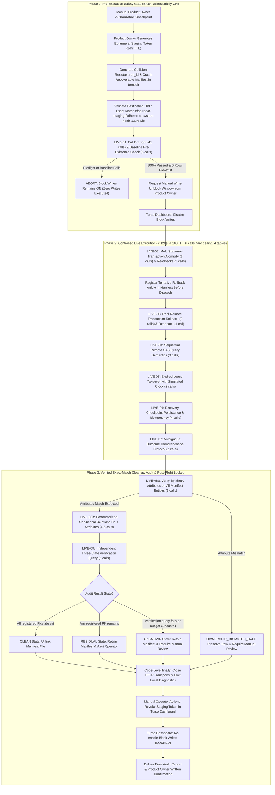
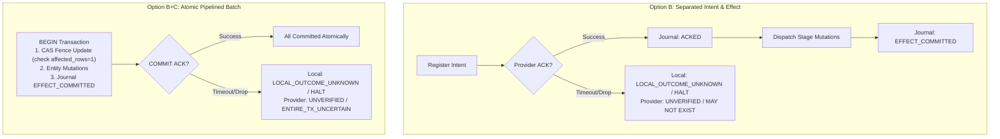
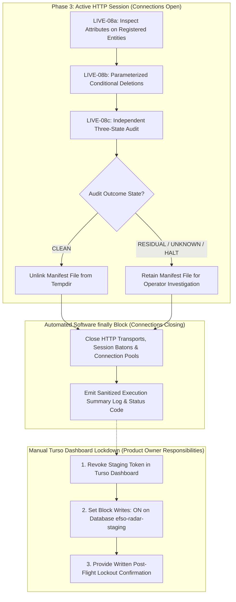

# Efso Radar — Phase 5B.3G: Controlled Live Turso Staging Reliability Validation

**Document Version:** 2.2.0  
**Status:** Architectural Specification & Operational Safety Plan (Final Post-Review Hardening)  
**Security Classification:** Public Documentation (Zero Secrets / Zero Private Identifiers)  
**Target Database:** Turso Cloud Staging (Exact Allowlist: `libsql://efso-radar-staging-fatihemres.aws-eu-north-1.turso.io`)  
**Operating Budget Policy:** STRICTLY 0 TRY / \$0.00 spend ceiling  
**Prerequisite Milestones:** Phase 5B.3E (PR #10), Phase 5B.3F (PR #12, commit `390b13e`)  

---

## 1. Executive Summary & Purpose

Phase 5B.3G defines the operational engineering protocol for a **single, controlled, live validation session** against real Turso cloud staging infrastructure.

In Phase 5B.3F, comprehensive hermetic testing proved Hrana v2 transaction atomicity, ambiguous commit handling (`UNKNOWN`), barrier-synchronized multi-worker lease contention, and SQLite/Turso contract parity across 40 offline tests. Phase 5B.3G validates that the remote Turso libSQL server endpoint exhibits identical behavior under live HTTP transport, with **crash-recoverable manifest tracking**, **pre-deletion ownership verification**, **parameterized conditional record cleanup**, and **zero financial spend**.



---

## 2. Strict Operational & Security Policies

All validation activities are bound by the following non-negotiable operational policies:

1. **Zero Financial Cost ($0.00 / 0 TRY Policy):**
   - The operational policy strictly requires \$0.00 / 0 TRY spend.
   - Defensive operational limits (**Strictly < 100 HTTP requests hard ceiling, < 10 row writes, < 2 MB bandwidth, execution < 120 seconds**) act as defensive circuit-breakers to strictly prevent resource over-utilization.
   - *Policy Clarification:* Request limits alone do not constitute an abstract mathematical guarantee against third-party platform billing or policy changes; rather, strict operational caps, ephemeral credentials, and immediate write-blocking provide defense-in-depth against unexpected charges.
2. **Exact Destination Allowlist & Isolation:**
   - The remote staging database destination is strictly allowlisted to:
     `libsql://efso-radar-staging-fatihemres.aws-eu-north-1.turso.io`  
     (and HTTPS endpoint `https://efso-radar-staging-fatihemres.aws-eu-north-1.turso.io`).
   - Wildcard destinations (`*.turso.io`) are strictly prohibited. Any destination differing from the exact allowlist fails closed immediately with `PermissionError`.
   - Operational SQLite database `data/radar.db`, ledger `data/state.json`, and `.env` are **strictly forbidden from access**.
   - Production workers, Telegram dispatchers, RSS collectors, Gemini API, and backup engines remain **completely disabled**.
3. **Minimum Required Token Permissions:**
   - Dedicated staging-only token generated via Turso CLI or Dashboard.
   - Permission scope: Read/Write access restricted strictly to the single designated staging database (`efso-radar-staging`).
   - Zero organization permissions, zero database provisioning or deletion rights.
   - Immediate manual revocation upon session completion or error abort.
4. **Read-Only Gate Under Block Writes: ON:**
   - Read-only preflight and baseline collision checks are completed **while Block Writes remains strictly ON**.
   - The manual write-unblock window is requested from the Product Owner if and only if preflight and baseline checks pass 100%.

---

## 3. Exact Table Scope, Synthetic Collision Resistance & Crash-Recoverable Manifest

### 3.1. Authoritative Schema v6 Table Classification (15 Tables)
The staging validation scope is strictly reconciled against the actual 15 Schema v6 tables verified by `CloudPreflightValidator`:

| Table Name | Test Reference | Role in Phase 5B.3G | Synthetic Primary Key / Partition Value | Max Synthetic Rows |
| :--- | :--- | :--- | :--- | :---: |
| `processed_articles` | LIVE-02, LIVE-03 | Multi-statement commit atomicity & rollback | `article_id = f"synth_art_{run_id}_01"`<br>`article_id = f"synth_art_{run_id}_02_rollback"` | 2 (1 persisted, 1 tentative) |
| `stories` | LIVE-02 | Multi-table transaction atomicity | `story_id = f"synth_story_{run_id}_01"` | 1 |
| `run_locks` | LIVE-04, LIVE-05 | CAS query semantics & lease expiry (Raw SQL) | `lock_key = f"synth_lock_{run_id}"` | 1 |
| `durable_recovery_state` | LIVE-06 | Checkpoint recovery & idempotency | `state_key = f"synth_stage_{run_id}::current"` | 1 |
| **Strictly Read-Only Tables (11 Tables)** | LIVE-01, LIVE-08 | **READ-ONLY STRUCTURAL AUDIT ONLY** | *Zero writes permitted* | **0** |
| `schema_migrations` | LIVE-01 | Read-only version inspection (`SELECT MAX(version)`) | *None* | 0 |
| `story_updates` | LIVE-01 | Read-only schema & index inspection | *None* | 0 |
| `notifications` | LIVE-01 | Read-only schema & index inspection | *None* | 0 |
| `editorial_assessments` | LIVE-01 | Read-only schema & index inspection | *None* | 0 |
| `owner_feedback` | LIVE-01 | Read-only schema & column inspection | *None* | 0 |
| `candidate_backlog` | LIVE-01 | Read-only schema & index inspection | *None* | 0 |
| `ai_usage_ledger` | LIVE-01 | Read-only schema & index inspection | *None* | 0 |
| `telegram_delivery_records` | LIVE-01 | Read-only uniqueness metadata inspection | *None* | 0 |
| `admin_operational_reports` | LIVE-01 | Read-only schema & column inspection | *None* | 0 |
| `experiment_budget_history` | LIVE-01 | Read-only schema & index inspection | *None* | 0 |
| `scheduled_execution_history` | LIVE-01 | Read-only schema & index inspection | *None* | 0 |

*Correction Note:* All non-existent table references (`pending_candidates`, `operational_metrics`, `cost_log`, `rss_fetch_log`, `gemini_request_log`, `dead_letter_queue`, `quarantine_log`) are eliminated. Only the authoritative 15 Schema v6 tables are referenced.

### 3.2. Collision-Resistant Unique Run ID & Derived Identities
To prevent key collisions across runs, test sessions never use hardcoded or predictable synthetic IDs. Every session generates a cryptographically collision-resistant run identifier:
```python
# Format: run_<UTC_TIMESTAMP>_<HEX_RANDOM>
run_id = f"run_{datetime.now(timezone.utc).strftime('%Y%m%dT%H%M%SZ')}_{uuid.uuid4().hex[:12]}"
```

All entity identities, synthetic payloads, worker identities, and lock keys are strictly derived from this `run_id`:
1. `processed_articles` (LIVE-02): `article_id = f"synth_art_{run_id}_01"`
   - Content Marker: `title = f"SYNTH_ARTICLE_{run_id}_01"`, `source = "staging_synth_test"`
2. `stories` (LIVE-02): `story_id = f"synth_story_{run_id}_01"`
   - Content Marker: `headline_tr = f"SYNTH_STORY_{run_id}_01"`, `category = "synth_test"`
3. `processed_articles` (LIVE-03 rollback tentative): `article_id = f"synth_art_{run_id}_02_rollback"`
   - Content Marker: `title = f"SYNTH_ARTICLE_{run_id}_02_ROLLBACK"`, `source = "staging_synth_test"`
4. `run_locks` (LIVE-04, LIVE-05): `lock_key = f"synth_lock_{run_id}"`
   - Content Marker: `worker_id in (f"runner_alpha_{run_id}", f"runner_beta_{run_id}")`
5. `durable_recovery_state` (LIVE-06): stage is `f"synth_stage_{run_id}"`, yielding `state_key = f"synth_stage_{run_id}::current"`
   - Content Marker: `worker_id = f"synth_worker_{run_id}"`

### 3.3. Crash-Recoverable Ownership Manifest

#### Pre-Dispatch Registration Invariant
Every record that might potentially be written—including tentative records like the rollback article in LIVE-03—**MUST be registered and persisted to the on-disk manifest before the dispatch of its network request**.

#### Manifest Location & Storage Rules
- Persisted in an ephemeral OS temporary directory:  
  `manifest_path = Path(tempfile.gettempdir()) / f"efso_radar_staging_manifest_{run_id}.json"`
- **Strict Prohibition:** Never stored in the Git repository (`.git`, `src/`, `docs/`) and never stored in operational data directories (`data/`, `data/radar.db`, `data/state.json`).
- File permissions are restricted to the executing user account (`0600` on POSIX, ACL-restricted on Windows).

#### Zero-Secrets Invariant
- The manifest file records ONLY structural metadata:
  `run_id`, timestamp, table, pk_column, pk_value, cleanup_dependency_order, and expected attribute verification markers.
- **NEVER** persist tokens, passwords, database URLs, chat IDs, or private identifiers to the manifest file.

#### Manifest Schema
```json
{
  "run_id": "run_20261025T150000Z_a1b2c3d4e5f6",
  "created_at": "2026-10-25T15:00:00Z",
  "registered_entities": [
    {
      "table": "processed_articles",
      "pk_column": "article_id",
      "pk_value": "synth_art_run_20261025T150000Z_a1b2c3d4e5f6_01",
      "order": 2,
      "expected_attributes": {"source": "staging_synth_test", "title_prefix": "SYNTH_ARTICLE_"}
    },
    {
      "table": "stories",
      "pk_column": "story_id",
      "pk_value": "synth_story_run_20261025T150000Z_a1b2c3d4e5f6_01",
      "order": 1,
      "expected_attributes": {"category": "synth_test", "headline_prefix": "SYNTH_STORY_"}
    },
    {
      "table": "processed_articles",
      "pk_column": "article_id",
      "pk_value": "synth_art_run_20261025T150000Z_a1b2c3d4e5f6_02_rollback",
      "order": 2,
      "expected_attributes": {"source": "staging_synth_test", "title_prefix": "SYNTH_ARTICLE_"}
    },
    {
      "table": "run_locks",
      "pk_column": "lock_key",
      "pk_value": "synth_lock_run_20261025T150000Z_a1b2c3d4e5f6",
      "order": 1,
      "expected_attributes": {"worker_prefix": "runner_"}
    },
    {
      "table": "durable_recovery_state",
      "pk_column": "state_key",
      "pk_value": "synth_stage_run_20261025T150000Z_a1b2c3d4e5f6::current",
      "order": 1,
      "expected_attributes": {"worker_prefix": "synth_worker_"}
    }
  ]
}
```

#### Crash Recovery Limitations & Status
> [!IMPORTANT]
> **Storage Durability Limitation:** Storage in the OS temporary directory (`tempfile.gettempdir()`) is **best-effort process crash protection, NOT guaranteed persistent storage**. Operating systems may purge temporary directories upon reboot, under disk storage pressure, or through background maintenance services (e.g. Windows Storage Sense or POSIX tmpfs unmounts). Operators must not rely on temp directory retention across system restarts.
> 
> **Post-integration status (2026-10-26):** Under the earlier documentation-only Phase 5B.3G-A PR, live recovery was only a design. Subsequent integrated G-B now implements `--recover-manifest` **for offline manifest validation only**, using in-memory SQLite. It does not connect to Turso, establish remote CLEAN, mutate staging or delete the source manifest. A **live remote recovery procedure** remains unimplemented, and requires separate PO authorization.

> **Persistent Manifest Store Foundation (Phase 5B.3G-C, 2026-10-28 — Remediated Candidate, Round 4):**
> A candidate persistent manifest store (`PersistentManifestStore` / `HermeticTestManifestStore`) is introduced to provide durable on-disk file writes with fsync, lockfile concurrency protection, publication without overwrite, and hash seal verification outside volatile OS temp directories.
>
> **Safety Invariants & Remediation Specifications:**
> 1. *Fail-Closed Deletion & Post-Publication Preservation (P1-A):* In this offline-only foundation, persistent manifest deletion is strictly disabled / fail-closed. Passing `AuditOutcomeState.CLEAN` does not delete the file; it raises `ManifestStoreSecurityError` because offline modules cannot produce independent remote audit proofs. Manifests are strictly preserved under all outcomes (`UNKNOWN`, `RESIDUAL`, `FAILED`, `OFFLINE_VALIDATION_PASSED`).
> 2. *Atomic Publication Without Overwrite & Fallback Narrowing (P1-B, P2):* Replaced `os.replace` with a platform-correct publication primitive (`_publish_file_no_overwrite`) using Win32 `MoveFileWithProgressW` without `MOVEFILE_REPLACE_EXISTING` on Windows (raises `FileExistsError` on existing targets) and `renameat2(RENAME_NOREPLACE)` / `os.link` on POSIX. Fallback from `renameat2` to `os.link` is narrowed strictly to unsupported operations (`ENOSYS`, `EINVAL`, `EOPNOTSUPP`); real I/O or permission errors (`EIO`, `EPERM`, `EACCES`) fail closed immediately without blind alternative publication. Strictly blocks late target creation races and dangling symlinks; all publication failures clean up temporary artifacts.
> 3. *Complete Write, Fsync & Canonical Entity Validation (P1-B, P1-C):* Employs a full write-all loop preventing short writes, executes `os.fsync()`, performs pre-publication size and SHA-256 readback verification, synchronously fsyncs parent directory on POSIX (with fail-closed error escalation), and performs post-publication content verification. Validates all 5 synthetic entities against canonical allowlists prior to writing (rejecting invalid title, modified ownership markers, duplicate entities, or wrong cleanup orders). Leaked temporary files and lockfiles are strictly prevented on any failure.
> 4. *Trusted Test Fixture Boundary & Scoped Fixtures (P1 — Round 4):* `PYTEST_CURRENT_TEST`, `pytest in sys.modules`, or mutable test mode flags are eliminated as authorization/ownership proof. A dedicated `HermeticTestFixtureScope` context manager/factory carries the trusted scope directly from pytest's `tmp_path`. Candidate fixture validation enforces structural pytest fixture provenance (`pytest-of-*` / `pytest-*` directory tree within system temporary storage), pre-existence, non-root temp location, no symlinks/reparse points, repository/home/system exclusion, and strictly owner-private POSIX mode 0700 permissions. `register_authorized_fixture_root()` is reduced strictly to internal trusted-harness delegation to `HermeticTestFixtureScope`. Fake `PYTEST_CURRENT_TEST` environment variables cannot authorize non-pytest temporary directories.
> 5. *Threat Model Clarification (Round 4):* Hermetic test mode and fixture scoping are explicitly documented as structural test harness guardrails preventing test stores from accidentally targeting or mutating production, repository, or arbitrary user directories. They do NOT provide a security or privilege-separation boundary against hostile in-process Python code running under the same OS user.
> 6. *Lockfile Ownership & Empty Content Correction (P2 — Round 4):* In `_ManifestRunLock._release_lock_if_owned()`, empty content (`content == ""`) is NEVER treated as proof of ownership. Unacquired lock cleanup is permitted only if file descriptor and filesystem identity (inode and device on POSIX and Windows) match the active open descriptor from the acquisition attempt. Foreign lockfiles (both empty and containing foreign tokens) are never unlinked under contention or release attempts across Windows and POSIX.
> 7. *Consistent Post-Publication Error Reporting (P2):* Any failure after canonical file publication (parent directory fsync, regular file inspection, readback OSError, byte length mismatch, content mismatch, or SHA-256 seal mismatch) consistently raises `ManifestStorePostPublicationError` explicitly stating an uncertain outcome, strictly prohibiting automatic retries, and preserving the canonical manifest file on disk fail-closed for forensic recovery.
> 8. *Durability Claims & Neutralized Authorization (P1-C, P1-D, P2):* Clarified as a candidate local persistent store foundation with documented platform limitations. Passing `live_authorized=True` is neutralized and rejected; live persistent writes fail closed (`PermissionError`) in this offline foundation. In-process store re-instantiation is documented as a *reopen simulation*, distinguished from real OS subprocess restart (verified via subprocess) and physical power-loss / machine reboot durability. Live staging write execution remains strictly unauthorized (offline-only engineering foundation).

---

## 4. Controlled Live Test Specifications

### LIVE-01: Read-Only Preflight & Baseline Pre-Existence Verification (Block Writes: ON)
- **Objective:** Verify staging database schema structure and confirm a 100% clean baseline prior to any write.
- **Execution State:** Executed **while Turso Block Writes is strictly ON**.
- **Preflight Inspection:**
  - Executes `CloudPreflightValidator.validate()` against staging Turso endpoint (41 HTTP calls).
  - Asserts `report.success is True`, all 15 Schema v6 tables present, all 129 columns valid, all 13 secondary indexes present, and critical uniqueness constraint on `telegram_delivery_records` verified.
  - Confirms schema fingerprint non-mutation invariant (`schema_fingerprint_before == schema_fingerprint_after`).
- **Baseline Pre-Existence Verification (Exact-Match Checks):**
  - Before any write dispatch, queries the remote database for each of the 5 registered manifest entities:
    `SELECT 1 FROM <table> WHERE <pk_column> = ?`, `[pk_value]` (5 HTTP calls).
  - Asserts that all 5 queries return 0 rows.
  - *Fail-Closed Abort:* If any registered entity pre-exists or preflight fails, execution immediately halts without requesting write unblocking.

### LIVE-02: Hrana v2 Multi-Statement Transaction Atomicity & Baton Read-Back
- **Precondition:** Product Owner has temporarily disabled Block Writes following successful LIVE-01.
- **Objective:** Prove multi-statement atomic commits succeed over real HTTP Hrana v2 transport.
- **Method:** `TursoHTTPClient.execute_transaction()` sends `BEGIN`, `INSERT` into `processed_articles` (`synth_art_{run_id}_01`), and `INSERT` into `stories` (`synth_story_{run_id}_01`).
- **Expected Outcome:**
  - Remote libSQL server returns a session baton in response 1.
  - Client issues `COMMIT` + `close` in response 2.
  - Commit confirmation returns HTTP 200 containing a complete `execute` result structure.
  - Read-back queries confirm both records persist with matching attributes (2 HTTP calls).

### LIVE-03: Real Remote Transaction Rollback on Statement Error
- **Ahead-of-Time Registration Requirement:**
  - The tentative rollback record (`synth_art_{run_id}_02_rollback`) **MUST be registered in the on-disk ownership manifest before dispatch**.
- **Method:**
  - `execute_transaction()` sends `BEGIN`, valid `INSERT` into `processed_articles` (`synth_art_{run_id}_02_rollback`), and an invalid second statement violating a `NOT NULL` constraint (`processed_articles.title`).
- **Expected Outcome:**
  - Server reports error on statement 2.
  - Client issues `ROLLBACK` + `close` over the baton.
  - Sanitized `TursoClientError` raised with zero untrusted strings echoed.
  - Read-back query confirms `synth_art_{run_id}_02_rollback` was **not** persisted (0 rows returned) (1 HTTP call).

### LIVE-04: Sequential Remote CAS Semantics & Ownership Enforcement (Isolated Synthetic Key)
- **Scope Clarification & Narrowed Claim:**
  - LIVE-04 explicitly tests **sequential remote Compare-And-Swap (CAS) query semantics** under HTTP transport (`INSERT ... ON CONFLICT(lock_key) DO UPDATE ... WHERE expires_at < ? OR worker_id = ?`).
  - *Scope Notice:* It does not test simultaneous multi-threaded socket contention over the wire (which was already proven hermetically offline with barrier synchronization in Phase 5B.3F).
  - Production lock methods (`acquire_run_lock`, etc.) hardcode `lock_key = 'radar_cron'` and are **NOT called**. LIVE-04 executes raw SQL targeting `lock_key = f"synth_lock_{run_id}"`.
- **Method:**
  - Runner Alpha executes CAS query with 5-minute lease at timestamp $t_0$ $\rightarrow$ affected rows = 1 (ownership acquired).
  - Runner Beta executes CAS query with same timestamp $t_0$ $\rightarrow$ affected rows = 0 (ownership rejected).
  - Runner Alpha executes CAS renewal query at timestamp $t_0$ $\rightarrow$ affected rows = 1 (idempotent owner renewal).
- **Expected Outcome:** Remote database enforces CAS conditional update semantics sequentially over HTTP (3 HTTP calls).

### LIVE-05: Expired Lease Takeover with Clock Progression (Isolated Synthetic Key)
- **Method:**
  - Runner Alpha holds `synth_lock_{run_id}` expiring at timestamp $t_0$.
  - Runner Beta executes CAS query simulating clock progression to $t_0 + 6\text{ min}$ (past expiration).
- **Expected Outcome:**
  - Runner Beta CAS query succeeds (affected rows = 1).
  - Read-back query confirms `worker_id == f"runner_beta_{run_id}"` (2 HTTP calls).

### LIVE-06: Recovery Checkpoint Persistence & Idempotency (Unique Synthetic Stage)
- **Repository Isolation Guarantee:**
  - `TursoStateRepository.save_recovery_state(stage, ...)` constructs `state_key = f"{stage}::current"`.
  - LIVE-06 uses uniquely partitioned synthetic stage `stage = f"synth_stage_{run_id}"`, yielding `state_key = f"synth_stage_{run_id}::current"`.
  - Guaranteed never to collide with production recovery stages (`rss_ingestion`, `curation`, `dispatch`).
- **Method:**
  - `get_recovery_state(stage)` confirms initial state is `None` (1 HTTP call).
  - `save_recovery_state(stage, f"synth_worker_{run_id}", {"cursor": 100})` persists checkpoint (1 HTTP call).
  - `save_recovery_state(stage, f"synth_worker_{run_id}", {"cursor": 100})` executes idempotent re-save (1 HTTP call).
  - `get_recovery_state(stage)` reads back persisted checkpoint (1 HTTP call).
- **Expected Outcome:** Checkpoint persisted and re-saved idempotently with matching cursor.

### LIVE-07: Ambiguous Outcome Protocol & Comprehensive Multi-Record Reconciliation
- **Handling Protocol for Uncertain Commits:**
  - If a real network disconnect or HTTP 500/502/503/504 gateway error occurs during `execute_transaction` COMMIT:
  - The client immediately halts write operations and raises `TursoClientError("Ambiguous transaction outcome (UNKNOWN)...")`.
  - **Comprehensive Multi-Record Inspection:**
    The inspection protocol must reconcile **all expected entities** in the transaction, not just a single article:
    1. Query 1: `SELECT 1 FROM processed_articles WHERE article_id = ?`, `[synth_art_id]`
    2. Query 2: `SELECT 1 FROM stories WHERE story_id = ?`, `[synth_story_id]`
  - **Outcome Classification:**
    - If **both** records exist $\rightarrow$ mark `COMMITTED_ORPHAN` and retain in manifest for cleanup.
    - If **neither** record exists $\rightarrow$ mark `NOT_COMMITTED`.
    - If **one exists and one is missing** $\rightarrow$ mark `PARTIAL_CORRUPTION_DETECTED` (libSQL atomicity failure); halt immediately for critical investigation.
    - If either reconciliation query fails or times out $\rightarrow$ status **MUST remain `UNKNOWN`**. Never assume absence or commit if verification cannot conclude. Halt and require manual review.

### LIVE-08: Pre-Deletion Ownership Verification, Parameterized Conditional Deletion & Three-State Audit

All steps of LIVE-08 are executed **while HTTP connection transports remain open**. Teardown and transport closure occur strictly after audit completion.

#### Step 8a: Explicit Ownership Verification Before Deletion
- **Safety Rule:** Never delete a record solely because its primary key matches.
- For all 5 registered entities in the manifest:
  - Query existing record: `SELECT * FROM <table> WHERE <pk_column> = ?`, `[pk_value]` (5 HTTP calls).
  - If record exists, verify that its payload contains the exact expected synthetic markers:
    - `processed_articles`: `title.startswith(f"SYNTH_ARTICLE_{run_id}")` and `source == "staging_synth_test"`
    - `stories`: `headline_tr.startswith(f"SYNTH_STORY_{run_id}")` and `category == "synth_test"`
    - `run_locks`: `worker_id in (f"runner_alpha_{run_id}", f"runner_beta_{run_id}")`
    - `durable_recovery_state`: `stage == f"synth_stage_{run_id}"` and `worker_id == f"synth_worker_{run_id}"`
- **Ownership Mismatch Halt:**
  - If any row exists whose attributes do NOT match the expected synthetic markers, **DO NOT DELETE IT**.
  - Halt execution immediately with status `OWNERSHIP_MISMATCH_HALT`, preserve the row, retain the manifest file, log sanitized diagnostic identifiers, and require manual review.

#### Step 8b: Parameterized Conditional Deletion (PK + Expected Attributes)
- Deletions are strictly conditional, requiring **both the exact primary key AND the expected synthetic ownership attributes** in the `WHERE` clause:
  1. `processed_articles`:
     `DELETE FROM processed_articles WHERE article_id = ? AND source = ? AND title LIKE ?`,  
     `[article_id, "staging_synth_test", f"SYNTH_ARTICLE_{run_id}%"]`
  2. `stories`:
     `DELETE FROM stories WHERE story_id = ? AND category = ? AND headline_tr LIKE ?`,  
     `[story_id, "synth_test", f"SYNTH_STORY_{run_id}%"]`
  3. `run_locks`:
     `DELETE FROM run_locks WHERE lock_key = ? AND (worker_id = ? OR worker_id = ?)`,  
     `[lock_key, f"runner_alpha_{run_id}", f"runner_beta_{run_id}"]`
  4. `durable_recovery_state`:
     `DELETE FROM durable_recovery_state WHERE state_key = ? AND stage = ? AND worker_id = ?`,  
     `[state_key, f"synth_stage_{run_id}", f"synth_worker_{run_id}"]`
- **Affected-Row Count Verification:**
  - For rows confirmed present in Step 8a: `affected_row_count` MUST be exactly 1.
  - If `affected_row_count == 0` on a row confirmed present: indicates concurrent mutation or ownership alteration; halt immediately, flag `RESIDUAL`, and retain manifest.
  - If `affected_row_count > 1`: immediate safety breach; halt immediately and alert operator.
  - For tentative rollback records confirmed absent in Step 8a: conditional deletion query may be dispatched or safely skipped; if dispatched, `affected_row_count` MUST be 0.
- Worst-case conditional deletion HTTP calls: 5 calls (4 nominal + 1 tentative rollback).

#### Step 8c: Independent Three-State Verification Audit
- For all 5 registered manifest entities, execute an independent verification query:
  `SELECT COUNT(*) AS cnt FROM <table> WHERE <pk_column> = ?`, `[pk_value]` (5 HTTP calls).
- **Audit Outcome States:**
  1. **`CLEAN` State:** Every registered entity returns `cnt == 0`. Zero synthetic rows remain. Unlink the on-disk manifest file.
  2. **`RESIDUAL` State:** Any registered entity returns `cnt > 0`. Preserve the on-disk manifest file. Halt and report sanitized diagnostics.
  3. **`UNKNOWN` State:** Any verification query fails, times out, or the request budget is exhausted before completing the audit. Preserve the on-disk manifest file. Halt and require manual review.

---

## 5. Request-Count Budget, Worst-Case Analysis & Failure Handling

### 5.1. Simulated vs. Worst-Case HTTP Call Breakdown
An empirical offline simulation against Schema v6 establishes the exact nominal and worst-case HTTP request requirements:

| Step Reference | Sub-Actions Executed | Nominal Calls | Worst-Case Calls (Tentative Record Persists) |
| :--- | :--- | :---: | :---: |
| **LIVE-01** | `CloudPreflightValidator.validate()` (15 tables, 129 cols, 11 idx, constraints, fingerprints) | 41 | 41 |
| **LIVE-01** | Baseline Pre-Existence Verification (exact queries for 5 manifest entities) | 5 | 5 |
| **LIVE-02** | Hrana v2 Transaction (BEGIN+stmts, COMMIT+close) + 2 read-backs | 4 | 4 |
| **LIVE-03** | Rollback Transaction (BEGIN+stmts, ROLLBACK+close) + 1 read-back | 3 | 3 |
| **LIVE-04** | Sequential Remote CAS Semantics (Alpha acquire, Beta conflict reject, Alpha renew) | 3 | 3 |
| **LIVE-05** | Expired Lease Takeover (Beta takeover CAS) + 1 read-back | 2 | 2 |
| **LIVE-06** | Recovery Checkpoint (Initial read, save, idempotent re-save, read-back) | 4 | 4 |
| **LIVE-07** | Ambiguous Outcome Reconciliation Protocol (Article read, story read) | 2 | 2 |
| **LIVE-08a** | Pre-Deletion Ownership Verification (attribute checks across manifest entities) | 5 | 5 |
| **LIVE-08b** | Parameterized Conditional Deletions (targeted deletes for verified entities) | 4 | 5 |
| **LIVE-08c** | Independent Three-State Audit (exact COUNT queries for all manifest entities) | 5 | 5 |
| **TOTAL CALLS** | **Complete Full-Session Execution** | **78** | **79** |

### 5.2. Hard Request Ceiling & Dedicated Cleanup Reserve
- **Single Hard Ceiling:** The request limit is set to **strictly < 100 HTTP requests**. There is NO variable allowance or higher ceiling under retry conditions.
- **Dedicated Cleanup Reserve (Planning Allowance):**
  - Exactly **20 HTTP requests are strictly reserved for LIVE-08 cleanup and audit** (worst-case requirement is 15 calls).
  - If cumulative HTTP calls reach **80 requests** during test steps LIVE-02 through LIVE-07, testing is immediately suspended and the runner transitions directly to LIVE-08 cleanup using its reserved allocation.
  - *Planning Allowance Notice:* The cleanup reserve is an operational planning allowance to prevent test steps from starving cleanup under nominal conditions; it is **NOT a mathematical guarantee of successful cleanup under network transport failures or cloud outages**.
  - *Architectural Inconsistency & Recommended Safe Policy Proposal (Open Proposal — NOT an Approved PO Decision):*
    - **Contradiction Identified:** The historical plan text above prescribes jumping directly from intermediate stages (LIVE-02..LIVE-07) to LIVE-08 upon reaching 80 requests. However, PR #35 enforces a strict monotonic stage sequence (`LIVE-01` -> preflight completed -> human window confirmed -> `LIVE-02` -> ... -> `LIVE-08`) at the wire security boundary, strictly prohibiting `LIVE-08` before stage sequence index 8 (`OUT_OF_ORDER_STAGE`).
    - **Recommended Safe Policy (Proposed):** In any early stage failure, abort, or 80-request cutoff prior to LIVE-08, **no automatic in-session cleanup is dispatched**. Execution halts immediately fail-closed, the persistent manifest is preserved on disk, session status is marked `UNKNOWN` or `FAILED`, transports are permanently invalidated (`close_session()`), and manual operator review is required. Any remote cleanup for incomplete sessions must be architected as an independent, separately authorized, and strictly audited recovery procedure rather than an in-session sequence bypass. No remote early-failure recovery is implemented under Phase 5B.3G-C.
- **Failure Handling on Budget Exhaustion Before Audit Completion:**
  - If unexpected query errors or connection retries cause cumulative calls to reach the hard 100-request ceiling before the 3-state audit can be fully completed, the runner **must not dispatch further requests**.
  - The outcome status is immediately marked **`UNKNOWN`**.
  - The on-disk manifest is preserved on disk in `tempfile.gettempdir()`.
  - A sanitized alert (`BUDGET_EXHAUSTED_AUDIT_INCOMPLETE`) is emitted.
  - Further execution halts for manual operator investigation and Product Owner review.

### 5.3. Execution Timeout
- A future authorized live session must remain **< 120 seconds**. Real remote latency and cleanup duration have not been verified. The integrated G-B simulator declares `SESSION_TIMEOUT_SECONDS = 120.0`, but does **not enforce a hard elapsed-time circuit breaker** for the full session.
- **G-C gate:** Implement and test a real session deadline including cleanup/audit; on expiry stop all unverified writes, retain an UNKNOWN/residual manifest and escalate to the operator. No live session is authorized.

### 5.4. Post-G-B code reconciliation (2026-10-26; OFFLINE evidence only)
- The preceding **78 nominal / 79 hypothetical persisted-rollback** table is a planning baseline, not a guarantee for every injected failure. The G-B test suite asserts **78 nominal** requests and permits **79 or 80** in its simulated persisted-rollback branch: the mock-only failure injection adds an extra INSERT. Corresponding LIVE-08 cleanup counts are **14 nominal / 15 injected-worst-case**. The strict **<100 dispatched requests** ceiling and 20-request cleanup reserve remain unchanged.
- **Simultaneous row occupancy differs from mutating SQL operations.** The G-B nominal test asserts four peak synthetic rows and 14 total mutating SQL operations, including updates/deletions. Define and separately check the plan's `<10 row writes` constraint before any live session rather than equating it with the number of mutating statements.
- G-B's `StagingSessionRunner` accepts only verified in-memory hermetic transports. It is **not** an integrated live G-C runner and implements no real Turso preflight, Block Writes sequencing, token handling, live cleanup, or live recovery. Basis: `src/efso_radar/staging/runner.py` and `tests/test_phase5b3g_b_hermetic_runner.py` at `main` `948f651c30cfb4b354696bdc48175580c0c4ae4a`. This records source/test assertions; no Windows test or remote operation was performed in this review.

### 5.5. Phase 5B.3G-C Live Readiness Gap Closure & Wire-Contract Matrix (2026-10-28; Issue #37)

#### 1. Compact LIVE-01–08 Readiness / Gap Matrix
The table below records the verified code and contract status across all 8 controlled staging stages, distinguishing `IMPLEMENTED`, `OFFLINE TESTED`, `NOT LIVE-WIRED`, and `PO GATED`:

| Stage | Name | Status | Allowed Wire Templates | Target Scope | Safety Invariants & Stop Contract |
| :--- | :--- | :--- | :--- | :--- | :--- |
| **LIVE-01** | Read-Only Preflight & Baseline Collision Check | `IMPLEMENTED`<br>`OFFLINE TESTED`<br>`NOT LIVE-WIRED`<br>`PO GATED` | 41 structural inspection queries + 5 baseline collision queries (`SELECT 1 AS found FROM <table> WHERE <pk> = ?`) | 15 Schema v6 tables (11 read-only + 4 synthetic) | Executed while Block Writes is strictly ON. Zero writes. Baseline pre-existence (>0 rows) immediately aborts session. |
| **LIVE-02** | Multi-Statement Transaction Atomicity & Readbacks | `IMPLEMENTED`<br>`OFFLINE TESTED`<br>`NOT LIVE-WIRED`<br>`PO GATED` | `INSERT INTO processed_articles`, `INSERT INTO stories`, 2 synthetic read-backs | `processed_articles` (`synth_art_{run_id}_01`), `stories` (`synth_story_{run_id}_01`) | Preflight + human approval window required. Baton validation. Failure halts fail-closed; preserves manifest on disk; marks UNKNOWN; no blind retry; prohibits LIVE-08 bypass. |
| **LIVE-03** | Remote Transaction Rollback on Statement Error | `IMPLEMENTED`<br>`OFFLINE TESTED`<br>`NOT LIVE-WIRED`<br>`PO GATED` | `INSERT INTO processed_articles` (duplicate PK), `SELECT article_id FROM processed_articles` | `processed_articles` (`synth_art_{run_id}_02_rollback`) | Ahead-of-time registration in manifest before dispatch. Intentional rollback. Read-back confirms 0 rows. Failure halts fail-closed; preserves manifest. |
| **LIVE-04** | Sequential Remote CAS Semantics & Ownership | `IMPLEMENTED`<br>`OFFLINE TESTED`<br>`NOT LIVE-WIRED`<br>`PO GATED` | `INSERT INTO run_locks ... ON CONFLICT(lock_key) DO UPDATE` (Alpha acquire, Beta conflict, Alpha renew) | `run_locks` (`synth_lock_{run_id}`) | Isolated synthetic key only. Beta conflict returns affected=0. Heartbeat update returns affected=1. Failure halts fail-closed; preserves manifest. |
| **LIVE-05** | Expired Lease Takeover with Clock Progression | `IMPLEMENTED`<br>`OFFLINE TESTED`<br>`NOT LIVE-WIRED`<br>`PO GATED` | CAS insert with $t_0 + 6\text{ min}$, read-back `SELECT worker_id FROM run_locks` | `run_locks` (`synth_lock_{run_id}`) | Simulated clock progression past expiration. Beta takeover returns affected=1. Failure halts fail-closed; preserves manifest. |
| **LIVE-06** | Recovery Checkpoint Persistence & Idempotency | `IMPLEMENTED`<br>`OFFLINE TESTED`<br>`NOT LIVE-WIRED`<br>`PO GATED` | Initial read, `INSERT INTO durable_recovery_state ... ON CONFLICT(state_key) DO UPDATE`, idempotent re-save, read-back | `durable_recovery_state` (`synth_stage_{run_id}::current`) | Uniquely partitioned synthetic stage. Cursor match verified. Failure halts fail-closed; preserves manifest. |
| **LIVE-07** | Ambiguous Outcome Protocol & Multi-Record Reconciliation | `IMPLEMENTED`<br>`OFFLINE TESTED`<br>`NOT LIVE-WIRED`<br>`PO GATED` | `SELECT 1 AS f FROM processed_articles WHERE article_id = ?`, `SELECT 1 AS f FROM stories WHERE story_id = ?` | `processed_articles`, `stories` | Reconciles both entities. Any discrepancy flags `PARTIAL_CORRUPTION_DETECTED` / `UNKNOWN`. Halts session; preserves manifest; zero blind write retries. |
| **LIVE-08** | Pre-Deletion Ownership Verification, Conditional Deletions & Three-State Audit | `IMPLEMENTED`<br>`OFFLINE TESTED`<br>`NOT LIVE-WIRED`<br>`PO GATED` | 8a: `SELECT * FROM <table> WHERE <pk> = ?` (5 remote statements across all 5 registered manifest entities; 5 HTTP calls if unbatched)<br>8b: Parameterized conditional `DELETE FROM <table> WHERE <pk> = ? AND <attrs>` (4 conditional DELETE statements for surviving rows, worst-case 5 if rollback had persisted; 4–5 HTTP calls if unbatched)<br>8c: `SELECT COUNT(*) AS cnt FROM <table> WHERE <pk> = ?` (5 audit queries across all 5 registered manifest entities; 5 HTTP calls if unbatched) | All 5 registered synthetic manifest entities (including tentative rollback entity) | Monotonic stage index 8 required. Full attribute precheck on all registered entities required before DELETE. Conditional delete requires affected_row_count == 1. 3-state audit (CLEAN/RESIDUAL/UNKNOWN) checking all 5 registered entities. Total remote statements: 14 nominal (5 + 4 + 5), up to 15 worst-case (5 + 5 + 5), distinct from HTTP request count if batched. Unlink manifest IF AND ONLY IF strictly CLEAN and PASSED. In offline foundation, persistent manifest store refuses deletion without verified remote proof. |

#### 2. Architecture Conflict Preservation: Historical 80-Request Cutoff vs. Monotonic Sequencing
- **Historical Runner Behavior (G-B):** The legacy `StagingSessionRunner` contained logic where reaching the 80-request test cutoff in `handle_request()` raised `TEST_CUTOFF_REACHED: Reached test step cutoff (80); entering cleanup`, after which the `finally` block jumped directly to `_run_live_08()`.
- **Integrated Architectural Conflict:** In the Phase 5B.3G-C outbound security boundary, jumping from an early stage (e.g. LIVE-03) directly to LIVE-08 contradicts the strictly monotonic stage sequence index requirement (`_stage_sequence_index == 8`). Jumping stages bypasses verified attributes and hazards attempting deletions without proof of what was written.
- **Fail-Closed Resolution:** When request cutoff (80) or any stage failure occurs before LIVE-08, execution aborts fail-closed (`CLEANUP_RESERVE_EXHAUSTED` / `TEST_CUTOFF`). The session status is set to `FAILED`, the audit state remains `UNKNOWN` or `RESIDUAL`, the manifest is preserved on disk, and the outbound security boundary session is permanently invalidated (`close_session()`, rejecting all further requests with `SESSION_HALTED`). In-session early cleanup bypass is strictly forbidden.
- **Separate Operator-Reviewed Recovery Dependency:** Any partial execution or early abort leaves tentative state that **requires a separate, independently authorized operator-reviewed recovery protocol**. Automatic retry or in-session cleanup is prohibited.

#### 3. Six Unwaived Live Readiness Blockers
Live Turso staging execution remains strictly unauthorized. The following technical and governance gates are open blockers that must be independently designed, reviewed, and authorized:
1. **Windows NTFS Owner-Private DACL Validation:** `PersistentManifestStore` currently validates POSIX 0700 permission bits; on Windows NTFS, owner-private DACL verification (ensuring non-elevated, non-shared ACLs) is not yet implemented for arbitrary local non-temp directories.
2. **Physical Power-Loss & Machine Reboot Semantics:** Process-crash durability is verified via subprocess execution against persisted files; physical power-loss / machine reboot persistence semantics across OS write buffers remains an open platform requirement.
3. **Live Transport Authorization Architecture:** Real HTTP transport (`httpx.HTTPTransport`) is permanently disabled by default. Enabling live transport requires an explicit architectural design with strict single-destination binding and zero capability of touching production.
4. **Remote Recovery Protocol:** An independently reviewed offline-to-online recovery runner that can consume an orphaned manifest, inspect remote state under Block Writes ON, and safely clean up orphaned entities has not yet been designed or authorized.
5. **Manual Block Writes & Ephemeral Token Revocation Evidence:** Post-flight lockdown in the operator candidate records an offline simulated assertion only; live execution requires external, out-of-band cryptographic proof or manual PO confirmation of dashboard Block Writes ON and token revocation.
6. **Commercial Policy Research & Invariant Verification (\$0.00 / 0 TRY):** Current official Turso Cloud Free pricing specifies **100 databases, 5 GB storage, 500M monthly row reads, 10M monthly row writes** (and 3 GB syncs/month) (the previously cited 9 GB storage and 25M writes belong to the paid Developer tier). Official pricing also notes that automatic per-unit extra charges occur when overages are enabled. However, **the actual owner account's plan, billing status, overage toggle, and quota headroom cannot be verified from repository records**. Live operations remain permanently blocked under the strict \$0.00 / 0 TRY hard ceiling, and agents must not query or inspect the cloud billing account without explicit per-operation PO authorization.

---

### 5.6. Issue #39 — Offline orphan evidence review contract (2026-10-29)

**Candidate implementation, not live recovery or PO acceptance.** `staging/offline_recovery_evidence.py` provides `review_recovery_evidence(expected_run_id=..., manifest_bytes=..., sealed_sha256=..., snapshot=...)`. The caller supplies only test-owned manifest bytes, the previously captured `OfflineManifestSeal.sha256`, and a typed `HermeticSnapshot`; the classifier performs no I/O. The existing canonical `PerRunOwnershipManifest.validate_payload` is shared with file validation, avoiding a second inventory/schema. The new byte boundary additionally rejects coercion and duplicate JSON keys. No existing `--recover-manifest` or persistent-store report fields change.

Snapshot bounds: at most five observations, each bound to an exact canonical table/PK column/PK value, at most two rows per observation, at most three projected PK/ownership columns, column names up to 64 characters and values up to 512. Inputs are mock observations, not authenticated remote proof. A caller-supplied digest is an integrity comparison, not an ownership, durable-storage or authorization certificate. The pure function cannot validate filesystem ownership/existence itself: missing bytes are reported as missing evidence; file safety stays with the existing owned fixture store/seal boundary. No path, transport, repository, callback, credentials or arbitrary query text is accepted.

Argon review remediation: shared canonical run-ID validation requires ASCII digits and strict whole-string matching, rejecting Unicode digits and trailing newlines. Only the new classifier byte boundary requires `created_at` to match a bounded ASCII ISO-8601 profile (20-32 characters: seconds, optional 1-6 fractional digits, and `Z` or a numeric `±HH:MM` offset), with real calendar/timezone validation. Malformed or secret-contaminated metadata yields sanitized `INVALID` / `UNKNOWN`. Historical store timestamp parsing is not changed.

| Evidence | Entity classification / review result |
| --- | --- |
| Successful mock query, zero rows | `ABSENT_IN_SIMULATION`; all five absent => `REVIEW_REQUIRED`, never proof of rollback or remote absence |
| Exactly one row, exact PK and every canonical ownership marker | `PRESENT_OWNED`; consistent remnants => simulated `RESIDUAL` |
| Wrong supplied canonical PK/ownership marker in an `OBSERVED` row | `OWNERSHIP_MISMATCH` / `OWNERSHIP_MISMATCH_HALT` takes precedence over missing/extra columns and duplicate rows/observations within the existing snapshot bounds; raw mismatched values never appear in the report. Failed/unavailable/ambiguous queries never provide confirmed ownership proof. |
| Missing projected fields, absent observation, unknown identity or malformed snapshot | `INCOMPLETE` / `UNOBSERVED` or rejected evidence; overall `UNKNOWN` |
| Duplicate rows or observations | `DUPLICATE_CARDINALITY`; overall `UNKNOWN` |
| Failed, unavailable or ambiguous query | Explicit query evidence; overall `UNKNOWN`; failure plus rows is contradictory |
| Missing, seal-changed or invalid local bytes | `MISSING`, `TAMPERED` or `INVALID`; overall `UNKNOWN`, five canonical identities remain unobserved when the expected run ID is valid |
| Contradictory LIVE-02 atomic peers, acknowledged COMMIT without both owned peers, or ambiguous COMMIT | `UNKNOWN`; no retry; tentative rollback article is always included and its unexpected presence is called out |

The return value is a read-only `RecoveryReview` model, serializable with `model_dump_json(indent=2)`. It includes the safe exact run ID, five canonical entities in stable descending dependency order `[2, 2, 1, 1, 1]` (matching the established cleanup intent contract, including expected ownership markers), per-entity classifications/counts, fixed `HERMETIC_SIMULATION` provenance, uncertainties and inert manual checks. It omits paths, raw manifest metadata, raw observed values, exception messages, DB URLs, private IDs, bearer tokens and SQL. `remote_state` is always `UNKNOWN`; `action` is always `MANUAL_REVIEW_ONLY`. Its distinct decision enum has no `CLEAN` member and grants no capability to the store, operator or outbound guard. `PersistentManifestStore.delete_manifest_if_clean` remains fail-closed, including caller-supplied `CLEAN`. Source bytes are never modified, deleted or retried, including failures. This is a misuse guardrail, not protection against hostile Python code in the same process.

Validation after Argon remediation: 147 focused tests passed on Windows Python 3.12.10, comprising 146 total classifier cases (61 net additional cases over the previous 85) plus the scan-only CLI test, which retains its discovery mock, passes test-owned settings and rejects `Settings.from_env()` calls. Full-suite/CI details are in [VERIFICATION](../VERIFICATION.md) and draft PR #40. No remote recovery, Windows operator-host DACL, physical power-loss guarantee, live Hrana transport, Block Writes/token control or account-specific $0 billing proof is implemented by this slice. The six blockers in §5.5 remain open. #13 is not closed. STOP for independent review and separate PO squash-merge approval; no live operation is authorized.

### 5.7. Issue #41 — Windows NTFS DACL offline evidence and threat model (2026-10-29)

**Candidate engineering policy, not PO acceptance or live-storage authorization.** `windows_dacl_evidence.py` supplies a pure bounded snapshot reviewer and `inspect_test_fixture_dacl(scope)`. The native entry accepts only an active `HermeticTestFixtureScope` root already in the existing harness registry: exactly one pytest-owned directory, with no arbitrary path, manifest or operational-file argument. Scope guardrails are structural misuse prevention, not privilege separation from hostile Python code under the same user.

The current token user SID must equal the descriptor owner SID; ownership alone is insufficient. Candidate `POLICY_MATCH` requires a stable local fixed-drive NTFS directory snapshot, non-reparse path, protected DACL, no inherited/inherit-only/no-propagate ambiguity, and explicit basic owner-only ALLOW entries covering `FILE_ALL_ACCESS`. Unknown generic/reserved masks are not mapped optimistically. SYSTEM and Administrators grants are **undecided**, not silently exempted; they return `UNVERIFIABLE`. Elevated, impersonated, SYSTEM/LocalService/NetworkService and broad well-known current identities cannot match. This profile is intentionally stricter than a Windows effective-access calculation and is not an account-specific security attestation.

| Evidence / threat | Conservative result |
| --- | --- |
| Missing or null DACL | `INSECURE` (`MISSING_DACL` / `NULL_DACL`); both permit unrestricted access under [Windows DACL semantics](https://learn.microsoft.com/en-us/windows/win32/secauthz/dacls-and-aces). An empty DACL differs: it supplies no explicit grant and cannot prove the required owner access, so `UNVERIFIABLE`. Contradictory snapshots are `INVALID_EVIDENCE`. |
| Owner mismatch, or nonzero non-owner grant (including Everyone, Authenticated Users, Users, anonymous or another user) | `INSECURE`. The strict policy also rejects inherited and child-only foreign grants; it does not claim they necessarily allow present effective access. |
| DENY ACEs and ACE order | `UNVERIFIABLE` semantics; a deny never cancels a foreign allow for this stricter profile. Windows processes ACEs in sequence, so we preserve input order and do not pretend to implement group-token [AccessCheck](https://learn.microsoft.com/en-us/windows/win32/secauthz/how-dacls-control-access-to-an-object) or [canonical ordering](https://learn.microsoft.com/en-us/windows/win32/secauthz/order-of-aces-in-a-dacl). This can reject a DACL that Windows would effectively restrict. |
| Unprotected/inherited ACL; object/callback/conditional/unknown ACE or unknown flags | `UNVERIFIABLE`. Only basic ALLOW/DENY layouts are decoded; no condition, group-membership, privilege, SACL or capability inference. [ACE headers and inheritance flags](https://learn.microsoft.com/en-us/windows/win32/api/winnt/ns-winnt-ace_header) define distinctions we must not discard. |
| Non-NTFS, nonfixed/mapped-network/UNC/device path | `UNVERIFIABLE`. Reject network/device path forms and nonfixed drives before fixture metadata traversal; require handle-reported NTFS and persistent ACL support ([drive type](https://learn.microsoft.com/en-us/windows/win32/api/fileapi/nf-fileapi-getdrivetypew), [volume API](https://learn.microsoft.com/en-us/windows/win32/api/fileapi/nf-fileapi-getvolumeinformationbyhandlew)). |
| Inaccessible/malformed descriptor, invalid scope/path, reparse point, unsupported platform/API | Sanitized `UNVERIFIABLE` reason; no exception text, fallback read, directory creation or ACL repair. Linux returns `UNSUPPORTED_PLATFORM`. |
| Replacement or time-of-check drift | `UNVERIFIABLE`: compare the prevalidated fixture inode to the opened file ID **before ACL access**, sample owner/DACL bytes twice on one handle, compare handle/path identities, revalidate scope/path after reading and compare token context. Detection is best-effort; ABA swaps, privileged/same-user interference and changes after return are not excluded. |

Private `_windows_dacl_reader.py` uses standard-library `ctypes` only. [CreateFileW](https://learn.microsoft.com/en-us/windows/win32/api/fileapi/nf-fileapi-createfilew) requests `OPEN_EXISTING`, `READ_CONTROL | FILE_READ_ATTRIBUTES`, and directory/open-reparse flags; no content read, write, DELETE, WRITE_DAC or WRITE_OWNER right is requested. It calls [GetSecurityInfo](https://learn.microsoft.com/en-us/windows/win32/api/aclapi/nf-aclapi-getsecurityinfo) on the bound handle, queries token identity/elevation with `TOKEN_QUERY`, and closes/frees handles and descriptor buffers on all paths. No token creation, privilege adjustment, account-name lookup or permission-setting API exists. Binary descriptors are bounded to 64 KiB, ACE count to 64, SID length to 68 bytes, token buffer to 8192 bytes; malformed layouts fail closed. The inspector does not create a store or consult operational `.env`/`data/`/manifests.

Reports contain only `POLICY_MATCH` / `INSECURE` / `UNVERIFIABLE`, fixed reason codes, `REVIEW_ONLY`, directory-only scope and provenance (`NOT_COLLECTED`, `HERMETIC_SIMULATION`, or `WINDOWS_TEST_FIXTURE`). The last label denotes a bounded native fixture inspection attempt, not proof that a failed query collected a descriptor. Paths, personal SIDs, raw ACEs, object IDs, hashes and API error text are excluded. `live_storage_authorized=False` and `durability_verified=False` are fixed literals. No report is consumed by storage authorization. The existing Windows constructor rejection, `StoragePlatformGuarantees.verify_platform_policy` rejection, disabled live writes and caller-CLEAN deletion refusal remain unchanged; only their obsolete explanatory wording is reconciled.

**Residual boundaries:** no owner-host ACL inspection, parent/child file ACL proof, hard-link/lifecycle guarantee or race-free operational adapter is supplied. Administrator/backup/system privileges and hostile same-user code can exceed this snapshot model. Actual fixture ACLs are never changed to manufacture a match. Windows directory fsync and physical reboot/power-loss guarantees remain separate open blockers, as do real transport, remote recovery, manual Block Writes/token evidence and account-specific $0 billing proof. All six live blockers in §5.5 remain open. #13 remains open.

**Antigravity security remediation and final review refinement (2026-10-29):** following independent reviews ([PR #42 comment 6494161773](https://github.com/fatihemres/efso-radar/pull/42#issuecomment-6494161773) and [comment 6494959440](https://github.com/fatihemres/efso-radar/pull/42#issuecomment-6494959440)), the candidate implementation was hardened against false-positive classifications, native Win32 descriptor vulnerabilities, and path identity bypasses:
1. Zero-mask ALLOW entries (`mask == 0`) are explicitly rejected with `UNSUPPORTED_MASK`, and foreign zero-mask entries are classified as `INSECURE` (`FOREIGN_ALLOW`), preventing false-positive `POLICY_MATCH`.
2. Token context validation is strictly restricted via `_supported_individual_user_sid()` to individual local/domain SAM user accounts and Azure AD accounts; service accounts (`NT SERVICE/*`, Local System, Local/Network Service), virtual accounts, built-in/domain groups, placeholder SIDs, 0-subauthority SIDs, reserved/low RIDs (< 500), and system-managed RIDs 503 (`DefaultAccount` / DSMA) and 504 (`WDAGUtilityAccount`) fail closed with `TOKEN_CONTEXT_UNSUPPORTED`. RID 500 (Administrator user) is preserved as an explicit policy choice. Note: SID shape alone cannot prove an account is an interactive human user (e.g. local software or service accounts such as `WSIAccount` may receive RID >= 1000); this helper is a conservative structural filter, not an operational identity attestation.
3. Native Win32 layout verification verifies `SE_SELF_RELATIVE` (0x8000) and revision 1 before bounded memory reads, correctly handles absent DACL without pointer dereference, and guarantees `LocalFree` and `CloseHandle` cleanup on all failure paths.
4. Path, volume, and file identity validation rejects relative, unrooted, traversal (`..`), and device paths, rejects zero volume serial numbers, and verifies 32-bit masked volume serial numbers and inode against `st_dev` / `st_ino`.
5. Foreign grants are preserved when unsupported ACE flags (e.g. `0x20`) are present, and basic ACE parsing supports 4-byte aligned padding without corrupting SID extraction.
6. `DaclReview` model validator enforces coherent status, reason codes, and provenance combinations.
7. Win32 descriptor fault-injection tests (`test_win32_descriptor_fault_injection_*`) deterministically verify `_read_handle_descriptor` error paths: `GetSecurityInfo` API failure (no leak, `LocalFree` not called), non-self-relative and invalid revision layout detection (`LocalFree` guaranteed on error), absent DACL with stale non-null out-pointer safety (no invalid memory dereference), and NULL DACL handling. Native thread/process token retrieval and OS handle creation boundaries remain standard Win32 ctypes calls and are acknowledged as nonblocking operational limits rather than fully emulated.
8. Local evidence updated: 178 focused tests passed / 3 skipped / 0 deselected on Windows Python 3.12.10 (49 net additional adversarial test cases over the initial 129). Full suite: 1069 passed, 18 skipped, 276 subtests passed. [VERIFICATION](../VERIFICATION.md) and the draft PR distinguish local evidence from exact-head Linux/Windows CI. STOP for independent ChatGPT review and selective Argon adversarial review, then separate explicit PO squash-merge approval. No merge, ACL change, live activation, cloud contact or release is authorized.

### 5.8. Issue #43 — Windows manifest durability crash-window contract (2026-10-29)

**Candidate engineering policy and fault-injection matrix; NOT physical durability certification, live-storage authorization, or PO acceptance.**

#### 1. Explicit Durability Evidence Hierarchy

Durability claims must respect a strict, transparent evidence hierarchy. Lower levels of evidence do not imply or prove higher levels:

1. **Level (a) — Process Restart:** Normal, clean interpreter exit where all buffers and open descriptors are flushed, followed by subsequent startup loading persisted state from disk.
2. **Level (b) — Test-Owned Subprocess Termination:** Abrupt, ungraceful process termination (`kill()` / `TerminateProcess` / `SIGKILL`) mid-write, verifying that partial/uncommitted writes leave no corrupt canonical manifest or ambiguous state, and preserve partial temporary files as inert orphan evidence.
3. **Level (c) — Mocked Failure / Crash Windows:** Deterministic fault injection simulating exact OS/filesystem failure points (disk full, controller I/O error, pre-publication corruption, name collision, unproven directory sync, post-publication readback failure) across Windows 1–8.
4. **Level (d) — Physical Machine Reboot:** Operating system shutdown or restart where the OS kernel flushes dirty page cache buffers to non-volatile controller queues before CPU halt.
5. **Level (e) — Sudden Hardware Power Loss:** Catastrophic hardware power interruption where power ceases instantaneously, exposing volatile drive DRAM write caches and in-flight controller transactions.

> [!CRITICAL]
> **Non-Proof Contract:** Deterministic simulation of Levels (a), (b), and (c) within the offline test suite **does NOT prove or guarantee resilience at Levels (d) or (e)**. Passing offline crash-window tests must never be described, represented, or conflated as proof of physical power-loss or machine-reboot durability.

#### 2. Physical Storage & Hardware Assumptions

Physical crash resilience on commodity hardware depends on low-level controller and filesystem behaviors that cannot be guaranteed by user-space application code alone:

- **SSD Volatile Write Caching:** Modern consumer-grade NVMe/SATA SSDs frequently acknowledge write operations (`FlushFileBuffers` or write commands) as soon as data resides in the drive's volatile on-board DRAM cache. Without hardware Power Loss Protection (PLP) capacitors found in enterprise datacenter drives, sudden power loss causes dirty volatile cache lines to evaporate, even if the OS kernel believed data was committed.
- **NTFS Journaling vs. User Data:** The NTFS Metadata Journal (`$LogFile` and USN Journal) guarantees filesystem metadata consistency (preventing filesystem structure corruption or raw volume inconsistency), but does **NOT** guarantee that user data stream contents or directory-entry modifications are flushed to non-volatile media synchronously without explicit flush operations.
- **Privilege & Platform Constraints on Directory Fsync:** Official Win32 documentation for `FlushFileBuffers` specifies that the target handle must have `GENERIC_WRITE` access, and flushing an entire volume requires Administrator privileges (`\\.\X:`). Under standard user privileges in Python test fixtures, calling `FlushFileBuffers` on directory handles commonly fails (`ERROR_ACCESS_DENIED`), and CPython's `os.fsync(dir_fd)` explicitly fails on Windows directory descriptors. Directory metadata flushing is therefore unproven and unsupported in the current unprivileged Python implementation.
- **External Storage & Virtualization:** Storage over mapped networks, SMB/NFS mounts, USB drives, or virtualized hypervisor disks (e.g., WSL2 or hypervisor virtual disks) may silently discard or buffer write-through flags unless explicitly configured for synchronous write-through durability.

#### 3. Comparison of Windows Publication Strategies

We evaluate four primary strategies for publishing atomic, crash-durable manifest files on Windows NTFS using authoritative Microsoft documentation:

| Strategy | Mechanism | Microsoft Learn Reference | Durability & Platform Limitations |
| --- | --- | --- | --- |
| **Strategy A (Current Baseline)** | Write temporary file -> `os.fsync(temp_fd)` -> Atomic no-overwrite publish via Win32 `MoveFileWithProgressW` (Windows) / `renameat2(RENAME_NOREPLACE)` (POSIX) -> Post-publication verification. | [MoveFileWithProgressW](https://learn.microsoft.com/en-us/windows/win32/api/winbase/nf-winbase-movefilewithprogressw) | **Directory Metadata Crash Gap:** File contents are synced to disk via `os.fsync()`, but the containing directory link is subject to Windows NTFS lazy cache manager flush (up to several seconds). Sudden power loss before directory flush can leave the canonical manifest missing or unlinked. |
| **Strategy B (MoveFileExW with MOVEFILE_WRITE_THROUGH)** | Publish file using Win32 `MoveFileExW` passing `MOVEFILE_WRITE_THROUGH` (0x00000008). | [MoveFileExW](https://learn.microsoft.com/en-us/windows/win32/api/winbase/nf-winbase-movefileexw) | **Same-Volume Metadata Durability Unproven:** Microsoft Learn documentation for `MoveFileExW` explicitly states: *"Setting this value guarantees that a copy made as a result of a cross-volume move is flushed to the disk. The flush occurs after the file is copied, but before the original file is deleted. This value has no effect if MOVEFILE_DELAY_UNTIL_REBOOT is also specified."* Because the documentation guarantees flushing only for cross-volume copy moves and does not specify same-volume directory rename flushing, same-volume directory-entry durability across physical power loss is **NOT ESTABLISHED BY THIS SOURCE / requires further evidence**. |
| **Strategy C (Directory Handle FlushFileBuffers)** | Open directory handle and call `FlushFileBuffers(hDirectory)`. | [FlushFileBuffers](https://learn.microsoft.com/en-us/windows/win32/api/fileapi/nf-fileapi-flushfilebuffers) | **Unproven / Unsupported in Current Environment:** Official documentation states `FlushFileBuffers` requires `GENERIC_WRITE` access, and administrator privileges for volume-level flush. It does not authoritatively declare an absolute OS impossibility for directory handles across all configurations, but in standard unprivileged Python environments, calling `FlushFileBuffers` on directory handles commonly fails (`ERROR_ACCESS_DENIED`), and CPython `os.fsync(dir_fd)` fails on Windows directory descriptors. |
| **Strategy D (Transactional WAL Store / SQLite Backend)** | Delegate atomic publication and crash-recovery journaling to an embedded engine (e.g., SQLite WAL mode with `synchronous=FULL`). | [SQLite WAL](https://www.sqlite.org/wal.html); [SQLite PRAGMA synchronous](https://www.sqlite.org/pragma.html#pragma_synchronous) | **Candidate Review Option (Not Host-Level Power-Loss Certification):** Under WAL mode, `synchronous=FULL` syncs the WAL file after each commit and the database file on checkpoints. In contrast, `synchronous=NORMAL` syncs only before checkpoint operations, which protects against application crashes but leaves committed transactions vulnerable to sudden OS crashes or power cuts. Even with `synchronous=FULL`, physical crash resilience still relies on underlying device write-cache flushing (consumer SSD volatile write caching without PLP). A candidate SQLite manifest store must also account for initial DB/WAL file creation lifecycle, VFS device sync assumptions, same-host restriction, and relationship to existing SQLite Schema v6. |

#### 4. Deterministic Crash Window Fault-Injection Matrix (Windows 1–8)

The offline manifest store candidate verifies fail-closed boundaries across 8 deterministic crash windows:

| Window ID | Crash Window Description | Immediate Fault / Trigger | Expected Invariant & Recovery State | Remote Write Authorized? | Automatic Retry Permitted? |
| --- | --- | --- | --- | :---: | :---: |
| **WINDOW_1** | Temp file creation failure | `O_CREAT` denied (`EACCES` / `ENOSPC`) | Canonical: `ABSENT`<br>Temp: `CLEANED` (none leaked)<br>Outcome: `FAILED_CLOSED` | **NO** | **NO** |
| **WINDOW_2** | Controlled payload write failure or disk full during serialization | Controlled `os.write()` failure / `ENOSPC` (unlinked during exception handling; abrupt process kill mid-write leaving inert temp orphan covered under Window 8) | Canonical: `ABSENT`<br>Temp: `CLEANED` (unlinked in exception handler)<br>Outcome: `FAILED_CLOSED` | **NO** | **NO** |
| **WINDOW_3** | File content fsync failure | `os.fsync()` failure (`EIO`) | Canonical: `ABSENT`<br>Temp: `CLEANED` (unlinked immediately)<br>Outcome: `FAILED_CLOSED` | **NO** | **NO** |
| **WINDOW_4** | Pre-publication verification failure | Size or SHA-256 mismatch on temp readback | Canonical: `ABSENT`<br>Temp: `CLEANED` (corrupted temp destroyed)<br>Outcome: `FAILED_CLOSED` | **NO** | **NO** |
| **WINDOW_5** | Pre-existing target manifest collision | Target manifest already exists on disk | Canonical: `PRESERVED` (unmodified byte-for-byte)<br>Temp: `CLEANED` (unlinked immediately)<br>Outcome: `FAILED_CLOSED` | **NO** | **NO** |
| **WINDOW_6** | Windows directory durability gap | Directory entry fsync unsupported/unproven | Canonical: `PRESERVED` (observed immediately post-save; power-loss durability remains UNKNOWN)<br>Temp: `CLEANED`<br>Outcome: `UNCERTAIN_HALT` | **NO** (Blocks LIVE) | **NO** |
| **WINDOW_7** | Post-publication readback/verification failure | `OSError` / permission error on canonical readback | Canonical: `PRESERVED`<br>Temp: `CLEANED`<br>Outcome: `UNCERTAIN_HALT` | **NO** | **NO** |
| **WINDOW_8** | Abrupt process termination mid-write before publication | `kill()` / `TerminateProcess` mid-payload | Canonical: `ABSENT`<br>Temp: `ORPHANED_INERT` (partial temp file preserved inertly on disk)<br>Outcome: `FAILED_CLOSED` | **NO** | **NO** |

#### 5. Testable Boundary Contract: Pre-Remote-Write Durability Gate

To prevent partial or uncommitted local manifests from authorizing remote database mutations, `PersistentManifestStore` provides an inert platform-prerequisite assessment:

- **Programmatic Assessment:** `verify_pre_remote_write_durability_gate(guarantees, is_hermetic_test) -> StoragePlatformDurabilityAssessment`.
- **Inert Safety Boundary:** Success of this platform prerequisite check establishes **ONLY** that the host filesystem supports both file and directory fsync syscalls (with Windows remaining unsupported under the current implementation). It does **NOT** establish that a valid manifest was created, persisted, sealed, or owned, and it **NEVER** grants permission or authorization for remote database operations. Remote live mutations remain permanently disabled in this offline slice.
- **Fail-Closed Rule:** In non-hermetic execution, the prerequisite check strictly fails closed (`ManifestStoreSecurityError`) if either file-level (`fsync_file_supported`) or directory-level persistence (`fsync_directory_supported`) is unproven on the operating platform (such as on Windows NTFS or Linux missing file fsync). In hermetic test mode, unsupported platforms produce an inert negative assessment (`platform_prerequisite_met=False`) without manufacturing positive capability.
- **Zero Ambiguity:** Manifest file creation alone or clean process exit alone can **never** be cited as authorization to proceed to live database writes.

#### 6. Product Owner Architectural Decision Gate

Before any live staging mutation can be authorized on Windows, the Product Owner must explicitly select and approve one of the following architectural options:

- **Option 1: Maintain POSIX-Only Live Manifest Store; Keep Windows Offline-Only.**
  Live staging runs are restricted strictly to Linux hosts where directory fsync (`os.fsync(dir_fd)`) and POSIX 0700 file ownership are proven. Windows remains an offline development and hermetic test environment. Requires 0 new runtime code or dependencies.
- **Option 2: Transition to Embedded SQLite WAL Manifest Store (Candidate Design).**
  Replace flat-file JSON publication with a local SQLite database using WAL mode (`PRAGMA journal_mode=WAL`, `PRAGMA synchronous=FULL`). SQLite manages atomic transaction commits and Windows NTFS crash recovery internally. Eliminates custom atomic rename and directory fsync limitations across both Windows and POSIX. Note: `synchronous=FULL` is required for WAL sync on commit; `synchronous=NORMAL` leaves transactions vulnerable across power cuts. Physical power-loss resilience still relies on underlying device write caches honoring flush commands. Initial DB/WAL file lifecycle, VFS sync assumptions, and integration with existing SQLite Schema v6 require an architectural redesign and PO approval.
- **Option 3: Explicit PO Staging-Only Waiver for Windows Directory Fsync.**
  The Product Owner explicitly authorizes staging execution on Windows while acknowledging and accepting the residual risk: a sudden host machine reboot or power loss within the multi-second NTFS lazy-flush window could result in an unlinked manifest, requiring manual dashboard cleanup. Production use remains strictly prohibited.

> [!NOTE]
> Antigravity does **not** choose, assume, or silently implement any live backend option. Live writes remain permanently blocked.

---

### 5.9. Issue #45 — Cross-Runner Ownership & Recovery Architecture Contract (2026-10-29)

**Candidate engineering policy and cross-runner recovery contract; NOT live staging authorization or backend selection.**

#### 1. Operational Mode Distinction: Persistent-Host Staging vs. Ephemeral Actions Automation

A critical distinction must be drawn between controlled one-off staging and unattended scheduled operations:

- **Mode (a) — Controlled One-Off Staging on a Stable, Owner-Managed Persistent Host:**
  - Operates on a dedicated, stable Linux host where local manifest persistence is achieved via POSIX 0700 file permissions and directory metadata fsync (`os.fsync(dir_fd)`).
  - Survives local application crashes because the local filesystem remains intact on disk.
  - If a crash or ambiguous COMMIT occurs, the human operator directly inspects the local manifest and performs controlled offline recovery on that exact machine.
  - **Limitation:** Does NOT solve cross-machine recovery, runner handoffs, or unattended cloud automation.
- **Mode (b) — Ephemeral GitHub-Hosted Actions Runners for Unattended Automation:**
  - GitHub-hosted runners (`ubuntu-latest`, `windows-latest`) are ephemeral virtual machines provisioned on demand for a single job and decommissioned immediately upon completion or abortion.
  - Any local filesystem artifact, temporary directory, or in-memory state vanishes upon VM teardown.
  - Subsequent scheduled or triggered jobs execute on entirely separate, isolated VM instances with zero access to the previous runner's local disk.
  - **Limitation:** A local manifest or local lockfile on Runner A is completely inaccessible to Runner B during crash recovery.

#### 2. Why Local Mechanisms & Actions Artifacts Do Not Solve Cross-Runner Ownership

Local durability strategies and standard CI artifacts cannot provide crash-safe cross-runner ownership:

1. **Local SQLite WAL:** SQLite Write-Ahead Logging (`PRAGMA journal_mode=WAL`, `PRAGMA synchronous=FULL`) provides crash durability across process failures *on a single host*. In an ephemeral Actions runner, the database, WAL file, and shared-memory files reside on the runner's ephemeral disk and evaporate upon VM termination.
2. **Workspace & OS Temp Files:** Local manifest JSON files in `/tmp` or the repository workspace are lost when the runner instance is decommissioned.
3. **GitHub Actions Artifacts:** Actions artifacts are uploaded asynchronously by post-job steps. If a runner crashes abruptly (VM termination, timeout, hard abort, kernel panic, or runner cancellation), artifact upload steps never execute. Furthermore, artifacts are eventually consistent, non-transactional, and cannot be synchronously inspected mid-run by parallel or recovering runners.

#### 3. Candidate Architecture: Provider-Persistent Run Ownership Journal (Inert Contract)

To support unattended cross-runner recovery, ownership state must be persisted in a shared, provider-level storage mechanism accessible to subsequent runners:

- **Intent-Before-Effect Ordering:**
  1. **Phase 1 (Intent Registration):** Runner writes an intent record (`INTENT_RECORDED`) to the remote journal specifying its unique canonical `run_id`, `runner_id`, intent stage (`LIVE_02`, etc.), and registered target entity identities.
  2. **Phase 2 (Effect Mutation):** Only after intent is durably acknowledged does the runner dispatch mutation statements.
  3. **Phase 3 (Effect Confirmation):** Upon verified completion, the runner updates the journal status to `EFFECT_COMMITTED` (or `ABORTED` on handled failure).

#### 4. The Two-Transaction Decoupling Problem & Remote Intent Vulnerability

A fundamental distributed systems constraint governs remote intent registration:

> [!CRITICAL]
> **Intent Registration is Itself a Remote Network Operation:**
> The journal intent insert is subject to network drops, gateway timeouts, HTTP 500/502/504 errors, and **ambiguous COMMITs**. It cannot simply be assumed durable.
>
> **The Two-Transaction Impossibility Window:**
> If intent registration and entity effect mutations are separate transactions, an atomic guarantee between intent and effect is impossible without two-phase commit (2PC) or single-transaction atomic batching. A runner can experience:
> 1. Ambiguous intent COMMIT: The runner cannot know whether the intent was recorded on the provider; mutations must strictly NOT proceed.
> 2. Acknowledged intent + Ambiguous effect COMMIT: The intent was recorded, but the effect transaction outcome is uncertain.
> 3. Acknowledged intent + Runner Crash: Runner A terminates after intent registration; Runner B finds an intent record with no corresponding committed effect rows.

#### 5. Evaluation of Schema v6 `durable_recovery_state` as Candidate Journal Table

The existing Schema v6 table `durable_recovery_state` was inspected as a candidate journal backend:

```sql
CREATE TABLE IF NOT EXISTS durable_recovery_state (
    state_key TEXT PRIMARY KEY,
    stage TEXT NOT NULL,
    worker_id TEXT NOT NULL,
    batch_id TEXT,
    last_processed_id TEXT,
    state_json TEXT NOT NULL,
    created_at TEXT NOT NULL,
    updated_at TEXT NOT NULL
);
```

**Architectural Evaluation & Constraints:**
1. **Namespace & Ownership Collision:** In LIVE-06 and LIVE-08, `durable_recovery_state` is already utilized as a *synthetic test entity* (`synth_stage_{run_id}::current`). In LIVE-08, automated cleanup deletes registered synthetic targets, including rows in `durable_recovery_state`. Utilizing this table simultaneously as the operational cross-runner journal creates an immediate lifecycle conflict: automated cleanup could delete the recovery journal before the session outcome is confirmed.
2. **Schema Isolation Limits:** The schema was designed for sequential batch processing, lacking dedicated columns for cryptographic manifest seals, multi-entity target inventories, runner identity fencing, and intent-vs-effect state machines.
3. **Transaction Isolation:** Inserting journal records into the same table used for synthetic test assertions risks query cross-talk during preflight collision scans (LIVE-01) and audit queries (LIVE-08).
4. **Strict Boundary:** Schema v6 table semantics must NOT be altered, migrated, or wired to remote Turso writes without a separate, explicit PO architectural decision.

#### 6. Product Owner Architectural Decision Gate (Options)

Before any cross-runner live recovery mechanism can be implemented, the Product Owner must decide:

- **Option A: Persistent-Host Staging Only (Keep GitHub Actions Offline-Only).**
  Restrict live staging execution strictly to an owner-operated persistent Linux workstation. GitHub Actions remains strictly hermetic/offline. Avoids all remote journal complexity and schema migrations.
- **Option B: Dedicated Remote Ownership Journal Table (Schema v7 Migration).**
  Design and migrate a dedicated, isolated table (e.g. `staging_run_journal`) with explicit fencing tokens, cryptographic digests, and separate lifecycle management outside synthetic test targets. Requires PO approval and schema version bump.
- **Option C: Single-Transaction Atomic Batching (Hrana Pipeline Transaction Coupling).**
  Enclose both the intent record and the entity mutations within a single Hrana v2 pipeline transaction (`BEGIN`, intent insert, effect inserts, `COMMIT`), eliminating the two-transaction failure window.
  *Note on Complementary Relationship with Option B:* Option C addresses transaction-level atomic coupling, but is not a standalone solution for Runner B discovering Runner A's run ID or inspecting residual records after Runner A's ephemeral runner VM is decommissioned. Runner B still requires a discoverable, provider-persistent journal store (Option B). Furthermore, even a combined pipeline transaction can suffer an ambiguous COMMIT on the wire, requiring discovery and manual reconciliation. Options B and C are therefore potentially **complementary**, not mutually exclusive standalone alternatives.

> [!NOTE]
> Antigravity does **not** choose, assume, or silently implement any live backend option. Live writes remain permanently blocked.

### 5.10. Launch Readiness — Controlled Staging Runner Offline Slice (2026-11-06; Issue #82 / Issue #13)

**Offline engineering slice only; strictly mock transport, zero cloud connections, and $0.00 / 0 TRY spending ceiling.**

#### 1. Transport-Injected Controlled-Staging Slice Execution Path
To prepare the controlled Turso staging runner for a future separately authorized reliability session, a dedicated transport-injected execution path was implemented across `src/efso_radar/staging/runner.py` and `live_ready_operator.py`:
- **`execute_controlled_staging`:** Top-level runner entrypoint in `efso_radar.staging.runner` (and exported from `efso_radar.staging`). Supports injecting concrete hermetic mock transports (`mock_transport: Optional[httpx.BaseTransport] = None`), enforcing exact destination allowlisting, and rejecting real network transports (`httpx.HTTPTransport`, `httpx.AsyncHTTPTransport`) fail-closed.
- **Dedicated LIVE-02..08 Slice (`skip_live_01=True`):** Supports executing the controlled write and cleanup stages directly (32 HTTP requests nominal), modeling the post-LIVE-01 write-unblock window strictly under an explicit offline mock-only assumption (`preflight_passed=False`, `preflight_assumed=True`, provenance `ASSUMED_OFFLINE_MOCK_ONLY`). Does not set `preflight_passed=True` and enforces offline gate transitions rather than direct field mutation. Any future actual staging execution requires verified remote preflight under Block Writes ON with authenticated same-session/same-run-ID and manifest-identity handoff, and separate PO approval.
- **Ahead-of-Time Ownership Manifest:** Enforces durable registration of all 5 synthetic entities (`processed_articles`: `_01` & `_02_rollback`, `stories`: `_01`, `run_locks`, `durable_recovery_state`) written and sealed to disk *before* any mutating write is dispatched.
- **Strict Request Ceiling & Cleanup Reserve:** Enforces single hard ceiling (<100 requests) and cleanup planning reserve (20 requests; nominal cleanup uses 14 requests).
- **Ambiguous COMMIT Fail-Closed:** Network errors, timeouts, or 500-series responses during COMMIT mark outcome `UNKNOWN`, permanently halt further mutating writes, skip automated cleanup, and retain the on-disk manifest for manual investigation.
- **Parameterized Conditional Cleanup & 3-State Audit (LIVE-08):** Conditional deletion requires exact primary key AND synthetic ownership attributes, verifying `affected_row_count == 1`. Three-state audit (`CLEAN` / `RESIDUAL` / `UNKNOWN`) inspects all 5 entities. Manifest is unlinked if and only if strictly `CLEAN`; preserved on `RESIDUAL`, `UNKNOWN`, or `OWNERSHIP_MISMATCH_HALT`.

#### 2. Architecture Boundary & ERD-017 Non-Proof Disclaimer
- **Hermetic Logic Evidence vs. Live Reliability Guarantees:** Passing hermetic mock tests provides offline logic, invariant, and fault-injection evidence only. It does **NOT** prove process-crash survival, host reboot or power-loss durability, cross-process real preflight handoff, or remote Turso cloud reliability, nor does it prove or certify unattended cross-runner recovery on ephemeral GitHub Actions VMs where local disks and temporary directories vanish upon runner decommission.
- **ERD-017 Architectural Direction Selected (PO Approved 2026-11-06; Issue #82 / Issue #84):** Following the Launch Readiness audit, the Product Owner explicitly selected **Option B (provider-persistent cross-runner ownership journal)** for target unattended GitHub Actions + Turso automation, complemented selectively by **Option C (single-transaction atomic batching)** where appropriate ([PO Decision Comment 6679425019](https://github.com/fatihemres/efso-radar/issues/82#issuecomment-6679425019)). Option A remains recognized for supervised single-machine staging sessions only. This selects architectural direction only; it is **NOT IMPLEMENTED / NOT LIVE**, and live writes remain permanently blocked. See §5.11 for the complete capability matrix, journal contract, and Schema v6 reuse assessment.
- **Hard Runtime Gate:** Real Turso staging writes remain permanently blocked. CLI live execution flags (`--live`, `--execute`, `--enable-writes`, etc.) fail closed immediately.

---

### 5.11. ERD-017 — Minimal Cross-Runner Journal Contract & Schema v6 Reuse Assessment (2026-11-06; Issue #84)

**PO-Approved Architectural Direction (Option B + Selective C); Strictly Offline Design Only; NOT IMPLEMENTED / NOT LIVE.**

#### 1. Context, Authority, and Architectural Direction
- **PO Decision Evidence:** Product Owner architecture selection on Launch Readiness Issue #82 ([Comment 6679425019](https://github.com/fatihemres/efso-radar/issues/82#issuecomment-6679425019)), followed by Issue #84 assignment.
- **Target Unattended System Architecture:** **Option B** (provider-persistent, cross-runner-discoverable ownership and recovery journal in Turso/libSQL) is selected for the intended GitHub Actions + Turso unattended scheduled pipeline.
- **Selectively Complementary Transaction Coupling:** **Option C** (single-transaction atomic batching coupling journal intent + entity mutations inside one Hrana pipeline transaction) is selected as a complementary technique where atomic coupling is supported, but cannot stand alone without Option B for runner discovery or ambiguous wire COMMIT resolution.
- **Supervised Staging Boundary:** **Option A** (local POSIX 0700 manifest with `os.fsync`) remains valid solely for supervised, single-machine controlled staging on an owner-managed persistent host, but is fundamentally incapable of solving cross-runner recovery across ephemeral Actions runner VMs.
- **Recommended Candidate (Not Approved Implementation):** A dedicated journal table is the **recommended architectural candidate under Option B, requiring a separate engineering implementation and migration PO GO**. Schema v7 remains an unapproved candidate design; no schema version bump or migration has been authorized.
- **Hard Safety & Budget Boundary:** This design selection does **NOT** authorize Schema v7 migration, table creation, journal code implementation, live staging connections (including reads), tokens, cron/production schedules, Gemini, Telegram, or cloud backup. Strict **$0.00 / 0 TRY** expenditure requires independent verification of provider Free Tier entitlement and billing disablement before any live execution, which remains a strict preflight gate rather than a runtime code guarantee.
- **Offline Prototype Implementation (2026-11-06; Issue #90):** Implemented the offline journal storage/transition engine in `src/efso_radar/staging/journal.py` (`StagingOwnershipJournal`) and candidate Schema v7 prototype DDL, tested strictly on hermetic in-memory/temp SQLite fixtures (`tests/test_staging_ownership_journal_offline.py`). Default schema version remains strictly 6; live connections remain permanently blocked.

#### 2. Schema v6 Capability vs. Gap Matrix

| Schema v6 Construct | Existing Capability (Integrated Contract) | Operational Gap for Unattended Cross-Runner Recovery | Reused vs. New State Decision |
| :--- | :--- | :--- | :--- |
| **`run_locks`** (Migration v1) | Mutually exclusive task-level concurrency lease (`lock_key`, `worker_id`, `acquired_at`, `expires_at`, `heartbeat_at`). Prevents overlapping processes on same task. | Leases are ephemeral; expires upon timeout. Does not record ahead-of-time entity inventories, mutation stages, cryptographic manifest digests, or post-crash reconciliation proofs for `UNKNOWN` outcomes. | **REUSED** for coarse-grained runner mutual exclusion. **INSUFFICIENT** for mutation-level ownership or cross-runner orphan discovery. |
| **`scheduled_execution_history`** (Migration v6) | Historical run execution log (`run_id`, `run_type`, `worker_id`, `started_at`, `finished_at`, `status`, aggregate counters). | Written coarse-grained at start/finish. Lacks per-stage transition tracking, fencing tokens, entity primary keys, or rollback manifests. Cannot prove atomic coupling. | **REUSED** for operational metrics and history. **NOT A RECOVERY JOURNAL**. |
| **`telegram_delivery_records`** (Migration v6) | Durable outbox with strict at-most-once delivery constraint (`uq_recipient_message UNIQUE (recipient_chat_id, message_key)`), attempt counter, and 5 delivery statuses (`PENDING`, `DISPATCHING`, `SENT`, `FAILED`, `DELIVERY_UNCERTAIN`; `domain.py::DeliveryStatus`). | Domain-specific to external Telegram HTTP dispatch. Does not track database mutations, synthetic staging keys, or cross-runner SQL cleanup. | **REUSED** exclusively for Telegram message dispatch deduplication and uncertainty reconciliation. |
| **`ai_usage_ledger`** (Migration v5) | Persistent token consumption, candidate count, batch hash index (`idx_ai_usage_ledger_batch_hash`), model names, and estimated USD cost for Gemini API. | Domain-specific AI budget ledger and response cache. Completely orthogonal to staging database entity mutation ownership. | **REUSED** exclusively for AI cost tracking, duplicate candidate caching, and fail-closed budget checks. |
| **`durable_recovery_state`** (Migration v6) | Generic pipeline checkpointing (`state_key`, `stage`, `worker_id`, `batch_id`, `last_processed_id`, `state_json`, timestamps). | **Critical lifecycle and namespace collision:** In LIVE-06 and LIVE-08, this table is itself the *synthetic test target entity* (`synth_stage_{run_id}::current`), registered in the ahead-of-time manifest and targeted for automated conditional cleanup. Using it simultaneously as the operational cross-runner recovery journal creates an immediate lifecycle hazard: automated cleanup would delete the recovery journal before verification is finalized. Also lacks fencing tokens, manifest seal digests, and structured target inventory columns. | **CANNOT SERVE AS OPERATIONAL JOURNAL.** Retained as synthetic test target for LIVE-06/08 and general batch checkpointing. Dedicated journal table recommended as candidate v7. |
| **`staging/offline_recovery_evidence.py`** | Pure, inert in-memory verification models (`HermeticSnapshot`, `ManifestEvidence`, `ReviewDecision`) comparing snapshots against sealed manifests. | Operates purely on in-memory Pydantic data structures without persistence or network I/O; not a live storage backend. | **REUSED** as deterministic verification logic and decision rules for evaluating snapshot evidence. |

##### Operational Mapping: Unattended Operations vs. Reused Controls
- **Ordinary Editorial Operations (Collection / Evaluation / Delivery):**
  - Concurrency & execution lease: Reuses `run_locks`.
  - Batch evaluation cache & cost tracking: Reuses `ai_usage_ledger`.
  - Telegram alert deduplication & outbox: Reuses `telegram_delivery_records`.
  - Daily admin report delivery: Reuses `admin_operational_reports`.
  - Execution history & monitoring: Reuses `scheduled_execution_history`.
- **Staging Multi-Stage Mutations (LIVE-02..08) & Ephemeral Crash Recovery:**
  - Requires dedicated provider-persistent journal state (Option B).
  - **Lifecycle Isolation Principle:** Staging synthetic target lifecycles and ordinary production work MUST NOT share one table or namespace. The operational journal must survive the deletion of synthetic test entities during LIVE-08 cleanup.

#### 3. Minimal Future Journal Contract (Design Only)

##### A. Canonical Run ID & Fencing Tokens
- **`run_id` Format:** Strict canonical regex profile: `\Arun_[0-9]{8}T[0-9]{6}Z_[a-f0-9]{12}\Z` (enforced across manifest and database).
- **`owner_id` Identity:** Ephemeral runner identifier combining execution environment and worker UUID (e.g. `gha_<run_id>_<attempt>_<uuid>` or `host_<hostname>_<pid>`).
- **`fencing_token` Semantics:** Monotonically increasing positive integer initialized at `1`.
  - **Compare-And-Swap (CAS) on Journal:** Journal updates validate `WHERE fencing_token = :expected_token`, atomically setting `fencing_token = :expected_token + 1`.
  - **Fencing the *Effect*, Not Just the Journal:** A CAS update on the journal alone is **not sufficient** to fence mutations. If entity mutations execute in separate SQL statements without an atomic fence check, a delayed/zombie runner could pass its journal check earlier or bypass it to issue mutations. Therefore, **every mutation and cleanup operation must be bound to an authoritative, server-enforced fence check** (either within the same atomic transaction or verified via row-count conditions), aborting immediately if the fence has advanced.

##### B. Journal Identity vs. Sealed Manifest Target Inventory
- **Ahead-of-Time Target Registration:** Before any entity mutation statement is dispatched, the runner records an intent containing:
  - `manifest_seal_hex`: SHA-256 digest of the canonical manifest JSON.
  - `target_inventory_json`: JSON-serialized canonical inventory of all registered entities (`table`, `pk_column`, `pk_value`, `expected_attributes`).
- **Strict Target Boundary:** Mutations are forbidden from creating, modifying, or deleting any row not explicitly enumerated in `target_inventory_json`.

##### C. Least-Privilege & Read Provenance
- **Scoped Inspection:** Cross-runner recovery queries must query strictly by `run_id` or scan for unresolved statuses (`INTENT_PENDING`, `ACKED`, `UNKNOWN`). Broad table scans or multi-tenant reads are prohibited.
- **Read Provenance & Replica Semantics:** Recovery tools must record read provenance (`UNVERIFIED_READ` vs `PRIMARY_CONSISTENT_READ`). Simply attaching a label like `REPLICATED_CONSISTENT_READ` does not confer consistency. On distributed backends like Turso/libSQL, edge read-replicas may lag primary writes; authoritative recovery inspection must execute against the primary instance with provider-confirmed linearizable or read-after-write consistency semantics under explicit PO GO.

##### D. State Transitions & Execution Patterns: Option B vs. Option B+C

The system design defines two distinct execution patterns with different recovery and crash-visibility characteristics:

###### Pattern 1: Separated Two-Phase Intent & Effect (Option B Alone)
1. **Phase 1 (Intent Insert):** Runner issues `INSERT INTO staging_run_journal ... status = 'INTENT_PENDING'`. Once provider acknowledges, status is `ACKED`.
2. **Phase 2 (Entity Mutations):** Runner dispatches entity mutations across tables.
3. **Phase 3 (Effect Confirmation):** Runner issues `UPDATE staging_run_journal SET status = 'EFFECT_COMMITTED'`.
- **Crash Visibility (Option B):**
  - If Runner A crashes *after* Phase 1 ACK but *before* Phase 2: An `ACKED` intent row **is durable and discoverable** by Runner B / operator. The operator inspects target tables, observes no targets, and transitions journal to `ABORTED`.
- **Ambiguous COMMIT on Intent (Option B):**
  - If the Phase 1 insert receives a network drop / timeout: The local runner enters **`LOCAL_OUTCOME_UNKNOWN` / `LOCAL_HALT`**. The remote provider state is **`UNVERIFIED / MAY NOT EXIST`**. The runner does **not** assume the remote row exists or has status `UNKNOWN`. Follow-up writes or retries to manufacture certainty are strictly prohibited.

###### Pattern 2: Atomic Intent & Effect Batching (Option B + Option C)
1. **Single Atomic Pipeline Transaction:** A single Hrana v2 pipeline couples journal intent, authoritative fence validation, entity mutations, and journal status confirmation within `BEGIN ... COMMIT`.
- **Crash Visibility (Option B+C):**
  - If Runner A crashes *before* `COMMIT`: The uncommitted transaction aborts completely in the database engine. **No intent row and no entity mutations exist on the provider.** There is **no orphaned pre-effect intent row to recover** on the provider.
- **Ambiguous COMMIT on Atomic Block (Option B+C):**
  - If `COMMIT` drops or times out: The client outcome is **`LOCAL_OUTCOME_UNKNOWN` / `LOCAL_HALT`**. Remote provider state is **`UNVERIFIED / ENTIRE_TX_UNCERTAIN`**. Either the entire atomic block committed (intent + mutations + committed status), or nothing committed. Discovering this requires operator-supervised read-only inspection of both the journal and target tables under separate PO GO.



##### E. Authoritative Fencing of Effects & Conditional Cleanup
- **Enforcing the Fence on Mutations:**
  - In Option B+C atomic transactions, the fence update statement (`WHERE run_id = :run_id AND fencing_token = :expected_token`) executes within the same atomic transaction as the mutations. The application asserts that the fence update affected exactly 1 row; if 0 rows (because another runner bumped the token), the transaction is immediately rolled back.
  - If mutations are executed outside a single transaction, each individual mutation statement must carry an authoritative ownership/fence predicate, or execution must HALT fail-closed as unsupported.
- **Parameterized Conditional Cleanup (LIVE-08):**
  - Cleanup requires matching primary key AND synthetic ownership attributes AND verified `affected_row_count == 1`.
  - Cleanup is authorized IF AND ONLY IF the acting runner possesses the matching active `fencing_token`.
- **Three-State Audit (LIVE-08):** Independent inspection of all 5 registered entities (`CLEAN`, `RESIDUAL`, `UNKNOWN`).
- **Journal/Manifest Teardown:** Manifest unlinking and journal closure occurs IF AND ONLY IF the audit evaluation is strictly `CLEAN`. In all other cases (`RESIDUAL`, `UNKNOWN`, `OWNERSHIP_MISMATCH_HALT`), the journal row and manifest are permanently preserved for operator inspection.

##### F. Retention & Operator-Only Recovery
- **No Automated Takeover:** Ephemeral runners on unattended scheduled workflows must NEVER automatically take over an orphaned, in-flight, or `UNKNOWN` run.
- **Operator-Driven Reconciliation:** Recovery of an unverified or orphaned run requires an authorized human operator executing offline/read-only audit tooling, inspecting provider state against the sealed manifest, and manually approving cleanup or retirement under separate PO GO.

##### G. Duplicate Invocation & Split-Brain Mitigation
- **Split-Brain Reality:** A primary key on `staging_run_journal.run_id` prevents duplicate runners from claiming the *identical* run ID. However, **`run_id` uniqueness alone does NOT prevent split-brain execution across multiple runners**: distinct runners triggered for the same schedule can generate distinct run IDs targeting the same logical workload, or runner leases may expire while a stalled runner continues executing.
- **Multi-Layered Mitigation:**
  1. **Coarse-Grained Task Lease (`run_locks`):** Active heartbeat lease must be held. If lease expires or is stolen, runner must self-fence.
  2. **Run-Level Primary Key:** Prevents identical run ID collisions.
  3. **Authoritative Monotonic Fencing Tokens:** Every mutating transaction verifies the current fencing token; if a takeover runner bumped the token, stale runner writes fail atomically.
  4. **Ahead-of-Time Manifest Seal:** Bound to exact target inventory; unauthorized targets are denied by the boundary guard.

#### 4. Schema Evaluation: Candidate Schema v7 Assessment (Design Only)

##### A. Assessment of Schema v6 Reuse
- **Direct Table Reuse Rejected:** Repurposing `durable_recovery_state` is fundamentally unsafe because:
  1. It introduces a fatal lifecycle collision with LIVE-06 and LIVE-08 synthetic target testing and automated cleanup.
  2. It lacks necessary columns for fencing tokens, manifest seals, and structured target inventories.
  3. Modifying `durable_recovery_state` in-place would break existing stage recovery contracts and schema version stability.
- **Conclusion:** A dedicated journal table is the **recommended architectural candidate under Option B, requiring a separate engineering implementation and migration PO GO**. Schema v7 remains an unapproved candidate design.

##### B. Candidate Minimal Schema v7 Table Definition (Design Only — Not Executed)

```sql
CREATE TABLE IF NOT EXISTS staging_run_journal (
    run_id TEXT PRIMARY KEY,
    owner_id TEXT NOT NULL,
    fencing_token INTEGER NOT NULL DEFAULT 1,
    stage TEXT NOT NULL,
    status TEXT NOT NULL,
    manifest_seal_hex TEXT NOT NULL,
    target_inventory_json TEXT NOT NULL,
    created_at TEXT NOT NULL,
    updated_at TEXT NOT NULL,
    last_error TEXT
);

CREATE INDEX IF NOT EXISTS idx_staging_run_journal_status
    ON staging_run_journal (status, updated_at);
```

##### C. Transaction Boundaries: Separated (Option B) vs. Atomic Batch (Option B+C)

In candidate Option B+C, the transaction couples the authoritative fence check, entity mutations, and journal status inside one atomic block:

```sql
BEGIN;
-- 1. Atomically validate authoritative fence and increment token
UPDATE staging_run_journal
    SET fencing_token = :expected_fencing_token + 1,
        stage = 'LIVE_02',
        status = 'MUTATING',
        updated_at = :now
    WHERE run_id = :run_id
      AND fencing_token = :expected_fencing_token;
-- Application verifies affected_row_count == 1; if 0, ROLLBACK and HALT immediately

-- 2. Execute registered stage entity mutations (bound to same transaction)
INSERT INTO processed_articles (article_id, title, source, published_at, processed_at)
    VALUES (:synth_art_id, :title, :source, :pub_at, :now);

-- 3. Confirm effect commitment within same transaction
UPDATE staging_run_journal
    SET status = 'EFFECT_COMMITTED',
        updated_at = :now
    WHERE run_id = :run_id
      AND fencing_token = :expected_fencing_token + 1;
COMMIT;
```

- **Why Option C Alone Is Insufficient:**
  1. A network timeout during `COMMIT` leaves the client in `LOCAL_OUTCOME_UNKNOWN`, requiring external discovery.
  2. If Runner A crashes abruptly mid-run, Runner B cannot inspect uncommitted local transaction buffers; Runner B requires committed provider state to discover what was intended and what was affected.
  3. Therefore, Option B provides **durable discoverability across independent runners**, while Option C provides **atomic consistency during active execution**. They are complementary, not competing.

##### D. Candidate Non-Destructive Application Rollback Design (Design Only)
- **Non-Destructive Operational Rollback:**
  - Operational rollback must be **strictly non-destructive**:
    1. Revert application code / disable the journal feature switch.
    2. Retain the `staging_run_journal` table and all records intact on the database.
    3. Maintain backward-compatible read access to allow cross-runner discovery and forensic inspection of unresolved or `UNKNOWN` runs.
  - Routine operational rollback must **NEVER** execute `DROP TABLE` or delete rows from `schema_migrations`. Dropping the table destroys the very evidence needed to reconcile state after runner crashes or ambiguous operations.
- **Audited Data Retirement Procedure (Separately Authorized):**
  - Physical table retirement or schema removal is an exceptional, separately authorized administrative procedure. It is permissible ONLY after:
    1. Independent verification that zero unresolved, in-flight, or `UNKNOWN` runs exist;
    2. Complete archival and export of operational recovery evidence and audit logs;
    3. An explicit, separate Product Owner GO specifically authorizing destructive database modification.
- **Strict Implementation Gate:** No migration script is executed, no migration code is added to `schema.py`, and the database schema remains at version 6.

##### E. Issue #90 Offline Implementation & Independent Review Remediation (2026-11-06)
- **Scope & Runtime Boundaries:** Implemented in `src/efso_radar/staging/journal.py` strictly for offline hermetic testing against in-memory or temporary SQLite connections. No live Turso connections (including reads), no cloud endpoints, and no production schema migration (`CURRENT_SCHEMA_VERSION` remains 6).
- **Independent Security & Engineering Remediations (PR #91):**
  1. *Target Inventory Containment & Expression Prevention:* Callers cannot supply arbitrary SQL, broad clauses (e.g. `OR 1=1`), or SQL expressions in VALUES clauses (e.g. `? || '_foreign'`). Both structured `StageMutationCommand` and tuple SQL enforce allowlisted tables, exact PK equality between parameter values and declared/registered PKs, and mandatory presence/equality of ALL registered expected attributes. Any non-literal `?` placeholder is rejected fail-closed. Furthermore, duplicate column identifiers (case-insensitive) are strictly prohibited across both structured command and tuple SQL paths to eliminate parameter binding ambiguity between SQLite and Python dictionaries. Conditional cleanup queries are constructed directly by the journal manager from `target_inventory_json`, preventing SQL injection and unconfined deletions.
  2. *Canonical Inventory Fingerprinting & Validation:* `register_intent` validates `target_inventory` against canonical `PerRunOwnershipManifest.validate_payload` and authenticates `manifest_seal_hex` against `compute_canonical_inventory_fingerprint` (retained `compute_authenticated_manifest_seal` as backward-compatible alias). This binds the run_id, canonical timestamp, and allowlisted 5 entities into a deterministic fingerprint. Caller-supplied digests and foreign rows are never trusted as authentication proof and fail closed.
  3. *Single-Transaction Atomic Cleanup:* Fencing CAS update to `CLEANUP_PENDING`, exact conditional deletions, 3-state audit (`CLEAN` / `RESIDUAL`), and status finalization to `CLEANED_UP` execute inside a single atomic `BEGIN IMMEDIATE` transaction. Any error or residual entity triggers complete transaction rollback, ensuring zero partial deletions.
  4. *Enforced Local UNKNOWN/HALT, Scoped Marker Safety & Crash Window Disclosure:* Ambiguous commits in both mutations and intent registration latch client state to `LOCAL_OUTCOME_UNKNOWN` / `HALT`. Automated retries, mutations, cleanups, or aborts for halted runs are strictly denied fail-closed (`JournalHaltedError`). Models both `COMMITTED_BUT_ACK_LOST` and `ROLLED_BACK_AND_ACK_LOST`. To prevent cross-test interference and global temp pollution, halt markers are scoped to an explicitly owned directory (`marker_dir`), created with exclusive creation mode (`"x"` / `O_CREAT | O_EXCL`) with pre-existing foreign file overwrite protection (`HaltMarkerPersistenceError`). If `marker_dir` is not configured, marker writes fail closed without touching global temp. Write failures (`OSError`, disk full) and `os.fsync()` errors are **NEVER silently swallowed** and fail closed immediately with `HaltMarkerPersistenceError`. Any unexpected, malformed, or foreign existing marker file is treated as unsafe and causes `is_halted()` to return `True` fail-closed (never returning `False` simply because valid JSON contains a different run ID), permanently halting automated execution. Reconstructed journal instances pointing to the scoped marker directory recognize the halt marker and fail closed. **Crash Window & Durability Disclosure:** (a) The crash window between provider COMMIT and client marker publication is explicitly **UNPROVEN / BLOCKED**: an abrupt process termination (e.g. `SIGKILL`, power loss) mid-flight leaves the marker unwritten; local file markers cannot guarantee crash-safe halt without before-dispatch durable intent logging. (b) On ephemeral CI runners (e.g. GitHub Actions), local filesystem state is destroyed upon runner teardown; therefore, durable cross-runner client halt across distinct VM instances is explicitly classified as a **BLOCKED dependency** pending centralized durable storage (Issue #82 G2).
  5. *Removal of Caller-Controlled Authorization:* Removed write-capable `operator_reconcile_run` and caller boolean `is_po_approved=True`. Replaced with read-only `propose_operator_reconciliation`, which emits non-authorizing `OperatorReconciliationProposal` (`PROPOSAL_ONLY_NON_AUTHORIZING`) for manual offline review.
  6. *Unresolved Run / UNKNOWN Re-entry Prevention:* `register_intent` verifies inside an atomic `BEGIN IMMEDIATE` transaction that no unresolved runs (including `UNKNOWN`) exist before admitting fresh registration or updating `run_locks`.
  7. *Safe Abort Semantics:* Aborting is prohibited once mutating writes have begun (`MUTATING`, `EFFECT_COMMITTED`, `CLEANUP_PENDING`). In pre-mutation states, abort verifies zero residual entities exist before marking `ABORTED`.
  8. *Offline Fixture Isolation & Disclosure:* `apply_candidate_schema_v7` enforces a runtime guard restricting DDL execution strictly to `:memory:` or OS temporary directories (`tempfile.gettempdir()`). Note: The guard serves as defense-in-depth against applying candidate DDL to operational files, while isolation relies on callers providing hermetic in-memory or temp fixtures. Read operations default to `ReadProvenance.OFFLINE_LOCAL_FIXTURE_READ`.

##### F. Issue #92 Offline Journal ↔ Mock Hrana Integration Seam & Security Remediation (2026-11-07; PR #93)
- **Scope & Objective:** Implement the minimal offline integration seam between the staging ownership journal and the mock Hrana transport (`StagingJournalHranaSeam`, `build_live02_synthetic_mutations` in `src/efso_radar/staging/journal_hrana_seam.py`). Authorizes bounded offline engineering and hermetic tests only; live staging connections (including reads) and production schema migrations remain permanently blocked.
- **Atomic Option B+C Execution over Hrana Interactive Pipeline & Review Remediation:**
  1. *Authoritative Intent Registration:* Validates `target_inventory` against canonical `PerRunOwnershipManifest`. Workload admission (`NOT EXISTS` unresolved runs with status not in `CLEANED_UP`, `ABORTED` and duplicate `run_id`) is enforced directly inside the atomic registration transaction with statement row count verification (`affected_row_count == 1`). Rejects distinct run IDs even with expired leases or same owner fail-closed.
  2. *Single-Transaction Atomic Batching (`execute_atomic_stage_mutation`):* Couples fence token CAS increment (`fencing_token = expected + 1`, `status='MUTATING'`), active lease predicate (`run_locks.expires_at > ?`), allowlisted entity insertions (`processed_articles`, `stories`), and journal confirmation (`status='EFFECT_COMMITTED'`) in a single Hrana interactive transaction baton. Client explicitly inspects statement row counts inside the transaction (`affected_row_count == 1`); if a stale owner check, expired lease, or constraint error occurs, `ROLLBACK` is dispatched immediately, ensuring zero partial mutations.
  3. *Truly Fail-Closed Multi-Phase Cleanup (`execute_conditional_cleanup`):* Structures cleanup into 4 strictly verified phases: Phase 1 executes fence CAS to `CLEANUP_PENDING` and reverse-dependency deletions, verifying all DELETE outcomes have `type == 'ok'`; Phase 2 executes in-transaction audit queries (`SELECT *` for all registered PKs inside the active baton) enforcing exact result cardinality and zero residual rows; Phase 3 releases `run_locks` lease and updates journal status to `CLEANED_UP` (without COMMIT) verifying `affected_row_count == 1`; Phase 4 dispatches explicit `COMMIT` only after Phase 3 succeeds, requiring verified single OK acknowledgment. If registered rows or foreign attributes remain, partial cleanup is requested, or any step fails, the transaction immediately rolls back and halts fail-closed (`CleanupVerificationError`), never transitioning to `CLEANED_UP`.
  4. *Strict Hermetic HTTP Client Boundary & Pinned Transport Identity:* Rejects pre-initialized/cached HTTP clients (`_client is not None`) and `read_only=True` clients fail-closed at construction; pins approved transport identity at construction and verifies identity before lazy client initialization and across all requests, including read paths (`audit_workload`, `review_recovery_evidence`), rejecting transport tampering beforehand with zero network dispatch.
  5. *Mock Hrana Transaction Lifecycle & Pre-Commit Timeout Rollback:* Pre-commit timeout fault injection relocated to COMMIT persistence before `conn.commit()`; rolls back server-side SQLite transaction and invalidates active batons; subsequent reads never commit pending writes. Mock transport rejects nested `BEGIN` within active transactions with `SQLITE_ERROR`. Wire-level protocol validation enforces non-empty session batons, exact result counts (`1 + len(statements)`), statement outcome `type == 'ok'`, and verified COMMIT acknowledgments.
  6. *Forensic Review & Audit:* Reconstructs recovery evidence via `review_cross_runner_recovery_evidence()`. Performs 3-state workload audits (`CLEAN`, `RESIDUAL`, `UNKNOWN`, `OWNERSHIP_MISMATCH_HALT`). Rejects automated retries or takeovers on `UNKNOWN`.
  7. *Local Halt Latching:* Latches local state via scoped marker directory `.lock` files.
- **Non-Proof Contract & Durability Disclosure:** Passing offline tests on hermetic mock Hrana transport does **NOT** prove remote Turso provider durability, process-crash survival before client marker publication, or cross-runner recovery across ephemeral GitHub Actions runner VM teardowns. Durability in unattended environments remains an explicitly unproven / blocked dependency pending centralized durable storage (Issue #82 G2).

#### 5. Failure & Cost Matrix (Option B & Option B+C Invariants)

| Failure Scenario | Primary Risk | System Action (Option B vs. B+C) | Retry / Cleanup Policy | Cost & Budget Policy ($0.00 / 0 TRY) |
| :--- | :--- | :--- | :--- | :--- |
| **Ambiguous journal-intent COMMIT (Option B)** | Unknown whether intent was recorded on Turso provider. | Client marks local status `LOCAL_OUTCOME_UNKNOWN` / `LOCAL_HALT`. Remote provider journal state is `UNVERIFIED / MAY NOT EXIST`. | **NEVER** blind-retry intent insert. **NEVER** dispatch entity mutations. Preserve on-disk manifest. Do not assume remote journal shows `UNKNOWN`. | Unverified design estimate (<100 request ceiling). Provider Free Tier verification required prior to execution. |
| **Ambiguous COMMIT on Atomic Block (Option B+C)** | Uncertainty whether entire atomic transaction (intent + mutations) committed. | Client marks local status `LOCAL_OUTCOME_UNKNOWN` / `LOCAL_HALT`. Remote provider state is `UNVERIFIED / ENTIRE_TX_UNCERTAIN`. | **NEVER** blind-retry batch. **NEVER** run automated cleanup. Retain local manifest. Requires authorized operator-supervised read-only inspection. | Unverified design estimate. $0.00 / 0 TRY hard ceiling preserved. |
| **Process crash during active mutations** | Partial or orphaned state on provider. | **Option B:** Runner B / operator discovers `ACKED` intent row with expired lease; inspects targets. If targets absent, marks `ABORTED`.<br/>**Option B+C:** Uncommitted transaction rolled back by engine; no orphan intent row exists on provider. | **Option B:** Cleanup of intent row permitted ONLY after proven absence of targets.<br/>**Option B+C:** Zero provider cleanup needed (engine rolled back). | Zero network requests during offline crash. $0.00 / 0 TRY. |
| **Foreign owner / fencing mismatch** | Delayed/zombie runner or concurrent process attempting mutations. | CAS update fails (`fencing_token != expected`, `affected_rows == 0`). Runner triggers immediate fail-closed `HALT`. | Prohibit all writes. Do **NOT** clean up. Log `OWNERSHIP_MISMATCH_HALT`. Preserves state for operator investigation. | Zero mutation requests executed. $0.00 / 0 TRY. |
| **Missing or partial journal** | Inability to verify entity ownership or manifest authenticity. | Runner detects missing journal record or corrupt manifest seal. Immediate fail-closed `HALT`. | Treat all registered entities as `UNKNOWN`. Prohibit automated cleanup. Requires manual operator recovery. | Zero mutation requests. $0.00 / 0 TRY. |
| **Runner B takeover attempt** | Premature takeover of Runner A's active run before lease expiry. | Takeover is strictly forbidden during unattended automated workflows. Allowed ONLY via explicit operator CLI command with incremented `fencing_token`. | Unattended runners must exit cleanly without attempting takeover. Operator intervention required. | Unverified design estimate (read query). $0.00 / 0 TRY. |
| **Race / duplicate re-entry** | Two workflow runs triggered simultaneously for the same schedule. | Runner fails `run_locks` lease acquisition, or fails `PRIMARY KEY (run_id)` on journal insert. | Clean exit with status code 0. No mutations dispatched. | Unverified design estimate (lock probe). $0.00 / 0 TRY. |
| **Unknown provider / billing / quota change** | Unexpected provider response or billing status change. | Any HTTP 402, 429, or unexpected status code triggers immediate fail-closed `HALT`. | Pipeline terminates permanently. No retries. No paid fallback. | HTTP errors do **not** prove zero charge; provider Free Tier entitlement and unlinked billing must be verified preflight. Strict $0.00 / 0 TRY. |


## 6. Separation of Software Cleanup vs. Manual Dashboard Operations

Software-level execution and cloud platform administration must never be conflated. Software cannot guarantee third-party cloud dashboard settings or token revocations:



1. **Automated Software-Level Operations:**
   - Performs attribute verification, parameterized conditional deletions, and 3-state audit **before** closing HTTP resources.
   - Unlinks the manifest file if and only if `CLEAN` state is verified; preserves the manifest if `RESIDUAL`, `UNKNOWN`, or `OWNERSHIP_MISMATCH_HALT`.
   - In the `finally` block, cleanly closes `httpx.Client`, session batons, and transport pools, and emits local execution diagnostics.
2. **Manual Turso Dashboard Operations (Mandatory Human Responsibilities):**
   - Product Owner manually invalidates/revokes the staging token in the Turso Dashboard or CLI.
   - Product Owner manually verifies and re-enables **Block Writes: ON** on the `efso-radar-staging` database.
   - Product Owner provides explicit written post-flight confirmation that Block Writes is ON and the token is revoked.

---

## 7. Fail-Closed Abort Triggers & Emergency Lockdown

Execution must abort immediately and trigger lockdown upon any of the following triggers:

| Abort Trigger | Detection Mechanism | Immediate Action |
| :--- | :--- | :--- |
| **Destination Discrepancy** | Target URL does not match exact allowlisted staging hostname | Halt immediately; zero network calls dispatched. |
| **Schema Inconsistency** | Preflight finds $< 15$ tables, $< 129$ columns, or schema fingerprint mutation | Halt immediately; zero writes dispatched; Block Writes remains ON. |
| **Baseline Contamination** | Baseline pre-existence check returns $> 0$ rows for any manifest entity | Halt immediately; zero writes dispatched; Block Writes remains ON. |
| **Ownership Mismatch** | Pre-delete verification finds row with non-matching synthetic attributes | Halt immediately; DO NOT delete; flag `OWNERSHIP_MISMATCH_HALT`. |
| **Unexpected Affected Rows** | Conditional DELETE affects $> 1$ row, or 0 rows on a confirmed present entity | Halt immediately; flag `RESIDUAL`/`UNKNOWN`; retain manifest. |
| **Execution Request Cap** | Cumulative HTTP calls reach 80 requests before cleanup | Suspend test execution; enter LIVE-08 cleanup using 20 reserved calls. |
| **Hard Session Ceiling** | Cumulative HTTP calls reach 100 requests | Hard halt; flag `UNKNOWN`; retain manifest for manual review. |
| **Server Error** | HTTP status 500, 502, 503, 504 outside expected error tests | Halt; enter read-only inspection protocol; never retry blind writes. |
| **Cleanup Failure** | Conditional deletion fails or audit returns `RESIDUAL`/`UNKNOWN` | Flag `RESIDUAL`/`UNKNOWN`; retain manifest; alert operator. |

---

## 8. Manual Product Owner Authorization Protocol

Live staging execution remains strictly blocked until the following manual checkpoint is satisfied:

```
[ ] 1. Product Owner reviews and approves this specification (v2.2.0) and Issue #13.
[ ] 2. Product Owner creates a staging-only, single-database ephemeral token (1-hour TTL).
[ ] 3. Operator verifies exact staging destination URL and runs LIVE-01 while Block Writes is strictly ON.
[ ] 4. Preflight and baseline checks pass 100% (0 pre-existing rows); operator requests unblock window.
[ ] 5. Product Owner disables Block Writes on database 'efso-radar-staging' in Turso Dashboard.
[ ] 6. Operator runs Phase 5B.3G runner (< 120s, < 100 requests hard ceiling, 20-call cleanup reserve).
[ ] 7. LIVE-08 conditional deletions and 3-state audit confirm CLEAN state; manifest unlinked.
[ ] 8. Product Owner manually re-enables Block Writes: ON in Turso Dashboard.
[ ] 9. Product Owner manually revokes staging token and provides written confirmation.
```
